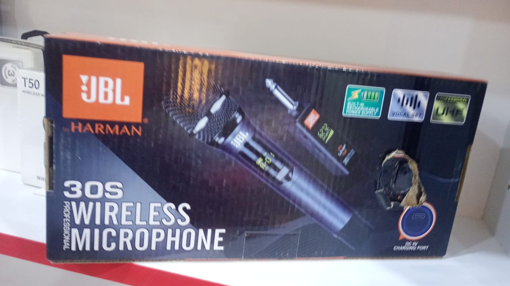
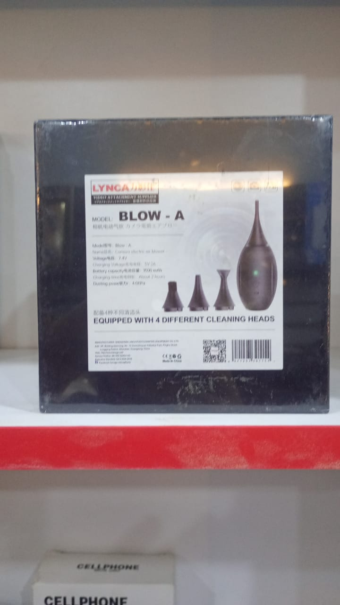
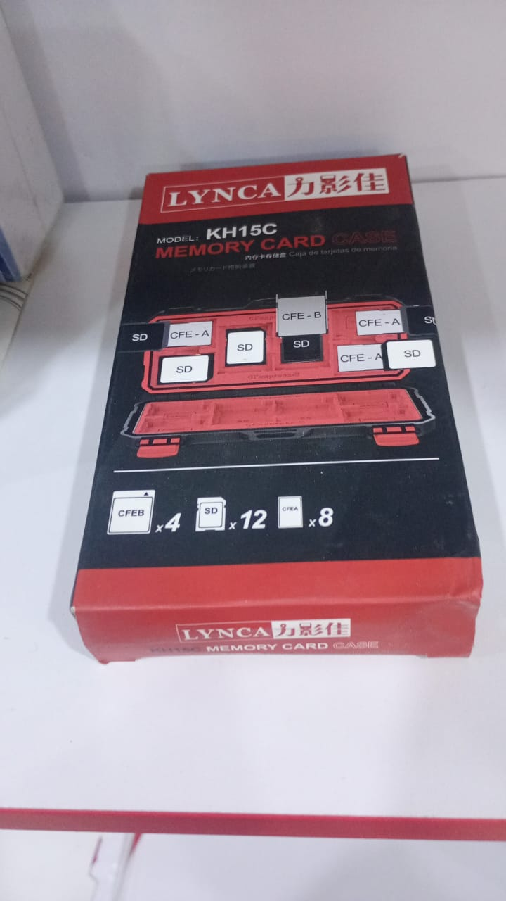
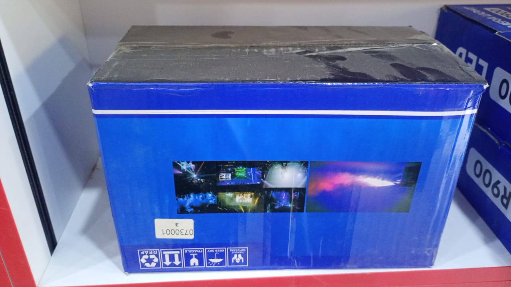
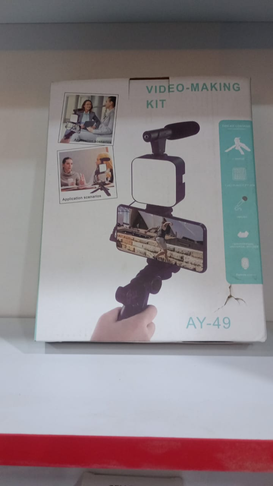
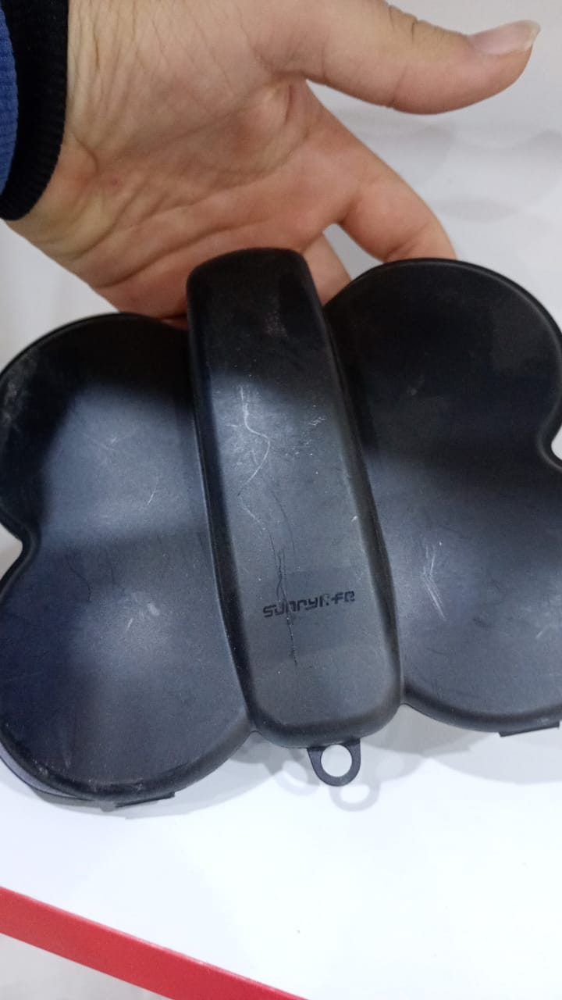
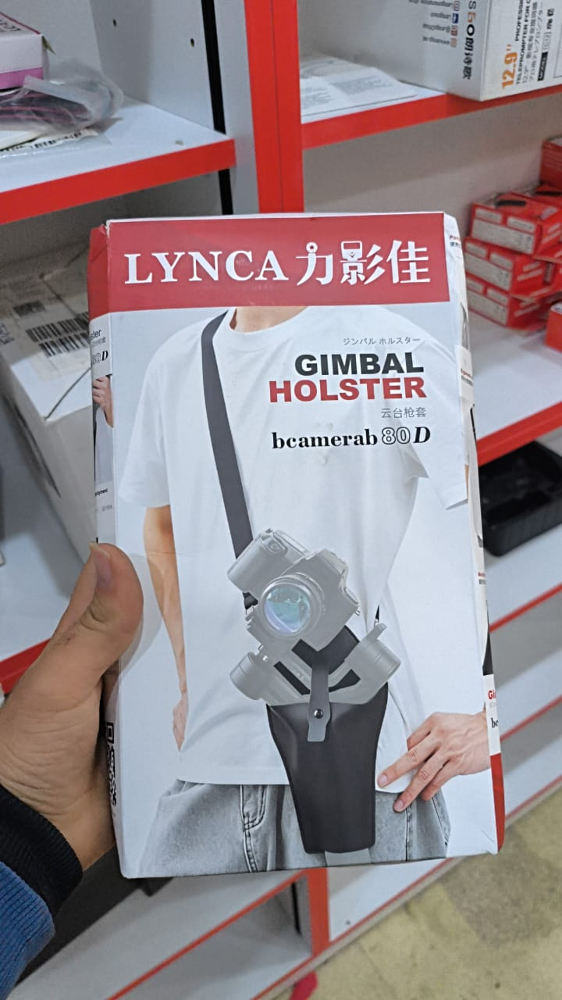

# طلبات التحديث والميزات الجديدة — 2026-11 (344 رسالة)

> أرشيف حرفيّ لرسائل المالك (طلب seq 628 · TASK-0370). النصوص منقولة كما هي حرفاً بحرف؛ أُخفي في هذه النسخة العامّة **فقط** المفاتيح السرّية وأرقام الهواتف (النصّ الكامل بلا إخفاء في الحزمة المشفّرة). الوسائط التي فيها بيانات زبائن في الحزم المشفّرة؛ صور المنتجات معروضة مباشرة. الدليل والتغطية: [README.md](README.md) · الحالة: [٤_حالة_التنفيذ.md](٤_حالة_التنفيذ.md).

### م-0347 · 2026-11-01 06:55 UTC · الجلسة 01MWfC (هذه المحادثة)

المصدر: سجلّ المالك gmt_owner_log · seq 292 · النوع: request · المهام: TASK-0290 (🔧 ناقص — قيد العمل) · TASK-0294 (🔧 ناقص — قيد العمل) · **الحالة: 🔧 ناقص — قيد العمل**

~~~~text
نحن مو طلبنا المنتجات اللي موجوده في المتجر تنتقل ايضا لتكون في الها منتج موجود في الجرد مرتبط فيه يعني ما في شيء في المتجر مو موجود على الجرد وافي شيء موجود على الجرد مو موجود على المتجر ابدا ابدا
~~~~

### م-0348 · 2026-11-01 06:55 UTC · الجلسة 01MWfC (هذه المحادثة)

المصدر: سجلّ المالك gmt_owner_log · seq 293 · النوع: request · المهام: TASK-0294 (🔧 ناقص — قيد العمل) · **الحالة: 🔧 ناقص — قيد العمل**

~~~~text
اكمل
~~~~

### م-0351 · 2026-11-01 07:22 UTC · الجلسة 01MWfC (هذه المحادثة)

المصدر: سجلّ المالك gmt_owner_log · seq 296 · النوع: request · المهام: TASK-0294 (🔧 ناقص — قيد العمل) · **الحالة: 🔧 ناقص — قيد العمل**

~~~~text
رح اعطيك صور منتجات موجودة بدرعا
 بس مو محطوطة بنقطة البيع 
ضيفعا انت لمخزونهم

وفي حال منتج مو معرف عندنا عرفه
~~~~

### م-0352 · 2026-11-01 07:23 UTC · الجلسة 01MWfC (هذه المحادثة)

المصدر: سجلّ المالك gmt_owner_log · seq 297 · النوع: image · المهام: TASK-0295 (✅ منجز) · **الحالة: ✅ منجز**

~~~~text
[١٤ صورة بلا نصّ] MM-240 11 inch · R900 · LED 660 PRO · F99 · N-432PRO · PL-26 · Vehicle BlackBOX DVR 1080 · W150 · LJ-S01 · Mobile Phone LED Light (مربّع) · Mobile Phone LED Light (دائري) · Pro LED 600 Varicolor · M777 · NeePho NP-3180S
~~~~

### م-0353 · 2026-11-01 07:25 UTC · الجلسة 01MWfC (هذه المحادثة)

المصدر: سجلّ المالك gmt_owner_log · seq 298 · النوع: request · المهام: TASK-0295 (✅ منجز) · **الحالة: ✅ منجز**

~~~~text
ايضا لد 800 rgp
و rl 24 عدد2
ZGRL 28 
كلشي صور  كميتها 1
[+٧ صور: ترايبود مفتوح بحقيبة · NeePho NP-3160 · بطارية DIGITAL F550/F570 (علبتان) · RGBW-LED PM-36 · Q11s Fill Light Selfie Stick · TELESIN Smartphone Magnetic Neck Holder (صورتان)]
~~~~

### م-0354 · 2026-11-01 07:29 UTC · الجلسة 01MWfC (هذه المحادثة)

المصدر: سجلّ المالك gmt_owner_log · seq 299 · النوع: image · المهام: TASK-0295 (✅ منجز) · **الحالة: ✅ منجز**

~~~~text
[٢٠ صورة بلا نصّ] SX9 · REMAX K18 (صورتان) · SX31 · Wireless Microphone بعلبة شحن (صينيّ بلا موديل) · K35 · SX35 Mini (صورتان) · REMAX K12 (صورتان) · SX21 (صورتان) · REMAX K16 · Q81 · T50 · Microphone Wireless (بلا موديل) · SX26 · K31Pro · Wireless Lavalier Microphone (بلا موديل · يدعم 1 إلى 2) · Wireless Lavalier Microphone بعلبة شحن (بلا موديل)
~~~~

### م-0355 · 2026-11-01 07:31 UTC · الجلسة 01MWfC (هذه المحادثة)

المصدر: سجلّ المالك gmt_owner_log · seq 300 · النوع: answer · المهام: TASK-0295 (✅ منجز) · **الحالة: ✅ منجز**

~~~~text
عدا بطارية اللد 6 وشاحن اللد 3
بالنسبة ل r900 حط من 2 وال3
S02 هو منتج جديد
المربع والدائرة اشائة ماك سيف
~~~~

### م-0356 · 2026-11-01 07:32 UTC · الجلسة 01MWfC (هذه المحادثة)

المصدر: سجلّ المالك gmt_owner_log · seq 301 · النوع: answer · المهام: TASK-0295 (✅ منجز) · **الحالة: ✅ منجز**

~~~~text
 ضيف من الاصدار 2 والاصدار 3 
قطعة. لكل واحد R900  قلتل
~~~~

### م-0357 · 2026-11-01 07:33 UTC · الجلسة 01MWfC (هذه المحادثة)

المصدر: سجلّ المالك gmt_owner_log · seq 302 · النوع: answer · المهام: TASK-0295 (✅ منجز) · **الحالة: ✅ منجز**

~~~~text
البطارية حط 10 وشاحن بطارية حط 5
المنتجات سميها او ابحث على مماثلاتها من الصور
~~~~

### م-0358 · 2026-11-01 07:35 UTC · الجلسة 01MWfC (هذه المحادثة)

المصدر: سجلّ المالك gmt_owner_log · seq 303 · النوع: request · المهام: TASK-0295 (✅ منجز) · **الحالة: ✅ منجز**

~~~~text
ممكن يكونو بغير اسم 
طابق بالصور
~~~~

### م-0359 · 2026-11-01 07:36 UTC · الجلسة 01MWfC (هذه المحادثة)

المصدر: سجلّ المالك gmt_owner_log · seq 304 · النوع: answer · المهام: TASK-0295 (✅ منجز) · **الحالة: ✅ منجز**

~~~~text
هذا هو الترايبود المفتوح [+لقطة شاشة لصورة Tripod 330A من ردّ Claude]
~~~~

### م-0360 · 2026-11-01 07:37 UTC · الجلسة 01MWfC (هذه المحادثة)

المصدر: سجلّ المالك gmt_owner_log · seq 305 · النوع: answer · المهام: TASK-0295 (✅ منجز) · **الحالة: ✅ منجز**

~~~~text
الي نحطوط مرتين معناعا كميته 2
~~~~

### م-0361 · 2026-11-01 07:37 UTC · الجلسة 01MWfC (هذه المحادثة)

المصدر: سجلّ المالك gmt_owner_log · seq 306 · النوع: answer · المهام: TASK-0295 (✅ منجز) · **الحالة: ✅ منجز**

~~~~text
بيزيد
~~~~

### م-0363 · 2026-11-01 07:42 UTC · الجلسة 01MWfC (هذه المحادثة)

المصدر: سجلّ المالك gmt_owner_log · seq 308 · النوع: request · المهام: TASK-0290 (🔧 ناقص — قيد العمل) · **الحالة: 🔧 ناقص — قيد العمل**

~~~~text
لسع في قطع من الكفرات مو مندمجة ؟ [+لقطة: كفر سيليكون R50 cover · 7773196762474 · مخزون الفرع 1 · مستهلك 12$ · جملة 9$]
~~~~

### م-0365 · 2026-11-01 07:56 UTC · الجلسة 01MWfC (هذه المحادثة)

المصدر: سجلّ المالك gmt_owner_log · seq 310 · النوع: image · المهام: TASK-0295 (✅ منجز) · **الحالة: ✅ منجز**

~~~~text
[لقطة ٨:٥٤ المتجر: «Light battery» — صورة علبة DIGITAL F550/F570 صفراء · وصف «بطارية فيديو رقمية بديلة متوافقة مع موديلات F550 وF570…» · مواصفات: الجهد 7.4 فولط · السعة 2200 ميلي أمبير ساعي · شحن سريع · الكفالة شهر · الموديل F550/F570 · زمن الشحن ساعتان ونصف · نوع المنتج بطارية فيديو رقمية · ما في العلبة · مدّة التشغيل ٢–٣ ساعات · بدون تأثير ذاكرة · سوني سلسلة L / NP-F · عمر طويل إضافي]
[لقطة ٨:٥٥ المتجر: «بطارية فيديو DIGITAL F550/F570» — صورة علبتين DIGITAL · وصف «بطارية فيديو بديلة (غير أصلية) من نوع F550/F570.» · الموديل F550/F570 · على العلبة: DIGITAL Video Battery · Extra Long Life · No memory effect · Quick charge · كود المنتج 6298633071687 · السعر عند الطلب]
~~~~

### م-0366 · 2026-11-01 07:58 UTC · الجلسة 01MWfC (هذه المحادثة)

المصدر: سجلّ المالك gmt_owner_log · seq 311 · النوع: request · المهام: TASK-0295 (✅ منجز) · **الحالة: ✅ منجز**

~~~~text
هذا المنتج خاطئ.  الاسم لمنتج اخر تماما
~~~~

### م-0367 · 2026-11-01 07:58 UTC · الجلسة 01MWfC (هذه المحادثة)

المصدر: سجلّ المالك gmt_owner_log · seq 312 · النوع: image · المهام: TASK-0295 (✅ منجز) · **الحالة: ✅ منجز**

~~~~text
[لقطة ٨:٥٨ نافذة المنتج في الجرد: الصورة ١ من ٢ علبة بيضاء «W150 Panel light» (إضاءة لوحية بمشبك) · الاسم «إضاءة موبايل LJ-S01 LED Light» · 6213220703604 · مخزون الفرع 1 · الإجمالي 1 · الموديل LJ-S01 · على العلبة: full color · strong stability · adjustable 360° lighting · «إضاءة LED صغيرة للموبايل بمشبك (LJ-S01).»]
[صورة مرفقة: علبة برتقالية «LJ-S01 LED LIGHT Mobile phone light» — 360° full color · strong stability · adjustable lighting]
~~~~

### م-0369 · 2026-11-01 09:53 UTC · الجلسة 01MWfC (هذه المحادثة)

المصدر: سجلّ المالك gmt_owner_log · seq 314 · النوع: image · المهام: TASK-0295 (✅ منجز) · **الحالة: ✅ منجز**

~~~~text
[٩:٠٣ نافذة منتج الجرد «W150» — صورة علبة W150 Panel light مع اللوحة · الباركود 4320367133427 · سعر المستهلك 15$ · الإجمالي 16 · الجملة 7$]
[٩:٠٤ «LJ-S02كف اضاءة» — علبة LJ-S02 LED LIGHT RGB mobile phone light · [رقم تتبّع/هاتف مخفي] · 25$ · الإجمالي 23 · الجملة 16$ · التكلفة 12$ · الشراء 5.956$]
[٩:٠٤ «S02 light» — علبة سوداء RGB LED LIGHT · 5879557916777 · 25$ · الإجمالي 2 · الجملة 16$]
[٩:٠٨ قائمة الادابترات: Canon ef_r ادابتر 6210626825732 (0) · Adapter rings EF-EOS R [رقم تتبّع/هاتف مخفي] (31) · Adapter rings EF-M [رقم تتبّع/هاتف مخفي] (10) · M50 adpter 9421404288725 (1 · صورة علبة VILTROX) · ادابتر سيغما تصحيح عدسة (0)]
[٩:٠٩ الأغطية — دائرة على «غطاء جسم كاميرا RF بشعار Canon» 2825153439297 (0) ودائرة على «زوج اغطية كمرا» [رقم تتبّع/هاتف مخفي] (61 · 15$) · وبينهما 49mm/52mm/rf زوج أغطية/58mm غير معلّمة]
[٩:١٠ الإكسسوارات — دائرة على «قشاط اكسترا سماكة» [رقم تتبّع/هاتف مخفي] (1) ودائرة على «حزام لكمرات كانون مبطن دبل» 6202159437445 (0 · 10$) · «جلدة دائرية تحت…» [رقم تتبّع/هاتف مخفي] (5) يقطعها طرف الدائرة الأولى]
[٩:١٥ الحقائب — دائرة على «حقيبة ظهر للكاميراJINNUOLANG» 6250867181730 (0 · 35$) ويلامس طرفها «حقيبة اكس…» 6522354617627 (11) · ودائرة على «شنتاية ظهر كانون قياس سمول» 5832758722307 (2 · 30$) ويلامس طرفها «TARION PB-01» و«حقيبة ستاند»]
~~~~

### م-0371 · 2026-11-01 10:26 UTC · الجلسة 01MWfC (هذه المحادثة)

المصدر: سجلّ المالك gmt_owner_log · seq 316 · النوع: image · المهام: TASK-0295 (✅ منجز) · **الحالة: ✅ منجز**

~~~~text
هذا عو s01
[صورة: علبة برتقالية «LJ-S01 LED LIGHT Mobile phone light» — 360° full color · strong stability · adjustable lighting]
~~~~

### م-0372 · 2026-11-01 10:26 UTC · الجلسة 01MWfC (هذه المحادثة)

المصدر: سجلّ المالك gmt_owner_log · seq 317 · النوع: request · المهام: TASK-0295 (✅ منجز) · **الحالة: ✅ منجز**

~~~~text
هدول هنن نفس المنتج لذلك انت ما في داعي ترجع تدمجهم فقط احذف اللي حطيته انت في درعا وحط كميه من الموجود عندنا في درعا بدلا منه يعني كانك زدت عدده
[لقطة ٨:٥٨: «إضاءة موبايل LJ-S01 LED Light» 6213220703604 بصورة علبة W150 · مخزون الفرع 1] [لقطة ٩:٠٣: «W150» 4320367133427 · 15$ · الإجمالي 16]
~~~~

### م-0373 · 2026-11-01 10:33 UTC · الجلسة 01MWfC (هذه المحادثة)

المصدر: سجلّ المالك gmt_owner_log · seq 318 · النوع: answer · المهام: TASK-0295 (✅ منجز) · TASK-0298 (✅ منجز) · **الحالة: ✅ منجز**

~~~~text
نعم كانت موجوده ولكن انت وضعتها في درع باسم 02 وضاب بدلا منها كف دبليو 150 
لكنه بكل احوال منتج جديد ولا يوجد منه حاليا غير في درعا
بالنسبه لكفرات سيليكون فحاليا الكل سعرهم 15 دولار واحد السعر
~~~~

### م-0374 · 2026-11-01 10:35 UTC · الجلسة 01MWfC (هذه المحادثة)

المصدر: سجلّ المالك gmt_owner_log · seq 319 · النوع: request · المهام: TASK-0297 (✅ منجز) · **الحالة: ✅ منجز**

~~~~text
لا داعي انه تعمل شيء للكف الاضاءه 02 لانه انا راح اساويه
~~~~

### م-0375 · 2026-11-01 10:36 UTC · الجلسة 01MWfC (هذه المحادثة)

المصدر: سجلّ المالك gmt_owner_log · seq 320 · النوع: request · المهام: TASK-0299 (✅ منجز) · **الحالة: ✅ منجز**

~~~~text
زر التعديل في نظام الجرد لازم يحتوي على زر اسمه تعديل الكميات 
وفيه تعديل السريع كميات كميات الافرع او نقاط البيع تعديل سريع طبعا مع انشاء فاتوره تسويه 
عند نقطه لبيع تمت اضافه او خصم وبتظهر في سجل نقطه البيع
~~~~

### م-0376 · 2026-11-01 10:41 UTC · الجلسة 01MWfC (هذه المحادثة)

المصدر: سجلّ المالك gmt_owner_log · seq 321 · النوع: request · المهام: TASK-0294 (🔧 ناقص — قيد العمل) · **الحالة: 🔧 ناقص — قيد العمل**

~~~~text
كمل
~~~~

### م-0378 · 2026-11-01 10:51 UTC · الجلسة 01MWfC (هذه المحادثة)

المصدر: سجلّ المالك gmt_owner_log · seq 323 · النوع: request · المهام: TASK-0300 (✅ منجز) · **الحالة: ✅ منجز**

~~~~text
كمل
~~~~

### م-0379 · 2026-11-01 11:01 UTC · الجلسة 01MWfC (هذه المحادثة)

المصدر: سجلّ المالك gmt_owner_log · seq 324 · النوع: request · المهام: TASK-0300 (✅ منجز) · **الحالة: ✅ منجز**

~~~~text
كمل
~~~~

### م-0380 · 2026-11-01 11:12 UTC · الجلسة 01MWfC (هذه المحادثة)

المصدر: سجلّ المالك gmt_owner_log · seq 325 · النوع: request · المهام: TASK-0300 (✅ منجز) · **الحالة: ✅ منجز**

~~~~text
كمل
~~~~

### م-0381 · 2026-11-01 11:32 UTC · الجلسة 01MWfC (هذه المحادثة)

المصدر: سجلّ المالك gmt_owner_log · seq 326 · النوع: request · المهام: TASK-0294 (🔧 ناقص — قيد العمل) · **الحالة: 🔧 ناقص — قيد العمل**

~~~~text
كمل
~~~~

### م-0382 · 2026-11-01 11:56 UTC · الجلسة 01MWfC (هذه المحادثة)

المصدر: سجلّ المالك gmt_owner_log · seq 327 · النوع: request · المهام: TASK-0300 (✅ منجز) · TASK-0294 (🔧 ناقص — قيد العمل) · **الحالة: 🔧 ناقص — قيد العمل**

~~~~text
كمل ايضا الطلبات الاخرى ونفذ. كلشي موجود عندك
~~~~

### م-0383 · 2026-11-01 12:26 UTC · الجلسة 01MWfC (هذه المحادثة)

المصدر: سجلّ المالك gmt_owner_log · seq 328 · النوع: answer · المهام: TASK-0168 (✅ منجز) · **الحالة: ✅ منجز**

~~~~text
س١ طريقة نزول القيمة: «بلا إهلاك: سجلّ فقط» · س٢ من أين تُضاف: «إضافة يدوية» · س٣ من يرى ويعدّل: «الأدمن فقط (مقترح)»
~~~~

### م-0385 · 2026-11-01 13:06 UTC · الجلسة 01MWfC (هذه المحادثة)

المصدر: سجلّ المالك gmt_owner_log · seq 330 · النوع: request · المهام: TASK-0302 (✅ منجز) · **الحالة: ✅ منجز**

~~~~text
هذول هن نفس المنتج لذلك ادمجهم وايضا احرص على انه اذا دخل من فاتوره مشتريات نعرف انه هذا هو المنتج نفسه 
يعني تعرف تلقائيا على الاسمين
~~~~

### م-0386 · 2026-11-01 13:06 UTC · الجلسة 01MWfC (هذه المحادثة)

المصدر: سجلّ المالك gmt_owner_log · seq 331 · النوع: image · المهام: TASK-0302 (✅ منجز) · **الحالة: ✅ منجز**

~~~~text
① «MCCEL رأس اضائة مستمرة 300w مع ريمونت» باركود 6265046469776 · سعر المستهلك 100$ · الإجمالي 0 · صورة LED Video Light 300W · ② «MM8820 light» باركود 9223548024968 · سعر الشراء 35.3$ · الإجمالي 0 · صورتان (رأس إضاءة وعلبته)
~~~~

### م-0387 · 2026-11-01 13:07 UTC · الجلسة 01MWfC (هذه المحادثة)

المصدر: سجلّ المالك gmt_owner_log · seq 332 · النوع: request · المهام: TASK-0302 (✅ منجز) · **الحالة: ✅ منجز**

~~~~text
هذا ايضا نفس الشيء يعني يتعرف على دول المنتجين على انهم منتج واحد
~~~~

### م-0388 · 2026-11-01 13:07 UTC · الجلسة 01MWfC (هذه المحادثة)

المصدر: سجلّ المالك gmt_owner_log · seq 333 · النوع: image · المهام: TASK-0302 (✅ منجز) · **الحالة: ✅ منجز**

~~~~text
① «T602 رأس اضاءة» باركود 7071409950091 · سعر الشراء 6.72$ · الإجمالي 0 · صورتان (علبة كرتون ورأس إضاءة وريموت) · ② «BD-600X COB راس اضائة. ابيض شمسي» باركود [رقم تتبّع/هاتف مخفي] · سعر الشراء 11.369$ · التكلفة 60 · الجملة 60 · المستهلك 65 · الإجمالي 54 · 5 صور
~~~~

### م-0390 · 2026-11-01 13:08 UTC · الجلسة 01MWfC (هذه المحادثة)

المصدر: سجلّ المالك gmt_owner_log · seq 335 · النوع: image · المهام: TASK-0302 (✅ منجز) · **الحالة: ✅ منجز**

~~~~text
① «BD400-SS رأس اضائة ابيض شمسي» باركود [رقم تتبّع/هاتف مخفي] · سعر الشراء 11.369$ · التكلفة 55 · الجملة 50 · المستهلك 70 (عرض 300$) · الإجمالي 20 · 3 صور · ② «BD-T1001B رأس اضاءة» باركود 8306613253058 · سعر الشراء 8.33$ · الإجمالي 0 · صورتان
~~~~

### م-0392 · 2026-11-01 14:50 UTC · الجلسة 01MWfC (هذه المحادثة)

المصدر: سجلّ المالك gmt_owner_log · seq 337 · النوع: note · المهام: TASK-0302 (✅ منجز) · **الحالة: ✅ منجز**

~~~~text
فتحتلك الوصول للشبكة
~~~~

### م-0393 · 2026-11-01 14:56 UTC · الجلسة 01MWfC (هذه المحادثة)

المصدر: سجلّ المالك gmt_owner_log · seq 338 · النوع: request · المهام: TASK-0302 (✅ منجز) · **الحالة: ✅ منجز**

~~~~text
مراوح الدرون لم اطلب منك ان تكون منتجا واحدا لا تخبص من عندك
~~~~

### م-0394 · 2026-11-01 14:58 UTC · الجلسة 01MWfC (هذه المحادثة)

المصدر: سجلّ المالك gmt_owner_log · seq 339 · النوع: answer · المهام: TASK-0302 (✅ منجز) · **الحالة: ✅ منجز**

~~~~text
س١ «سويهم كلهم … 300 للمبيع 280 بالجمله» مين المقصود؟ — الجواب: «هذا السعر اعطيتك اياه للدي جي اي نيو هو ال 300 وال 2008» · س٢ اختلاف الأسعار — الجواب: «اتركه الان نهائيا»
~~~~

### م-0397 · 2026-11-01 15:14 UTC · الجلسة 01MWfC (هذه المحادثة)

المصدر: سجلّ المالك gmt_owner_log · seq 342 · النوع: image · المهام: TASK-0303 (✅ منجز) · **الحالة: ✅ منجز**

~~~~text
① «YM-S600-SS light» $70 · صور كثيرة (AR lens technology…) · وصف «إضاءة تصوير LED موديل YM-600-SS … 100W … Bowens Mount» · ② «YM-S600-SS 100W ابيض شمسي» · «السعر عند الطلب» · صورة واحدة صغيرة · كود 2706403063847 · ومنتجات من نفس القسم تظهر فيها «YM-S600-SS light $70»
~~~~

### م-0398 · 2026-11-01 15:22 UTC · الجلسة 01MWfC (هذه المحادثة)

المصدر: سجلّ المالك gmt_owner_log · seq 343 · النوع: request · المهام: TASK-0303 (✅ منجز) · TASK-0304 (🔧 ناقص — قيد العمل) · **الحالة: 🔧 ناقص — قيد العمل**

~~~~text
اجل كل شيء وابدا بمراجعه المنتجات واضافه تفاصيل وصور ومثل انا الطلب راجع الطلب اللي طلبته منك انا اكثر من مره عن هذا الموضوع جيب من امازون وعلي بابا والنت
~~~~

### م-0399 · 2026-11-01 15:30 UTC · الجلسة 01MWfC (هذه المحادثة)

المصدر: سجلّ المالك gmt_owner_log · seq 344 · النوع: request · المهام: TASK-0304 (🔧 ناقص — قيد العمل) · **الحالة: 🔧 ناقص — قيد العمل**

~~~~text
ممتاز ممتاز الان شغلك كثير نظامي 
فورا زامل اللي عم تشتغلوا فورا فورا زامنه وارفعوا على السيستم تبعنا
~~~~

### م-0401 · 2026-11-01 15:44 UTC · الجلسة 01MWfC (هذه المحادثة)

المصدر: سجلّ المالك gmt_owner_log · seq 346 · النوع: request · المهام: TASK-0304 (🔧 ناقص — قيد العمل) · **الحالة: 🔧 ناقص — قيد العمل**

~~~~text
ايضا انتبه بين الفرق بين ثلاث منتجات التي نفسها لانه في نسخه عاديه وفي نسخه تاتي بكج غير ومعكم مع اضاءه مع قمع اضاءه او دفيوزر 
وبتجي نسخه ايضا نفس النسخه الثانيه ولكن فيها ار دي بي فانتبه انه ما تخلط بيناتهم ودقق بالبحث واذا ما عرفت تبحث عنها في الاسم او توصل لها فابحث بالصور واذا ما لقيت صور اخرى او شيء فعادي جدا لانهم
~~~~

### م-0402 · 2026-11-01 15:46 UTC · الجلسة 01MWfC (هذه المحادثة)

المصدر: سجلّ المالك gmt_owner_log · seq 347 · النوع: request · المهام: TASK-0304 (🔧 ناقص — قيد العمل) · **الحالة: 🔧 ناقص — قيد العمل**

~~~~text
على العكس تماما طلبت منك انه تترك المبالغه
ايضا المنتج اللي بتلاقي فيه صور كافيه ما في داعي تضيف له كثير صور
~~~~

### م-0403 · 2026-11-01 15:46 UTC · الجلسة 01MWfC (هذه المحادثة)

المصدر: سجلّ المالك gmt_owner_log · seq 348 · النوع: request · المهام: TASK-0305 (🔧 ناقص — قيد العمل) · TASK-0364 (✅ منجز) · **الحالة: 🔧 ناقص — قيد العمل**

~~~~text
ايضا راجع رسالتي انا كيف طلبت منك انه نعمل تصنيفات جديده وتصنيفات وداخل التصنيفات ومجموعات واقسام لكل المنتجات وممكن منتج يكون في اكثر من قسم بحيث نحصل على كميه لا متناهيه تقريبا من المتجر يكون مبين اكثر فيه 
راجع رسائل السابقه عن هذا الموضوع
~~~~

### م-0404 · 2026-11-01 15:49 UTC · الجلسة 01MWfC (هذه المحادثة)

المصدر: سجلّ المالك gmt_owner_log · seq 349 · النوع: answer · المهام: TASK-0304 (🔧 ناقص — قيد العمل) · **الحالة: 🔧 ناقص — قيد العمل**

~~~~text
[سؤال Claude: الشجرة الجديدة (10 تصنيفات رئيسية · فرعية · مجموعات + أقسام متقاطعة في المتجر) — أطبّقها؟] — الجواب: «نعم طبّقها كما هي»
~~~~

### م-0406 · 2026-11-01 16:12 UTC · الجلسة 01MWfC (هذه المحادثة)

المصدر: سجلّ المالك gmt_owner_log · seq 351 · النوع: request · المهام: TASK-0304 (🔧 ناقص — قيد العمل) · **الحالة: 🔧 ناقص — قيد العمل**

~~~~text
كمل الان المنتجات  
كمل الان المنتجات بدءا من ترتيبها في المتجر يعني من قسم راس الاضاءه الموجه 
من ثم ننتقل الى الباقي ثم نخطط الشجره والاقسام

نعم يمكنك استخدام البحث بالصور من علي بابا اذا لم تجد المنتج لدي ولدينا للمنتج اكثر من صوره يمكنك استخدامها للبحث بالصوره اذا لم تجده بالاسم او الاسماء البديله او اسماء الفواتير او التوافقيات
صحيح شغلك كمل والاهم ارفع كل دفعة بتشتغلها فورا
اقصى حد من الصور ممكن يوصل لك المنتج سبع صور الا المنتج اللي فيه اكثر من خيار يعني مدموج فيه اكثر من منتج
تخطى المنتج واي ام 8 00 وضيفه ولا بعدين
~~~~

### م-0407 · 2026-11-01 16:28 UTC · الجلسة 01MWfC (هذه المحادثة)

المصدر: سجلّ المالك gmt_owner_log · seq 352 · النوع: request · المهام: TASK-0304 (🔧 ناقص — قيد العمل) · **الحالة: 🔧 ناقص — قيد العمل**

~~~~text
كمل
~~~~

### م-0408 · 2026-11-01 16:33 UTC · الجلسة 01MWfC (هذه المحادثة)

المصدر: سجلّ المالك gmt_owner_log · seq 353 · النوع: request · المهام: TASK-0304 (🔧 ناقص — قيد العمل) · **الحالة: 🔧 ناقص — قيد العمل**

~~~~text
كمل
~~~~

### م-0409 · 2026-11-01 19:56 UTC · الجلسة 01MWfC (هذه المحادثة)

المصدر: سجلّ المالك gmt_owner_log · seq 354 · النوع: request · المهام: TASK-0304 (🔧 ناقص — قيد العمل) · **الحالة: 🔧 ناقص — قيد العمل**

~~~~text
ماهي الاقسام التي انهيتها ؟
طلبت منك تراجع كل الاقسام 
قسم قسم وكل منتج على حده 
ابتداء من قسم راس الاضاءه الموجه يعني كم الاقسام في المتجر 
لا تطف وتنتقل لمنتجات اخرى اشتغل فيهم منتج منتج قسم قسم
~~~~

### م-0410 · 2026-11-01 19:56 UTC · الجلسة 01MWfC (هذه المحادثة)

المصدر: سجلّ المالك gmt_owner_log · seq 355 · النوع: request · المهام: TASK-0304 (🔧 ناقص — قيد العمل) · **الحالة: 🔧 ناقص — قيد العمل**

~~~~text
كمل
~~~~

### م-0411 · 2026-11-01 20:09 UTC · الجلسة 01MWfC (هذه المحادثة)

المصدر: سجلّ المالك gmt_owner_log · seq 356 · النوع: request · المهام: TASK-0304 (🔧 ناقص — قيد العمل) · **الحالة: 🔧 ناقص — قيد العمل**

~~~~text
طلبت منك تراجع كل الاقسام 
قسم قسم وكل منتج على حده 
ابتداء من قسم راس الاضاءه الموجه يعني كم الاقسام في المتجر 
لا تطف وتنتقل لمنتجات اخرى اشتغل فيهم منتج منتج قسم قسم
~~~~

### م-0412 · 2026-11-01 20:18 UTC · الجلسة 01MWfC (هذه المحادثة)

المصدر: سجلّ المالك gmt_owner_log · seq 357 · النوع: request · المهام: TASK-0304 (🔧 ناقص — قيد العمل) · **الحالة: 🔧 ناقص — قيد العمل**

~~~~text
اعتمد على الصور الموجوده عندنا في بحثك يعني هذول صور منتجات الحقيقيه اللي في هالاسامي
ركز اكثر شيء على المنتجات اعاده صورها اثنين او اقل
ابحث بعمق عن هذول المنتجات
~~~~

### م-0414 · 2026-11-01 20:34 UTC · الجلسة 01MWfC (هذه المحادثة)

المصدر: سجلّ المالك gmt_owner_log · seq 359 · النوع: request · المهام: TASK-0304 (🔧 ناقص — قيد العمل) · **الحالة: 🔧 ناقص — قيد العمل**

~~~~text
لا تسالني اسئله في اللغه الانجليزيه وانما وجه الى الاسئله في العربي
توقف
القسم الاول راس الاضاءه المستمره ادرسه منتجا منتجا طبعا هذا المنتجات يلي درستها انت اذا عندك اسئله اسالني اياها هنا في اللغه العربيه 
طبعا حافظ على المبالغه في القوه الواطيه 
اسحب بوسترات وصور للمنتج كما طلبت منك وراجع رسائل القديمه لا تفهم
~~~~

### م-0415 · 2026-11-01 20:41 UTC · الجلسة 01MWfC (هذه المحادثة)

المصدر: سجلّ المالك gmt_owner_log · seq 360 · النوع: answer · المهام: TASK-0304 (🔧 ناقص — قيد العمل) · **الحالة: 🔧 ناقص — قيد العمل**

~~~~text
فيديو 60 غير فيديو 80 كل واحد منتج زيد ديو 80 وبقوه 80 وات وزيد يو 60 هو بقوه 60 وات 
اي سوفت بوكس لمبات صحيح 
مهم قياس 90 × 70 نعم تصرف وكمل
~~~~

### م-0416 · 2026-11-01 20:43 UTC · الجلسة 01MWfC (هذه المحادثة)

المصدر: سجلّ المالك gmt_owner_log · seq 361 · النوع: answer · المهام: TASK-0304 (🔧 ناقص — قيد العمل) · **الحالة: 🔧 ناقص — قيد العمل**

~~~~text
لا لا هم منتجين مختلفين كل واحد نسخه نفس المنتج ونفس المعمل ولكن واحد بقوه 60 وواحد بقوه 80
~~~~

### م-0417 · 2026-11-01 20:44 UTC · الجلسة 01MWfC (هذه المحادثة)

المصدر: سجلّ المالك gmt_owner_log · seq 362 · النوع: request · المهام: TASK-0304 (🔧 ناقص — قيد العمل) · **الحالة: 🔧 ناقص — قيد العمل**

~~~~text
برايي ابدا الان في قسم ملحقات اكسسوارات لدرون وختمه كله ثم ننتقل للي بعده الفلاشات 
على نفس الرتم ونفس السوي بوسترات وصور وكل شيء
~~~~

### م-0418 · 2026-11-01 20:49 UTC · الجلسة 01MWfC (هذه المحادثة)

المصدر: سجلّ المالك gmt_owner_log · seq 363 · النوع: answer · المهام: TASK-0304 (🔧 ناقص — قيد العمل) · **الحالة: 🔧 ناقص — قيد العمل**

~~~~text
ايضا اربع مراوح لا درون النيو
~~~~

### م-0419 · 2026-11-01 20:50 UTC · الجلسة 01MWfC (هذه المحادثة)

المصدر: سجلّ المالك gmt_owner_log · seq 364 · النوع: answer · المهام: TASK-0304 (🔧 ناقص — قيد العمل) · **الحالة: 🔧 ناقص — قيد العمل**

~~~~text
نعم غيره وكمل
~~~~

### م-0420 · 2026-11-01 20:52 UTC · الجلسة 01MWfC (هذه المحادثة)

المصدر: سجلّ المالك gmt_owner_log · seq 365 · النوع: answer · المهام: TASK-0304 (🔧 ناقص — قيد العمل) · **الحالة: 🔧 ناقص — قيد العمل**

~~~~text
لم ارفض شيء اكمل كل شيء
~~~~

### م-0421 · 2026-11-01 21:31 UTC · الجلسة 01MWfC (هذه المحادثة)

المصدر: سجلّ المالك gmt_owner_log · seq 366 · النوع: request · المهام: TASK-0304 (🔧 ناقص — قيد العمل) · **الحالة: 🔧 ناقص — قيد العمل**

~~~~text
في شيء لازم انوه عليه انه انت الصوره الاساسيه اللي موجوده اذا لقيتها نفسها او شيء مشابه لها استبدلها لان الصوره الاساسيه تكون كثير سيئه ورديقه
ايضا كما قلت لك دوما في الصوره الاساسيه او الاولى يكون بوستر في المتجر 
اما في الجرد اذا حسنت تخلي الصوره الاساسيه هي صوره علبه المنتج
~~~~

### م-0423 · 2026-11-01 21:33 UTC · الجلسة 01MWfC (هذه المحادثة)

المصدر: سجلّ المالك gmt_owner_log · seq 368 · النوع: answer · المهام: TASK-0304 (🔧 ناقص — قيد العمل) · **الحالة: 🔧 ناقص — قيد العمل**

~~~~text
سؤالي: إذا كانت صورتنا الوحيدة للعلبة حقيقية لكنها رديئة ولم أجد علبة أفضل، فما الأساسية في الجرد؟ — جواب المالك: «صورة علبتنا كما هي»
~~~~

### م-0424 · 2026-11-01 21:54 UTC · الجلسة 01MWfC (هذه المحادثة)

المصدر: سجلّ المالك gmt_owner_log · seq 369 · النوع: request · المهام: TASK-0304 (🔧 ناقص — قيد العمل) · **الحالة: 🔧 ناقص — قيد العمل**

~~~~text
لا تنسى تزامل كل طلباتي سواء اللي اشتغلتها او اللي ما اشتغلتها بحيث لما ينتهي هون التوكنز تبعنا يحسن يكمل موديل الذكاء الاصطناعي الاخر نفس الشغل تماما بحيث ما ارجع اعيد شو طلباتي
~~~~

### م-0425 · 2026-11-02 06:14 UTC · الجلسة 01MWfC (هذه المحادثة)

المصدر: سجلّ المالك gmt_owner_log · seq 370 · النوع: request · المهام: TASK-0304 (🔧 ناقص — قيد العمل) · **الحالة: 🔧 ناقص — قيد العمل**

~~~~text
اكمل
~~~~

### م-0428 · 2026-11-03 06:58 UTC · الجلسة 01XEjH (الجلسة الأخرى)

المصدر: سجلّ المالك gmt_owner_log · seq 373 · النوع: request · المهام: TASK-0306 (✅ منجز) · **الحالة: ✅ منجز**

~~~~text
مرحبا هل يمكننا الاكمال شوف شو اشتغل النموذج الاخر
~~~~

### م-0429 · 2026-11-03 07:34 UTC · الجلسة 01XEjH (الجلسة الأخرى)

المصدر: سجلّ المالك gmt_owner_log · seq 374 · النوع: request · المهام: TASK-0304 (🔧 ناقص — قيد العمل) · **الحالة: 🔧 ناقص — قيد العمل**

~~~~text
لم أتحقّق على طلبات حقيقية أنّ طلب الزبون من المتجر يخصم الكمية من منتج الجرد الصحيح للخيار.
هذه لسى ما بدنا ياها 
حاليا بيطلب بينزل اوردر فقط
الان مطلوب منك انو تشتغل على   قسم   الفلاشات
~~~~

### م-0430 · 2026-11-03 07:34 UTC · الجلسة 01XEjH (الجلسة الأخرى)

المصدر: سجلّ المالك gmt_owner_log · seq 375 · النوع: request · المهام: TASK-0304 (🔧 ناقص — قيد العمل) · **الحالة: 🔧 ناقص — قيد العمل**

~~~~text
اكمل قسم الفلاشات
~~~~

### م-0431 · 2026-11-03 07:34 UTC · الجلسة 01XEjH (الجلسة الأخرى)

المصدر: سجلّ المالك gmt_owner_log · seq 376 · النوع: request · المهام: TASK-0304 (🔧 ناقص — قيد العمل) · **الحالة: 🔧 ناقص — قيد العمل**

~~~~text
ابحث في امازون او علي بابا او صور غوغل
والصور والبوسترات ايضا
الان انت اشتغل عليهن منتج منتج عبي مواصفات وصور وبوسترات وتوافقيات واسماء اخرى

اعمل انت الان فقط في قسم الفلاش
وافحصهم منجا منتجا بدون تخطي
~~~~

### م-0433 · 2026-11-03 07:44 UTC · الجلسة 01XEjH (الجلسة الأخرى)

المصدر: سجلّ المالك gmt_owner_log · seq 378 · النوع: request · المهام: TASK-0307 (✅ منجز) · **الحالة: ✅ منجز**

~~~~text
ايضا اذا شفت اسامي غير هذا الاسم اللي عندنا فحطه كاسم بديل او كاسماء اخرى لنفس المنتج
~~~~

### م-0438 · 2026-11-03 08:13 UTC · الجلسة 01XEjH (الجلسة الأخرى)

المصدر: سجلّ المالك gmt_owner_log · seq 383 · النوع: request · المهام: TASK-0307 (✅ منجز) · **الحالة: ✅ منجز**

~~~~text
هذه الفواتير اضفها الى الفطير الفوريه بتاريخها او ادمجها كلها بفاتوره شراء واحده او حط كل واحده بتاريخها 
طبعا هذه الفواتير القديمه لذلك ما في داعي تعدي للمخزون على اساسها تعدل المخزون لكن مطلوب منك انه تحطها لحتى يكون كل المنتجات الموجوده عندنا مربوطه بفواتير شراء وايضا نعرف سعر الراس مات طبعا كلهم مصروفهم صفر  واربط مع اسم المورد 
يعني بحيث نحن النظام عندنا من ربط كل المنتجات من وين اجت وشو فاتوره الشراء الاصليه
[مرفق 9 صور لفواتير «شركة الرائد لتجارة اكسسوار الموبايل» (Al Raed) إلى جنرال ميديا تك - حلب - الفرقان: ① 1376 بيع أجل 2025-10-27 · 12 بنداً · 137.45 ② 1418 بيع أجل 2025-10-30 بثلاث نسخ: 3 بنود 195.94 · 4 بنود 208.29 · 5 بنود 226.29 (مدفوع 200) ③ 11122 بيع أجل 2025-11-04 · كمرا واي فاي سيارة 4k 6×20 · اكس 600 4×18 · 192 − حسم 9.6 = 182.4 ④ 11274 بيع نقدي 2025-11-16 · 7 بنود · 177.6 ⑤ 11326 بيع أجل 2025-11-19 · 15 بنداً · 369.15]
~~~~

### م-0439 · 2026-11-03 08:13 UTC · الجلسة 01XEjH (الجلسة الأخرى)

المصدر: سجلّ المالك gmt_owner_log · seq 384 · النوع: image · المهام: TASK-0307 (✅ منجز) · **الحالة: ✅ منجز**

~~~~text
هذه هي البطاريه الكوبي التي اشتريناها من سمارت ستور
[مرفق لقطة صفحة المنتج «Lp e17 battry copy1» — Canon Compatible LP-E17]
~~~~

### م-0440 · 2026-11-03 08:13 UTC · الجلسة 01XEjH (الجلسة الأخرى)

المصدر: سجلّ المالك gmt_owner_log · seq 385 · النوع: request · المهام: TASK-0307 (✅ منجز) · TASK-0304 (🔧 ناقص — قيد العمل) · **الحالة: 🔧 ناقص — قيد العمل**

~~~~text
اكمل
~~~~

### م-0441 · 2026-11-03 08:19 UTC · الجلسة 01XEjH (الجلسة الأخرى)

المصدر: سجلّ المالك gmt_owner_log · seq 386 · النوع: answer · المهام: TASK-0307 (✅ منجز) · **الحالة: ✅ منجز**

~~~~text
سؤالي: كمرا سيارة 4K · اكس 600 · مايك اف 11-2 غير موجودة — جواب المالك: «أسماؤها عندنا مختلفة»
سؤالي: ستاند حمالة موبايل سيبا 3366 أيّ منتجَينا؟ — جواب المالك: «اتركهم في فاتوره الشراب ضمن خط احمر لحتى اراجعه وانا اعمل له ربط يدوي او اقول لك عليه او ارجع اعدل الاسم يرتبط»
سؤالي: مسند 3160 س بسعرين 5.8 و5.5 — جواب المالك: «لا اعرف عمل لها تسويه انت اذا رايتها متمثله او لا ايضا للتنويه وهناك بعض منتجات التي اشتريها من الرائد او من غيره ونشتريها من الصين باسعار ارخص لكن هنا نشتريها باغلى كونها فوريه لا تحتاج الى استيراد فيجب ان لا تخلط ولكن كميات الاكبر عم بتكون من الصين فانا براي هاي لحالها بدها جلسه لها واحده لحتى نتناقش فيها»
~~~~

### م-0443 · 2026-11-03 08:45 UTC · الجلسة 01XEjH (الجلسة الأخرى)

المصدر: سجلّ المالك gmt_owner_log · seq 388 · النوع: request · المهام: TASK-0307 (✅ منجز) · **الحالة: ✅ منجز**

~~~~text
الفواتير اللي انت ضفتها لم تضيفها في تاريخ عم تظهر كانها جديده وهي لازم تكون قديمه
~~~~

### م-0444 · 2026-11-03 08:50 UTC · الجلسة 01XEjH (الجلسة الأخرى)

المصدر: سجلّ المالك gmt_owner_log · seq 389 · النوع: answer · المهام: TASK-0307 (✅ منجز) · TASK-0304 (🔧 ناقص — قيد العمل) · **الحالة: 🔧 ناقص — قيد العمل**

~~~~text
كانون
بالنسبه لبطاريه كانون كوبي 1 لا هذه هي الصوره الاساسيه يعني هذه صورتها الحقيقيه هي مطابقه تماما للبطاريه الاساسيه ولكن باختلاف التغليف
~~~~

### م-0446 · 2026-11-03 09:01 UTC · الجلسة 01XEjH (الجلسة الأخرى)

المصدر: سجلّ المالك gmt_owner_log · seq 391 · النوع: request · المهام: TASK-0307 (✅ منجز) · **الحالة: ✅ منجز**

~~~~text
هي ايضا فواتير قديمه لمورد اسمه عالم اكسسوار فواتير فوريه محترم من سوريا مشتراه في سوريا ايضا ضعها
[مرفق 13 صورة: فواتير «مبيعات دولار» إلى «زيتوني حلب» من «صالة عالم الاكسسوار»: 8037 (2025-10-15 · 560) · 8313 (2025-10-21 · 150) · 883؟ (2025-11-03 · 155 — يبدو «فاتورة مردود مبيعات») · 8994 (60) · 8993 (95) · 9384 (2025-11-22 · نسختان 308 و245 بحسم 3) · 9727 (2025-12-01 · 75) · 304 (2026-01-11 · 60) · شاشة 2026-03-30 (900) + 2908 (2026-03-30 · 1000) · شاشة 2026-04-06 (400) · 3329 (2026-04-11 · 225) + ورقة جمارك (شركة علماء الجديدة · مكبّرات KTS · 8628$)]
~~~~

### م-0447 · 2026-11-03 09:01 UTC · الجلسة 01XEjH (الجلسة الأخرى)

المصدر: سجلّ المالك gmt_owner_log · seq 392 · النوع: image · المهام: TASK-0304 (🔧 ناقص — قيد العمل) · **الحالة: 🔧 ناقص — قيد العمل**

~~~~text
هاي صوره واقعيه الفلاش ام ١ احتفظ بها واستبدلها الصوره الاساسيه وايضا على اساسها اعرف ابحث
[مرفق صورة: علبة «M1 · 锂电池机顶闪光灯 · Li-ion Camera Flash» + الفلاش «M1 Flashlight» برأس دائري وشاشة ملوّنة (M · S1/S2 · 1/128) + حقيبة قماش + دليل + كبل USB-C]
~~~~

### م-0448 · 2026-11-03 09:04 UTC · الجلسة 01XEjH (الجلسة الأخرى)

المصدر: سجلّ المالك gmt_owner_log · seq 393 · النوع: image · المهام: TASK-0307 (✅ منجز) · **الحالة: ✅ منجز**

~~~~text
هذه الكاميرتان هما من فواتير الرائد
[مرفق لقطة المتجر — قسم كاميرات الأكشن: «Serounder Sports Action Camera 4k» $70 (6220241248830) · «Full hd Sports Action Camera Serounder» $55 (6268368756357)]
~~~~

### م-0449 · 2026-11-03 09:04 UTC · الجلسة 01XEjH (الجلسة الأخرى)

المصدر: سجلّ المالك gmt_owner_log · seq 394 · النوع: image · المهام: TASK-0307 (✅ منجز) · **الحالة: ✅ منجز**

~~~~text
وهذه ايضا من فواتير الرائد
[مرفق لقطة المتجر: «كاميرا للسيارة dvr full hdT 626 Vehicle…» — G-sensor · Full HD 1080P · شاشة 3.0 · عدسة 170°]
~~~~

### م-0450 · 2026-11-03 09:09 UTC · الجلسة 01XEjH (الجلسة الأخرى)

المصدر: سجلّ المالك gmt_owner_log · seq 395 · النوع: request · المهام: TASK-0307 (✅ منجز) · TASK-0308 (⏳ لم يُنفَّذ (مخطّط)) · TASK-0309 (⏳ لم يُنفَّذ (مخطّط)) · **الحالة: ⏳ لم يُنفَّذ (مخطّط)**

~~~~text
ايضا  بين طلباتي ولكن ليس الان للتنفيذ 
انه اذا نفس المنتج لكن كان لدينا موردين مختلفين بسعر مختلفين سواء كام من الصين او من سوريا شو لازم نعمل وكيف لازم نتصرف على اي اساس نحسب الربح والكميه كيف بنقسمها والى اخره 

انسى ورقه الجمارك ما الك علاقه فيها وادخل كل شيء
ممتاز شغلك كثير حلو الان ايضا ضيف على طلباتي انه لازم نعمل فلتره في المشتريات حسب المورد او حسب اسم البائع خاصه في السوريه يعني الفوريه ممكن ناخذ كشف لكل فواتير او كل الحساب يعني تتطور هاي الاداه كثير لكن ليس الان الان خلينا عم نشتغل في المتجر وفي الطلبات السابقه اضيفها هي في اخر طلبات
~~~~

### م-0454 · 2026-11-03 11:51 UTC · الجلسة 01XEjH (الجلسة الأخرى)

المصدر: سجلّ المالك gmt_owner_log · seq 399 · النوع: request · المهام: TASK-0312 (✅ منجز) · TASK-0310 (✅ منجز) · **الحالة: ✅ منجز**

~~~~text
ههه يا عيني عليك الاشياء التي يختلف راس مالها سواء اذا اشترينا نهى من الصين او اشتريناها من مورد اخر من او من عالم اكسسوار او من اي مورد او مشتريات فوريه لازم تحط للمنتج سجل اسعار وربط بالفواتير حاليا لانه بعدين مثل ما قلت لك اعطيتك خطه لحتى نناقش هذا الموضوع لما نشتري نفس المنتج باسعار مختلفه 
ايضا على فاتوره ليديا نظيف 20 قطعه 660 برو 
١ فواتير الشراء ما لازم يكون فيها اي منتج خاصه الصيني اي منتج مو مربوط في منتج حقيقي او ماله صوره او مو معرف انا عم اعطيك كل فواتير شرائي في السنه الماضيه  كرمال يكون كل المنتجات عندنا مربوطه بفاتوره شراء بدل ما اعمل تسويه لكلهم خاص بعطيك كل فواتير شراء وبالنهايه بشوف شو البقي الاشياء اللي ما لقيت لها مطابق ضعيفها في اللون الاحمر او سالني عليها هون [صورة فاتورة ليديا: كفرات canon r/rp/R6 mark2/R50/M50/80d/700d/250d/750d/6dmarkii · M1SE · camera bag 32*25*12 · camera bag 30*13*45 · عواكس 30/60/80 · LED 660PRO] الان اسمهما حقيب اسمه وحقيبه ميديوم
~~~~

### م-0455 · 2026-11-03 11:51 UTC · الجلسة 01XEjH (الجلسة الأخرى)

المصدر: سجلّ المالك gmt_owner_log · seq 400 · النوع: request · المهام: TASK-0313 (✅ منجز) · TASK-0314 (🔧 ناقص — قيد العمل) · TASK-0309 (⏳ لم يُنفَّذ (مخطّط)) · **الحالة: ⏳ لم يُنفَّذ (مخطّط)**

~~~~text
فواتير شركه مدى هي فواتير شراء فوريه اما فاتوره ثالثه فهي فاتوره استيراد نصين ودفعت عليها تكاليف حوالي 700 دولار وزعها 
ايضا راح اعطيك الان تصحيحات اعطيتك صوره فيها اسامي الحقائب الموجوده الان 

[٣‏/١١، ١١:١٥ ص] .: سوفت 300 واط مع كبل طويل
هو نفسه
MCCEL رأس اضائة مستمرة 300 مع ريمونت

انارة نفخ مع طاقة شمسية ZTARX
هو   نفسه 
تيوب نفخ
[٣‏/١١، ١١:١٥ ص] .: Camera bag حقيبة
شنتاية ظهر كانون قياس لارج
[٣‏/١١، ١١:١٦ ص] .: سوفت 500 واط مع كبل طويل

RGB
نفسه
8518 رأس موجه rgp 500
[٣‏/١١، ١١:١٦ ص] .: سوفت بلون SIZE 5565
نفسه 
سوفت بالون 75

سوفت بوكس وعواكس 7100415829178
~~~~

### م-0456 · 2026-11-03 12:08 UTC · الجلسة 01XEjH (الجلسة الأخرى)

المصدر: سجلّ المالك gmt_owner_log · seq 401 · النوع: answer · المهام: TASK-0313 (✅ منجز) · TASK-0314 (🔧 ناقص — قيد العمل) · **الحالة: 🔧 ناقص — قيد العمل**

~~~~text
في فواتير مدى لا تعطيني فواتير شراء ثم فواتير ارجاع خلاص احذف بنود الارجاع من الفاتوره الشراء الاساسيه وحط فقط فاتوره شراء واحده نقص منها المرتجع طبعا كل فاتوره على حدا يعني ما تدمج كل الفواتير مع بعضهم
نعم هذه المنتجات اسمه بالفاتوره هيك طبقها ايضا وضيفها لانه هي اول فاتوره من هذا المورد القديمه جدا 
وايضا خط الاسامي يدل ضمن الاسامي الاخرى ليتعرف عليهم
~~~~

### م-0457 · 2026-11-03 12:12 UTC · الجلسة 01XEjH (الجلسة الأخرى)

المصدر: سجلّ المالك gmt_owner_log · seq 402 · النوع: request · المهام: TASK-0314 (🔧 ناقص — قيد العمل) · **الحالة: 🔧 ناقص — قيد العمل**

~~~~text
اذا فب منتجات ماعرفت تربطهم تصرف متل المرة الماضيية
~~~~

### م-0458 · 2026-11-03 12:16 UTC · الجلسة 01XEjH (الجلسة الأخرى)

المصدر: سجلّ المالك gmt_owner_log · seq 403 · النوع: answer · المهام: TASK-0314 (🔧 ناقص — قيد العمل) · **الحالة: 🔧 ناقص — قيد العمل**

~~~~text
تصرف مع rl 24 و 24 a  كانهم منتج واحد
~~~~

### م-0459 · 2026-11-03 13:33 UTC · الجلسة 01XEjH (الجلسة الأخرى)

المصدر: سجلّ المالك gmt_owner_log · seq 404 · النوع: request · المهام: TASK-0314 (🔧 ناقص — قيد العمل) · **الحالة: 🔧 ناقص — قيد العمل**

~~~~text
اولا اسالتك اسالني يوم في العربي ثاني نكمل لقد سالني في الانجليزي لا عاد تسالني في الانجليزي
~~~~

### م-0460 · 2026-11-03 13:50 UTC · الجلسة 01XEjH (الجلسة الأخرى)

المصدر: سجلّ المالك gmt_owner_log · seq 405 · النوع: answer · المهام: TASK-0314 (🔧 ناقص — قيد العمل) · **الحالة: 🔧 ناقص — قيد العمل**

~~~~text
كمل كم الدمج الفواتير واضافتهم وبس خلصت لحتى نرجع على مراجعه المنتجات والمتجر
~~~~

### م-0462 · 2026-11-03 14:01 UTC · الجلسة 01XEjH (الجلسة الأخرى)

المصدر: سجلّ المالك gmt_owner_log · seq 407 · النوع: request · المهام: TASK-0314 (🔧 ناقص — قيد العمل) · **الحالة: 🔧 ناقص — قيد العمل**

~~~~text
اشتغل بنفس الاليه اللي كنت انت عم تشتغل فيها الصبح لما ضفنا الرائد وعالم اكسسوار
~~~~

### م-0464 · 2026-11-03 14:13 UTC · الجلسة 01XEjH (الجلسة الأخرى)

المصدر: سجلّ المالك gmt_owner_log · seq 409 · النوع: request · المهام: TASK-0314 (🔧 ناقص — قيد العمل) · **الحالة: 🔧 ناقص — قيد العمل**

~~~~text
بالنسبه لار 24  وار ال 24 اي في الفاتوره الاساسيه ادمجهم كمياتهم على انهم منتج واحد وفي الجرد وبالتعريفات هم منتج واحد ولكن باسمين مختلفين وموردين مختلفين فقط
~~~~

### م-0465 · 2026-11-03 14:13 UTC · الجلسة 01XEjH (الجلسة الأخرى)

المصدر: سجلّ المالك gmt_owner_log · seq 410 · النوع: answer · المهام: TASK-0314 (🔧 ناقص — قيد العمل) · **الحالة: 🔧 ناقص — قيد العمل**

~~~~text
نعم
~~~~

### م-0466 · 2026-11-03 14:20 UTC · الجلسة 01XEjH (الجلسة الأخرى)

المصدر: سجلّ المالك gmt_owner_log · seq 411 · النوع: request · المهام: TASK-0315 (✅ منجز) · **الحالة: ✅ منجز**

~~~~text
@"2026-8-20-___-from_SHIXIN_By_Lynn-8.pdf" دخل هي ك فاتورة شراء صينية
من تاريخ اليوم
~~~~

### م-0468 · 2026-11-03 14:20 UTC · الجلسة 01XEjH (الجلسة الأخرى)

المصدر: سجلّ المالك gmt_owner_log · seq 413 · النوع: request · المهام: TASK-0315 (✅ منجز) · **الحالة: ✅ منجز**

~~~~text
@"2026-10-28-___-_from_SHIXIN_By_Lynn.pdf" وهي الفاتورة بتاريخ ١٥-١١. رح نكون مشتريينها  كمان صين
~~~~

### م-0469 · 2026-11-03 14:20 UTC · الجلسة 01XEjH (الجلسة الأخرى)

المصدر: سجلّ المالك gmt_owner_log · seq 414 · النوع: answer · المهام: TASK-0315 (✅ منجز) · **الحالة: ✅ منجز**

~~~~text
الثانية ايضا قيد النقل
~~~~

### م-0470 · 2026-11-03 14:31 UTC · الجلسة 01XEjH (الجلسة الأخرى)

المصدر: سجلّ المالك gmt_owner_log · seq 415 · النوع: request · المهام: TASK-0315 (✅ منجز) · **الحالة: ✅ منجز**

~~~~text
لا تحذف منتجات ابدا انا راح اراجع فواتير الشراء واشوف منتجات يلي ما هي موجوده او مو معرفه او مو مربوطه واراجعها انا وبعد ما اخلص المنتجات اللي راح اتركها فاضيه راح نعبيها لما نعبي منتجات المتجر والمنتجات الاخرى
~~~~

### م-0472 · 2026-11-03 14:42 UTC · الجلسة 01XEjH (الجلسة الأخرى)

المصدر: سجلّ المالك gmt_owner_log · seq 417 · النوع: request · المهام: TASK-0314 (🔧 ناقص — قيد العمل) · **الحالة: 🔧 ناقص — قيد العمل**

~~~~text
مراجعه الفواتير من قسم المشتريات وما فيهم خطوط حمراء وما لازم يكون عندك خطوط حمراء لانه كل منتجات معرفه اذا في منتجات مو معرفك اعرفها واذا في منتجات مدمجه فانزل هذولي مع المنتجات المدمجه يعني متى تبرها شيء جديد يعني مثلا هذا الاسم هو اسم ثاني للمنتج نفسه
~~~~

### م-0473 · 2026-11-03 14:45 UTC · الجلسة 01XEjH (الجلسة الأخرى)

المصدر: سجلّ المالك gmt_owner_log · seq 418 · النوع: request · **الحالة: ⚪ أمر تشغيل/متابعة/نشر — لا يحتاج تنفيذاً مستقلاً**

~~~~text
شو تبقى لدينا ؟
~~~~

### م-0475 · 2026-11-03 14:47 UTC · الجلسة 01XEjH (الجلسة الأخرى)

المصدر: سجلّ المالك gmt_owner_log · seq 420 · النوع: request · المهام: TASK-0304 (🔧 ناقص — قيد العمل) · **الحالة: 🔧 ناقص — قيد العمل**

~~~~text
خلص اللي بايدك وبلش فورا بقسم الفلاشات كمله وانهيه خاصه انه صار عندك صوره جديده فلاش ام واحد اللي ما كنت عم تعرفه
~~~~

### م-0476 · 2026-11-03 16:50 UTC · الجلسة 01XEjH (الجلسة الأخرى)

المصدر: سجلّ المالك gmt_owner_log · seq 421 · النوع: request · المهام: TASK-0304 (🔧 ناقص — قيد العمل) · **الحالة: 🔧 ناقص — قيد العمل**

~~~~text
كمل
~~~~

### م-0477 · 2026-11-03 16:58 UTC · الجلسة 01XEjH (الجلسة الأخرى)

المصدر: سجلّ المالك gmt_owner_log · seq 422 · النوع: answer · المهام: TASK-0304 (🔧 ناقص — قيد العمل) · **الحالة: 🔧 ناقص — قيد العمل**

~~~~text
نعم هم نفسهما فادمجهما واحذف واحد منهما تحت اسم اي تي 32 سي لا عندما ندمج منتجين موجودين في الجرد فيذهب احدهم ولكن تندمج معه كل شيء
~~~~

### م-0478 · 2026-11-03 17:09 UTC · الجلسة 01XEjH (الجلسة الأخرى)

المصدر: سجلّ المالك gmt_owner_log · seq 423 · النوع: request · المهام: TASK-0304 (🔧 ناقص — قيد العمل) · **الحالة: 🔧 ناقص — قيد العمل**

~~~~text
خلثت الفلاشات ؟
~~~~

### م-0479 · 2026-11-03 17:10 UTC · الجلسة 01XEjH (الجلسة الأخرى)

المصدر: سجلّ المالك gmt_owner_log · seq 424 · النوع: request · المهام: TASK-0304 (🔧 ناقص — قيد العمل) · **الحالة: 🔧 ناقص — قيد العمل**

~~~~text
كملن
~~~~

### م-0480 · 2026-11-03 17:20 UTC · الجلسة 01XEjH (الجلسة الأخرى)

المصدر: سجلّ المالك gmt_owner_log · seq 425 · النوع: image · المهام: TASK-0304 (🔧 ناقص — قيد العمل) · **الحالة: 🔧 ناقص — قيد العمل**

~~~~text
[7 صور بلا نصّ: فلاش M1 برأس دائري — صورة مع ملحقاته (سنوت، أبواب، قبّة، شبكة عسل، فلاتر ألوان)، خلفية الفلاش بالشاشة، الملحقات، الفلاش على كاميرا كانون — بشعار KDBAO؛ ثمّ صورة حقيقية للعلبة «M1 Li-ion Camera Flash» مع الفلاش والكيس والكابل والدليل، صورة الفلاش من الأمام، صورة العلبة]
~~~~

### م-0481 · 2026-11-03 17:21 UTC · الجلسة 01XEjH (الجلسة الأخرى)

المصدر: سجلّ المالك gmt_owner_log · seq 426 · النوع: request · المهام: TASK-0304 (🔧 ناقص — قيد العمل) · **الحالة: 🔧 ناقص — قيد العمل**

~~~~text
ابدأ ب قسم الدرون. بس خلصت الفلاش
والفللش اليونغو منكملو  بعدين بس اعطيك اسمه
~~~~

### م-0482 · 2026-11-03 17:35 UTC · الجلسة 01XEjH (الجلسة الأخرى)

المصدر: سجلّ المالك gmt_owner_log · seq 427 · النوع: request · المهام: TASK-0304 (🔧 ناقص — قيد العمل) · **الحالة: 🔧 ناقص — قيد العمل**

~~~~text
معه
قصم الدرون في المتجر 
قسم الدرون في المتجر والاهم انه كل الصور في المتجر تكون فوستر او صوره للمنتج على خلفيه بيضاء الصوره الاولى اما الصوره الموجوده لدينا فهي صوره العلبه الدم في الاخير ولكن في الجرد تكون الصوره الاولى 
الهدف انه في المتجر يبدو المظهر انيق وفي الجرد يبدو للموظف شكل العلبه كي لا يضيع
~~~~

### م-0483 · 2026-11-03 17:39 UTC · الجلسة 01XEjH (الجلسة الأخرى)

المصدر: سجلّ المالك gmt_owner_log · seq 428 · النوع: request · المهام: TASK-0304 (🔧 ناقص — قيد العمل) · **الحالة: 🔧 ناقص — قيد العمل**

~~~~text
كمل
~~~~

### م-0484 · 2026-11-03 17:47 UTC · الجلسة 01XEjH (الجلسة الأخرى)

المصدر: سجلّ المالك gmt_owner_log · seq 429 · النوع: answer · المهام: TASK-0304 (🔧 ناقص — قيد العمل) · **الحالة: 🔧 ناقص — قيد العمل**

~~~~text
ابحث على النت دي جي اي فليب هي تكون فليب سنجل يعني بدون ملحقات بدون الريموت 
بالنسبه لدي جي اي ميني اس اي ابحث عنها موجوده على الانترنت وايضا فيك تقلب العلبه 
بالنسبه لدرونات الاي 99 فيك تبحث عنها عادي
هذه الحقائب التي قمنا بدمجها ثم تفريقها لا تستعمل كانها مدموجه وانما حط لك كل واحده صور بوسترات حسب الدرون المخصصه لها
انهيت قسم الدرونات؟
قبل ما تبدا في المراوح وفي الاكسسوارات انهي لي قسم الدرونات بشكل كامل وقسم حقائب الدرونات
~~~~

### م-0486 · 2026-11-03 18:01 UTC · الجلسة 01XEjH (الجلسة الأخرى)

المصدر: سجلّ المالك gmt_owner_log · seq 431 · النوع: request · المهام: TASK-0304 (🔧 ناقص — قيد العمل) · **الحالة: 🔧 ناقص — قيد العمل**

~~~~text
اذا ما لقيت بوسترات فشوف صور اخرى للنفس المنتج
انهي موضوع حقائب الدرون وقسم الدرون 
ثم انتقل الى قسم اكسسوارات وملحقات الكاميرا
~~~~

### م-0487 · 2026-11-03 18:02 UTC · الجلسة 01XEjH (الجلسة الأخرى)

المصدر: سجلّ المالك gmt_owner_log · seq 432 · النوع: request · المهام: TASK-0304 (🔧 ناقص — قيد العمل) · **الحالة: 🔧 ناقص — قيد العمل**

~~~~text
اترك المراوح وانتقل الى قسم اكسسوارات وملحقات كاميرا
~~~~

### م-0489 · 2026-11-03 18:16 UTC · الجلسة 01XEjH (الجلسة الأخرى)

المصدر: سجلّ المالك gmt_owner_log · seq 434 · النوع: answer · المهام: TASK-0304 (🔧 ناقص — قيد العمل) · **الحالة: 🔧 ناقص — قيد العمل**

~~~~text
[سؤال: أيّ صورة قارئة لأيّ موديل (G101A · G105PRO · HT-02A · HT-10A)؟ — جواب المالك على الأربعة: No preference]
~~~~

### م-0491 · 2026-11-03 18:19 UTC · الجلسة 01XEjH (الجلسة الأخرى)

المصدر: سجلّ المالك gmt_owner_log · seq 436 · النوع: request · المهام: TASK-0304 (🔧 ناقص — قيد العمل) · **الحالة: 🔧 ناقص — قيد العمل**

~~~~text
بالنسبه لل البطاريات كوبيه وشواحن كوبي فحطهم نفس الاصليات تماما جيب صور اصليات وحطهم لانه راح استبدل البند انا ببند اصلي
اما المنتجات البطاريات اللي لها صوره فابحث عنها باستخدام صورتها
~~~~

### م-0492 · 2026-11-03 18:24 UTC · الجلسة 01XEjH (الجلسة الأخرى)

المصدر: سجلّ المالك gmt_owner_log · seq 437 · النوع: request · المهام: TASK-0304 (🔧 ناقص — قيد العمل) · **الحالة: 🔧 ناقص — قيد العمل**

~~~~text
ضيف ايضا بطاريات ال بي اي 6 وال بي اي 6 ان وال بي اي 6 ان اتش وشاحنهم ايضا 
ايضا ضيف توافقيات لكل شيء عم نحطه
~~~~

### م-0493 · 2026-11-03 18:32 UTC · الجلسة 01XEjH (الجلسة الأخرى)

المصدر: سجلّ المالك gmt_owner_log · seq 438 · النوع: request · المهام: TASK-0304 (🔧 ناقص — قيد العمل) · **الحالة: 🔧 ناقص — قيد العمل**

~~~~text
ضيف ايضا البي اي بي 6 ان اتش اللي قلت لك عليهم اصليات كانون
~~~~

### م-0496 · 2026-11-03 18:46 UTC · الجلسة 01XEjH (الجلسة الأخرى)

المصدر: سجلّ المالك gmt_owner_log · seq 441 · النوع: answer · المهام: TASK-0304 (🔧 ناقص — قيد العمل) · **الحالة: 🔧 ناقص — قيد العمل**

~~~~text
موجود في الجرد ادمجه ايضا خلاص تاثير المنتج يتاثر في كل مكان
~~~~

### م-0497 · 2026-11-03 18:54 UTC · الجلسة 01XEjH (الجلسة الأخرى)

المصدر: سجلّ المالك gmt_owner_log · seq 442 · النوع: request · المهام: TASK-0304 (🔧 ناقص — قيد العمل) · **الحالة: 🔧 ناقص — قيد العمل**

~~~~text
كما
~~~~

### م-0498 · 2026-11-03 21:57 UTC · الجلسة 01XEjH (الجلسة الأخرى)

المصدر: سجلّ المالك gmt_owner_log · seq 443 · النوع: request · المهام: TASK-0304 (🔧 ناقص — قيد العمل) · **الحالة: 🔧 ناقص — قيد العمل**

~~~~text
كمل
~~~~

### م-0499 · 2026-11-03 22:08 UTC · الجلسة 01XEjH (الجلسة الأخرى)

المصدر: سجلّ المالك gmt_owner_log · seq 444 · النوع: request · المهام: TASK-0304 (🔧 ناقص — قيد العمل) · **الحالة: 🔧 ناقص — قيد العمل**

~~~~text
تضفتلهم صور وبوسترات. مطابقة ؟
~~~~

### م-0500 · 2026-11-03 22:17 UTC · الجلسة 01XEjH (الجلسة الأخرى)

المصدر: سجلّ المالك gmt_owner_log · seq 445 · النوع: request · المهام: TASK-0304 (🔧 ناقص — قيد العمل) · **الحالة: 🔧 ناقص — قيد العمل**

~~~~text
كمل
~~~~

### م-0501 · 2026-11-03 22:33 UTC · الجلسة 01XEjH (الجلسة الأخرى)

المصدر: سجلّ المالك gmt_owner_log · seq 446 · النوع: request · المهام: TASK-0304 (🔧 ناقص — قيد العمل) · **الحالة: 🔧 ناقص — قيد العمل**

~~~~text
كمل
~~~~

### م-0502 · 2026-11-03 22:38 UTC · الجلسة 01XEjH (الجلسة الأخرى)

المصدر: سجلّ المالك gmt_owner_log · seq 447 · النوع: request · المهام: TASK-0304 (🔧 ناقص — قيد العمل) · **الحالة: 🔧 ناقص — قيد العمل**

~~~~text
اكمل
~~~~

### م-0503 · 2026-11-03 22:42 UTC · الجلسة 01XEjH (الجلسة الأخرى)

المصدر: سجلّ المالك gmt_owner_log · seq 448 · النوع: request · المهام: TASK-0304 (🔧 ناقص — قيد العمل) · **الحالة: 🔧 ناقص — قيد العمل**

~~~~text
اكمل
~~~~

### م-0504 · 2026-11-03 22:46 UTC · الجلسة 01XEjH (الجلسة الأخرى)

المصدر: سجلّ المالك gmt_owner_log · seq 449 · النوع: answer · المهام: TASK-0304 (🔧 ناقص — قيد العمل) · **الحالة: 🔧 ناقص — قيد العمل**

~~~~text
18-55 ⇐ EF-S 18-55 IS II · 70-200 يونغو ⇐ «هي يونغنو فعلاً» · Yongo 85 1.8 ⇐ YN85mm F1.8 لكانون EF
~~~~

### م-0507 · 2026-11-03 23:11 UTC · الجلسة 01XEjH (الجلسة الأخرى)

المصدر: سجلّ المالك gmt_owner_log · seq 452 · النوع: answer · المهام: TASK-0304 (🔧 ناقص — قيد العمل) · **الحالة: 🔧 ناقص — قيد العمل**

~~~~text
جوز بطاريات ليد ⇐ أزواج ⇐ +52 بطارية في Light battery · Light battry charger NO Package ⇐ ادمجه في Light battry charger · LP-E17: normal copy = copy1
~~~~

### م-0508 · 2026-11-03 23:11 UTC · الجلسة 01XEjH (الجلسة الأخرى)

المصدر: سجلّ المالك gmt_owner_log · seq 453 · النوع: request · المهام: TASK-0304 (🔧 ناقص — قيد العمل) · **الحالة: 🔧 ناقص — قيد العمل**

~~~~text
عليك العمل كالتالي استثني قسم ملحقات الدرون وابدا فيهم قسم قسم بحيث تنهي القسم كليا ما تراجعني باي شيء الا تنهي القسم كليا ثم انا اشيك من وراك فورا
~~~~

### م-0509 · 2026-11-03 23:11 UTC · الجلسة 01XEjH (الجلسة الأخرى)

المصدر: سجلّ المالك gmt_owner_log · seq 454 · النوع: answer · المهام: TASK-0304 (🔧 ناقص — قيد العمل) · **الحالة: 🔧 ناقص — قيد العمل**

~~~~text
لم اقل انا النورمال كوبي هي نفسها كوبي 1
~~~~

### م-0510 · 2026-11-03 23:31 UTC · الجلسة 01XEjH (الجلسة الأخرى)

المصدر: سجلّ المالك gmt_owner_log · seq 455 · النوع: request · المهام: TASK-0304 (🔧 ناقص — قيد العمل) · **الحالة: 🔧 ناقص — قيد العمل**

~~~~text
التي مكتوب عليها كوبي مثل الكانون اتركها لحالها
لكن الكوبي العادي اللي مكتوب عليها نورمال كوبي والكوبيات العاديات هذول اجعلهم على شكل بوستر يحتوي مع شاحن ثلاثي وفيه خيارات ممكن تشتري شاحن ثنائي لحاله شاحن ثلاثي لحاله بطاريتين مع شاحن ثنائي ثلاث بطاريات مع شاحن ثلاثي وممكن يشتري بطاريات لحالهم وعيفهم في الجرد على اساس منتجات منفصله لكن الان بدون اسعار ولما بحدد اسعار المنتجات المنفصله بتتحدث في المتجر
ايضا اضف انه عندنا اغطيه لكانون اي اف ام لكاميرات سلسله ام
امسح هذه الصوره التي فيها شعار شركه الرائد
نعم ولكن احرص على الصور في الجرد تكون الصور الواقعيه يعني مو مثل المتجر تكون صور واقعيه وصور العلبه كما اتفقنا
~~~~

### م-0511 · 2026-11-03 23:38 UTC · الجلسة 01XEjH (الجلسة الأخرى)

المصدر: سجلّ المالك gmt_owner_log · seq 456 · النوع: request · المهام: TASK-0304 (🔧 ناقص — قيد العمل) · **الحالة: 🔧 ناقص — قيد العمل**

~~~~text
لا لا الامر طبيعي انه يكون في المتجر دوما البوستر اولا اما في الجرد صوره المنتج 
اكمل كل المنتجات
~~~~

### م-0512 · 2026-11-03 23:50 UTC · الجلسة 01XEjH (الجلسة الأخرى)

المصدر: سجلّ المالك gmt_owner_log · seq 457 · النوع: request · المهام: TASK-0304 (🔧 ناقص — قيد العمل) · **الحالة: 🔧 ناقص — قيد العمل**

~~~~text
لكن في 602 دمجناه مع منتج اخر موجود من قبل
لا تزيل البي دي 600 اكس وانما ادمجه مع تي 602 بحيث يصير منتج واحد لهم نفس المواصفات ونفس البوسترات ونفس الصور ونفس الكود
انت بلشت تخبص الصور اللي عم تعرضها هون انت الاسماء المحادثه هذه هي المنتجات الغير موجوده عندي
~~~~

### م-0514 · 2026-11-03 23:53 UTC · الجلسة 01XEjH (الجلسة الأخرى)

المصدر: سجلّ المالك gmt_owner_log · seq 459 · النوع: image · المهام: TASK-0304 (🔧 ناقص — قيد العمل) · **الحالة: 🔧 ناقص — قيد العمل**

~~~~text
هذه المنتجات التي طلبت منك مراجعتها في هذا القسم
[3 صور من المتجر: (١) «Soft Light Lamp رأس اضاءة مع ريموت» #5986199948642 السعر عند الطلب · صورة رأس أسود بشريط أحمر · (٢) «M 66 rgp هيد لايت موجه يعمل بالبطارية» #69104198643978 بسعر 60$ · (٣) «ZSYB-SL-100B رأس اضاءة» #5498037267025 السعر عند الطلب]
~~~~

### م-0515 · 2026-11-03 23:55 UTC · الجلسة 01XEjH (الجلسة الأخرى)

المصدر: سجلّ المالك gmt_owner_log · seq 460 · النوع: image · المهام: TASK-0304 (🔧 ناقص — قيد العمل) · **الحالة: 🔧 ناقص — قيد العمل**

~~~~text
وهذه الصور ايضا تعرض لك المنتجات الغير مراجعه من قسم الاضاءه اللوحيه ليد بانيل
[4 لقطات متجر لقسم الإضاءة اللوحية: RL-16 · RL-150 · RL-1200 · RL-11 220V · RL-100 · LED-660 RGB · E900-3 · RL-660 USB · RL-32 · RL-29 · RL-24T مع ستاند 1.6م · RL-19T مع ستاند 1.6م · RL-19PULS · RL-1800 · E900-2 · BOX PRO LED 600 (بلا صورة) · SY-1280 150W · RL-900S · RL-900 · RL-660RGB USB · RING LIGHT JM16-6 (بلا صورة) · RL-19 — ومعها صف رؤوس الإضاءة: ZSYB V150PRO · ZU80 · ZSYB-SL-100B · ZGRL-60 · Soft Light Lamp · بور غريب zu 60 · T200PRO · TJ300]
~~~~

### م-0516 · 2026-11-03 23:56 UTC · الجلسة 01XEjH (الجلسة الأخرى)

المصدر: سجلّ المالك gmt_owner_log · seq 461 · النوع: image · المهام: TASK-0304 (🔧 ناقص — قيد العمل) · **الحالة: 🔧 ناقص — قيد العمل**

~~~~text
وهذه هي المنتجات الموجوده في قسم الاضاءه الكف الغير مراجعه
[3 لقطات متجر لقسم الإضاءة الكف: Telesin Magnetic Selfie Ring · Telesin LED S5-BGD-07 (بلا صورة) · Telesin LED P5-BGD-17 (بلا صورة) · Telesin LED P5-BGD-04 · LJ-S01 LED · NICE FOTO 008 (بلا صورة) · M1SE · LED W150+ (بلا صورة) · LED VIDEO LIGHT VL68 (بلا صورة) · VL60 · AY83 (بلا صورة) · LED LS-188 (بلا صورة) · RL-260 USB · MJ-27RGB اضاءة جيب · inch light 8 · inch light 6 · inch light (2nd model) 6 · inch 5V USB light 11 · inch light 10 · rgb 300 · 150 …]
~~~~

### م-0517 · 2026-11-04 06:56 UTC · الجلسة 01XEjH (الجلسة الأخرى)

المصدر: سجلّ المالك gmt_owner_log · seq 462 · النوع: request · المهام: TASK-0304 (🔧 ناقص — قيد العمل) · **الحالة: 🔧 ناقص — قيد العمل**

~~~~text
كمل
~~~~

### م-0518 · 2026-11-04 07:35 UTC · الجلسة 01XEjH (الجلسة الأخرى)

المصدر: سجلّ المالك gmt_owner_log · seq 463 · النوع: request · المهام: TASK-0304 (🔧 ناقص — قيد العمل) · **الحالة: 🔧 ناقص — قيد العمل**

~~~~text
ابدأ بالدرونات لبين ما اراجع انا الباقي
~~~~

### م-0519 · 2026-11-04 07:42 UTC · الجلسة 01XEjH (الجلسة الأخرى)

المصدر: سجلّ المالك gmt_owner_log · seq 464 · النوع: request · المهام: TASK-0304 (🔧 ناقص — قيد العمل) · **الحالة: 🔧 ناقص — قيد العمل**

~~~~text
انت لم  ترفع صور هيد رأس الاضائة ولا الحقيبة ولا البانيل  لايت
~~~~

### م-0521 · 2026-11-04 08:11 UTC · الجلسة 01XEjH (الجلسة الأخرى)

المصدر: سجلّ المالك gmt_owner_log · seq 466 · النوع: request · المهام: TASK-0304 (🔧 ناقص — قيد العمل) · **الحالة: 🔧 ناقص — قيد العمل**

~~~~text
ابحث في علي بابا
~~~~

### م-0522 · 2026-11-04 08:34 UTC · الجلسة 01XEjH (الجلسة الأخرى)

المصدر: سجلّ المالك gmt_owner_log · seq 467 · النوع: request · المهام: TASK-0304 (🔧 ناقص — قيد العمل) · **الحالة: 🔧 ناقص — قيد العمل**

~~~~text
البوستر يلي لازم  تحطه يكون.  فيه صورة الدرون
~~~~

### م-0523 · 2026-11-04 08:37 UTC · الجلسة 01XEjH (الجلسة الأخرى)

المصدر: سجلّ المالك gmt_owner_log · seq 468 · النوع: request · المهام: TASK-0304 (🔧 ناقص — قيد العمل) · **الحالة: 🔧 ناقص — قيد العمل**

~~~~text
انا حذفتهن
وكمل ودموج
~~~~

### م-0524 · 2026-11-04 08:43 UTC · الجلسة 01XEjH (الجلسة الأخرى)

المصدر: سجلّ المالك gmt_owner_log · seq 469 · النوع: image · المهام: TASK-0304 (🔧 ناقص — قيد العمل) · **الحالة: 🔧 ناقص — قيد العمل**

~~~~text
ادمج هذين المنتجين
~~~~

### م-0525 · 2026-11-04 08:43 UTC · الجلسة 01XEjH (الجلسة الأخرى)

المصدر: سجلّ المالك gmt_owner_log · seq 470 · النوع: image · المهام: TASK-0304 (🔧 ناقص — قيد العمل) · **الحالة: 🔧 ناقص — قيد العمل**

~~~~text
احذف هذا
~~~~

### م-0526 · 2026-11-04 08:43 UTC · الجلسة 01XEjH (الجلسة الأخرى)

المصدر: سجلّ المالك gmt_owner_log · seq 471 · النوع: answer · المهام: TASK-0304 (🔧 ناقص — قيد العمل) · **الحالة: 🔧 ناقص — قيد العمل**

~~~~text
نعم احذفه لانو  ثار مرتبط ب vl360
~~~~

### م-0527 · 2026-11-04 08:45 UTC · الجلسة 01XEjH (الجلسة الأخرى)

المصدر: سجلّ المالك gmt_owner_log · seq 472 · النوع: answer · المهام: TASK-0304 (🔧 ناقص — قيد العمل) · **الحالة: 🔧 ناقص — قيد العمل**

~~~~text
احذفه بدون ما تدمجوا مع في ال 360 فقط احذفه وحط في اسماء بديله في حيث اذا كان عندنا فاتوره فيها هذا فينندمت فورازي يبقى على حاله ما يتغير مواصفاته وصوره ولكن يصير له اسم هذا بديل لانه احنا بنستورد هذا وبنحطه بدل اليونان بولنزي
~~~~

### م-0528 · 2026-11-04 08:47 UTC · الجلسة 01XEjH (الجلسة الأخرى)

المصدر: سجلّ المالك gmt_owner_log · seq 473 · النوع: request · المهام: TASK-0304 (🔧 ناقص — قيد العمل) · **الحالة: 🔧 ناقص — قيد العمل**

~~~~text
اكمل بقسم الاوزمو والرونين
~~~~

### م-0531 · 2026-11-04 09:05 UTC · الجلسة 01XEjH (الجلسة الأخرى)

المصدر: سجلّ المالك gmt_owner_log · seq 476 · النوع: request · المهام: TASK-0304 (🔧 ناقص — قيد العمل) · **الحالة: 🔧 ناقص — قيد العمل**

~~~~text
بالنسبه للمنتجات اللي اعطيتني اياهم اكتشافها اعطيني صورها
او اماكنها 
وتفاصيل عنها اكثر 

بالنسبه للباقي ابدا البحث وكمل
~~~~

### م-0532 · 2026-11-04 09:06 UTC · الجلسة 01XEjH (الجلسة الأخرى)

المصدر: سجلّ المالك gmt_owner_log · seq 477 · النوع: image · المهام: TASK-0304 (🔧 ناقص — قيد العمل) · **الحالة: 🔧 ناقص — قيد العمل**

~~~~text
احءفه نهائيا
~~~~

### م-0533 · 2026-11-04 09:10 UTC · الجلسة 01XEjH (الجلسة الأخرى)

المصدر: سجلّ المالك gmt_owner_log · seq 478 · النوع: image · المهام: TASK-0304 (🔧 ناقص — قيد العمل) · **الحالة: 🔧 ناقص — قيد العمل**

~~~~text
ادمج
[لقطة الصفحة 1 من المتشابهات: ✓ على «Zu 60 هيد» و«zu60 cob» · ✗ على «بور غريب zu 60» · ✓ على W150 وLED W150+ · ✓ على Canon new 250 D body only (الاسمين)]
~~~~

### م-0534 · 2026-11-04 12:29 UTC · الجلسة 01XEjH (الجلسة الأخرى)

المصدر: سجلّ المالك gmt_owner_log · seq 479 · النوع: image · المهام: TASK-0304 (🔧 ناقص — قيد العمل) · **الحالة: 🔧 ناقص — قيد العمل**

~~~~text
هدول ال2 نفس الفاتورة احذف واحدة
~~~~

### م-0535 · 2026-11-04 12:29 UTC · الجلسة 01XEjH (الجلسة الأخرى)

المصدر: سجلّ المالك gmt_owner_log · seq 480 · النوع: answer · المهام: TASK-0304 (🔧 ناقص — قيد العمل) · **الحالة: 🔧 ناقص — قيد العمل**

~~~~text
الصورة ادمج عدا الي عليه اكس هاد غريب
~~~~

### م-0536 · 2026-11-04 12:29 UTC · الجلسة 01XEjH (الجلسة الأخرى)

المصدر: سجلّ المالك gmt_owner_log · seq 481 · النوع: request · المهام: TASK-0304 (🔧 ناقص — قيد العمل) · **الحالة: 🔧 ناقص — قيد العمل**

~~~~text
اكمل
~~~~

### م-0537 · 2026-11-04 12:44 UTC · الجلسة 01XEjH (الجلسة الأخرى)

المصدر: سجلّ المالك gmt_owner_log · seq 482 · النوع: request · المهام: TASK-0304 (🔧 ناقص — قيد العمل) · **الحالة: 🔧 ناقص — قيد العمل**

~~~~text
كمل
~~~~

### م-0538 · 2026-11-04 13:00 UTC · الجلسة 01XEjH (الجلسة الأخرى)

المصدر: سجلّ المالك gmt_owner_log · seq 483 · النوع: request · المهام: TASK-0304 (🔧 ناقص — قيد العمل) · **الحالة: 🔧 ناقص — قيد العمل**

~~~~text
اكمل
~~~~

### م-0539 · 2026-11-04 13:39 UTC · الجلسة 01XEjH (الجلسة الأخرى)

المصدر: سجلّ المالك gmt_owner_log · seq 484 · النوع: request · المهام: TASK-0304 (🔧 ناقص — قيد العمل) · **الحالة: 🔧 ناقص — قيد العمل**

~~~~text
شو تم عندنا ؟
~~~~

### م-0540 · 2026-11-04 13:40 UTC · الجلسة 01XEjH (الجلسة الأخرى)

المصدر: سجلّ المالك gmt_owner_log · seq 485 · النوع: request · المهام: TASK-0304 (🔧 ناقص — قيد العمل) · **الحالة: 🔧 ناقص — قيد العمل**

~~~~text
معناها كمل كلشي
~~~~

### م-0541 · 2026-11-04 14:02 UTC · الجلسة 01XEjH (الجلسة الأخرى)

المصدر: سجلّ المالك gmt_owner_log · seq 486 · النوع: request · المهام: TASK-0304 (🔧 ناقص — قيد العمل) · **الحالة: 🔧 ناقص — قيد العمل**

~~~~text
كل شيء عدا هذه الشحنه ابحث عنه وختمه اما عن هذه الشحنه فراح اعطيك اطلب من المورد الكتالوجات واعطيك اياهم 
كل شيء مستعمل او open بوكس فيك تعيفه بدون شيء لانه اساسا وصفه يعتمد على وصف المنتج المستعمل كم هو مستعمل وكم عدد شطر وملحقات وارده اي دوله
~~~~

### م-0542 · 2026-11-04 14:10 UTC · الجلسة 01XEjH (الجلسة الأخرى)

المصدر: سجلّ المالك gmt_owner_log · seq 487 · النوع: request · المهام: TASK-0304 (🔧 ناقص — قيد العمل) · **الحالة: 🔧 ناقص — قيد العمل**

~~~~text
قسم الاوبن بوكس والمستعمل انا برايي كله احذفه من المتجر او عيف ومختفي عيفه مختفي فقط يعني يبين فقط في الجرد بحيث ما تعمل المراجعه انت وين
~~~~

### م-0543 · 2026-11-04 14:14 UTC · الجلسة 01XEjH (الجلسة الأخرى)

المصدر: سجلّ المالك gmt_owner_log · seq 488 · النوع: request · المهام: TASK-0304 (🔧 ناقص — قيد العمل) · **الحالة: 🔧 ناقص — قيد العمل**

~~~~text
تمام شو تبقى لديك غير هذه الفاتوره التي سوف اعطيك انا كتالوجاتها
بالنسبه لهذول المنتجات اللي عم تحكي عنهم من حلقات تدرون فانا اعطيك فيهم فاتوره شراء فيك ايضا تاخذ الصوره الاصليه في دق اعلى او ابحث عنهم باستخدام الصوره او الاسم او الوظيفه
~~~~

### م-0544 · 2026-11-04 14:17 UTC · الجلسة 01XEjH (الجلسة الأخرى)

المصدر: سجلّ المالك gmt_owner_log · seq 489 · النوع: request · المهام: TASK-0304 (🔧 ناقص — قيد العمل) · **الحالة: 🔧 ناقص — قيد العمل**

~~~~text
محول الراوتر والكابل احذفهما تماما
قبل باور المسجله هو نفسه وصله الشاحن اربطه
انت بتحسن تنهيهم حاج طولنا كثير
~~~~

### م-0545 · 2026-11-04 14:24 UTC · الجلسة 01XEjH (الجلسة الأخرى)

المصدر: سجلّ المالك gmt_owner_log · seq 490 · النوع: answer · المهام: TASK-0304 (🔧 ناقص — قيد العمل) · **الحالة: 🔧 ناقص — قيد العمل**

~~~~text
لا لا قبل الباور المسجل هو نفسه قبل الشحن قبل الشاحن كبل الشاحن
~~~~

### م-0546 · 2026-11-04 14:25 UTC · الجلسة 01XEjH (الجلسة الأخرى)

المصدر: سجلّ المالك gmt_owner_log · seq 491 · النوع: request · المهام: TASK-0304 (🔧 ناقص — قيد العمل) · **الحالة: 🔧 ناقص — قيد العمل**

~~~~text
شو تم عندنا ؟
~~~~

### م-0547 · 2026-11-04 14:26 UTC · الجلسة 01XEjH (الجلسة الأخرى)

المصدر: سجلّ المالك gmt_owner_log · seq 492 · النوع: answer · المهام: TASK-0304 (🔧 ناقص — قيد العمل) · **الحالة: 🔧 ناقص — قيد العمل**

~~~~text
700 دي وام 50 واي 99 برو ادمجها 
ترايبودات ورجيني صورهم لاقول لك 
بالنسبه ل 700 دي والام 50 فاحذف كل شيء وحطهم كاميرات جدد 
وحط نسخه من الام 50 مارك 2 نسخه الكرياتيف ايضا كمنتج جديد
~~~~

### م-0548 · 2026-11-04 14:29 UTC · الجلسة 01XEjH (الجلسة الأخرى)

المصدر: سجلّ المالك gmt_owner_log · seq 493 · النوع: request · المهام: TASK-0304 (🔧 ناقص — قيد العمل) · TASK-0316 (✅ منجز) · **الحالة: 🔧 ناقص — قيد العمل**

~~~~text
اضيف ايضا كمنتجات جديده ار 8 
ارتميني مارك 2 
ار 6 مارك 2 
ار 6 مارك 3 
وكانوا 90 دي 

الان بدنا نضيف ميزه جديده لنظام الاوردرات بحيث في اشخاص بيقولوا لنا راح نحول لك نحن شنكاش نحط الاردن نحن ما عليه دفع ولكن بيكون الاوردر مجمد يعني انا بانشئ اوردر ولكن اذا لسه ما استلمت دفعته فبعي في مجمد ممكن ايضا انا اوردر عادي اعمل له تجميل بحيث خلاص ما يطلع جاهز للشحن او ما يكون مجهز 
وايضا يوصل رساله انه تم تجميد اوردر تبعك راجع بياناتك او راجع دفعاتك 
شيء اخر انه المنتجات اللي بتكون محجوزه في الاوردرات ولما نحط وصلت نقل الاوردرات بتبلغ الشخص انه وصلت وراح تكون قيد الشحن خلال 24 ساعه
~~~~

### م-0549 · 2026-11-04 14:43 UTC · الجلسة 01XEjH (الجلسة الأخرى)

المصدر: سجلّ المالك gmt_owner_log · seq 494 · النوع: request · المهام: TASK-0304 (🔧 ناقص — قيد العمل) · TASK-0317 (✅ منجز) · **الحالة: 🔧 ناقص — قيد العمل**

~~~~text
كل ال 700 دي بودي فقط ادمجهم
الان راح اعطيك ايضا كاميرات اذا كانت موجوده تقسمها على الشكل التالي 
كانون 250 دي نسخه بودي فقط 
وحطها مع مواصفاتها وسعرها فقط 560 دولار 
ونسخه ما عدسه 18 55 الاصدار الثالث سعرها 600 ددولار
كانون 700 دي بودي فقط سعرها 320 دولار ونسخه مع عدسه 18 ايضا الاصدار الثالث سعرها 350 دولار بتكون في المتجر موجوده صوره بالاساس صوره الكاميرا مع العدسه ولكن بسعر البودي بس فيها خيارين لازم الشخص يختاره يعني منحيه للتسويقيه للسعر يكون اوطى ولما يختارها مع العدسه يرتفع السعر 

ايضا عند انشاء حجز ينعمل مثل الاوردر ينرسل رساله انه انت حدثت ودفعت كذا وكذا وتم حفظ الصوره تبعيت الحجز تنحفظ الصوره وايضا ينعملها هويه بصريه مثل ايصال الاوردر ولكن ايصال الشروط طبعات الحجز
~~~~

### م-0550 · 2026-11-04 14:52 UTC · الجلسة 01XEjH (الجلسة الأخرى)

المصدر: سجلّ المالك gmt_owner_log · seq 495 · النوع: request · المهام: TASK-0304 (🔧 ناقص — قيد العمل) · **الحالة: 🔧 ناقص — قيد العمل**

~~~~text
تكلمت لك عن موضوع 700 دي كيف لدينا نسختين وكيف اظهاران في المتجر بالنسبه ارسل لي صورته حتى اشوفه الترايبوت اذا كنت اخر فاتوره من مدى فلاهتهم لانه هدول قياسين وكل واحد له سعر راس مال 
بالنسبه ايضا 
كانون ار 8 والاصدار الثاني منها
ايضا هذول الترايبودين نسميهم ميني ترايبود قابل للطي ما بعرف اعطيه يعني اسم لانه هو مدم التغطيه واكتب قياس صغير جدا وقياس صغير لانه في واحد اكبر من واحد وابحث عن صورهم على الانترنت وشيل هاي الصوره الاساسيه كلها اللي جاي من عند مدى
~~~~

### م-0551 · 2026-11-04 14:57 UTC · الجلسة 01XEjH (الجلسة الأخرى)

المصدر: سجلّ المالك gmt_owner_log · seq 496 · النوع: request · المهام: TASK-0304 (🔧 ناقص — قيد العمل) · **الحالة: 🔧 ناقص — قيد العمل**

~~~~text
في قسم الكاميرات الجديده كلها اجعل لها بوسترات كانون الرسميه مثل الدرونات واسترات وصور وكل شيء جديد احذف الصور القديمه 
اذا ما في كانون 80 دي ف اضفها كان وانت من عنديا 
اضيف كانون ار جديد ايضا 
وار 5 سي 
ضيف عدسه 24 105 ار اف وعدسه 24 105 ار اف الخط الاحمر فتحه ثابته 4 
ضيف ايضا عدسه 24 70 ار اف فتحه ثابت 2.8 خط احمر 
ضيف عدسه 16 ملم ار اف 
وعدست 50 مليمتر اس تي ام ار اف 
عدسه 85 فتحه 2 ار اف 
طبعا بجوز في منهم اللي انا هلا قلت لك عليهم موجودات لكن اذا ما كانوا موجودات ضيفهم 

كانون ار بي سعرها 585 دولار
~~~~

### م-0552 · 2026-11-04 15:09 UTC · الجلسة 01XEjH (الجلسة الأخرى)

المصدر: سجلّ المالك gmt_owner_log · seq 497 · النوع: request · المهام: TASK-0304 (🔧 ناقص — قيد العمل) · **الحالة: 🔧 ناقص — قيد العمل**

~~~~text
الغي الغي كل شيء مستعمل من المتجر او open بوكس
انت في الخيار الاساسي لا تذكر انها بودي فقط اتركها صوره الكاميرا مع العدسه واتركها خيار فقط كانون 250 دي او كانون 700 لكن اذا ما اختار شيء يختار فقط تكون بودي اونلي ويكتب في الطلب بودي اونلي 
اما اذا اختار الخيار الثاني فتكون مع العدسه ويتغير السعر يعني حيل تسويقيا مثل التيمو وعلي اكسبريس
ايضا ضيف كاميرات كانون ار 100 وار 50 وار 10
~~~~

### م-0556 · 2026-11-04 15:42 UTC · الجلسة 01XEjH (الجلسة الأخرى)

المصدر: سجلّ المالك gmt_owner_log · seq 501 · النوع: answer · المهام: TASK-0304 (🔧 ناقص — قيد العمل) · **الحالة: 🔧 ناقص — قيد العمل**

~~~~text
كاميره صينيه الاصدار الاول بالنسبه للاسعار ساعطيهم اياهم لاحقا 
الان بقي منتجات ما فيها صور وفيها صور واحده؟
~~~~

### م-0557 · 2026-11-04 15:44 UTC · الجلسة 01XEjH (الجلسة الأخرى)

المصدر: سجلّ المالك gmt_owner_log · seq 502 · النوع: request · المهام: TASK-0304 (🔧 ناقص — قيد العمل) · **الحالة: 🔧 ناقص — قيد العمل**

~~~~text
[لقطتان: STAND FOR CAMERA 3110 و Tripod 330A ترايبود]
هذان ادمجهما
ايضا عدد الفاتوره التي قلت اعطيك ان لها كتالوج 
عبي بقيه المنتجات عدا التي تنتظر كتالوجها
~~~~

### م-0558 · 2026-11-04 16:01 UTC · الجلسة 01XEjH (الجلسة الأخرى)

المصدر: سجلّ المالك gmt_owner_log · seq 503 · النوع: request · المهام: TASK-0304 (🔧 ناقص — قيد العمل) · **الحالة: 🔧 ناقص — قيد العمل**

~~~~text
هذول المايكات ابحث فيهم معرفات عندنا بالجرد او في المتجر من قبل ودمجهم
~~~~

### م-0559 · 2026-11-04 17:24 UTC · الجلسة 01XEjH (الجلسة الأخرى)

المصدر: سجلّ المالك gmt_owner_log · seq 504 · النوع: request · المهام: TASK-0304 (🔧 ناقص — قيد العمل) · **الحالة: 🔧 ناقص — قيد العمل**

~~~~text
احءفهم اذا مو معرفين كل جرد من قبل ولا موجودين في المتجر فاحذفهم الان اتركهم منتجات مخفيه
~~~~

### م-0560 · 2026-11-04 17:25 UTC · الجلسة 01XEjH (الجلسة الأخرى)

المصدر: سجلّ المالك gmt_owner_log · seq 505 · النوع: answer · المهام: TASK-0304 (🔧 ناقص — قيد العمل) · **الحالة: 🔧 ناقص — قيد العمل**

~~~~text
اذا كان كي 90 مو مدموج في شيء فنعم ادمجهم في كي 9 ما انا باثر اذا اثنيناتهم ما الهم ارتباط فادمجهم ما باثر
~~~~

### م-0561 · 2026-11-04 17:26 UTC · الجلسة 01XEjH (الجلسة الأخرى)

المصدر: سجلّ المالك gmt_owner_log · seq 506 · النوع: request · المهام: TASK-0304 (🔧 ناقص — قيد العمل) · **الحالة: 🔧 ناقص — قيد العمل**

~~~~text
ادمج k31 مع البرة
البرو
~~~~

### م-0562 · 2026-11-04 17:27 UTC · الجلسة 01XEjH (الجلسة الأخرى)

المصدر: سجلّ المالك gmt_owner_log · seq 507 · النوع: request · المهام: TASK-0304 (🔧 ناقص — قيد العمل) · **الحالة: 🔧 ناقص — قيد العمل**

~~~~text
شوف في منتجات كانت في المتجر مشابهه وما كان لها في مشابه في الجرد ثم انشانا من المتجر الى الجرد شوف ممكن تلاقي شيء من هدول المايكات
~~~~

### م-0563 · 2026-11-04 17:31 UTC · الجلسة 01XEjH (الجلسة الأخرى)

المصدر: سجلّ المالك gmt_owner_log · seq 508 · النوع: request · المهام: TASK-0304 (🔧 ناقص — قيد العمل) · **الحالة: 🔧 ناقص — قيد العمل**

~~~~text
شو تم ؟
~~~~

### م-0566 · 2026-11-04 17:45 UTC · الجلسة 01XEjH (الجلسة الأخرى)

المصدر: سجلّ المالك gmt_owner_log · seq 511 · النوع: request · المهام: TASK-0304 (🔧 ناقص — قيد العمل) · **الحالة: 🔧 ناقص — قيد العمل**

~~~~text
راح نوقف الان زامن كل شيء اشتغلته وخاصه اخر رساله لحتى يشتغلها الموديل الثاني 
ثم الان راح تشتغل على الطلبات السابقه المسجله لديك سواء في المتجر او الجرد او التطوير او كل شيء او الفحص
اترك موضوع تصحيح والالغاء والمتابعه المنتجات للموديل الثاني وانت تشتغل على موضوع الطلبات السابقه
يعني انت مهمتك التطوير مهمه المنتجات راح تكون للموديل ثاني
~~~~

### م-0567 · 2026-11-04 18:02 UTC · الجلسة 01XEjH (الجلسة الأخرى)

المصدر: سجلّ المالك gmt_owner_log · seq 512 · النوع: request · المهام: TASK-0149 (✅ منجز) · **الحالة: ✅ منجز** (صُحّحت في الدراسة seq 650)

~~~~text
كمل وشوف طلبات تطوير المتجر
وطلبات تطوير النظام
~~~~

### م-0569 · 2026-11-04 19:27 UTC · الجلسة 01XEjH (الجلسة الأخرى)

المصدر: سجلّ المالك gmt_owner_log · seq 514 · النوع: request · المهام: TASK-0321 (✅ منجز) · TASK-0322 (✅ منجز) · TASK-0323 (✅ منجز) · **الحالة: ✅ منجز**

~~~~text
سجل هذا السؤال لبعدين 
ابدا في تطويرات  اضافه بكجات سواء في المتجر او نقاط للبيع يعني يكون بكج اكثر من منتج ولهم سعر خاص او سعر محسوم وفي ايضا متصفح يعرض كل المنتج على حدا ويشوف صفحته ومراجعته 
ايضا الاداء اللي حكينا عنها اللي هي البحث في عدسه جوجل او بحث على جوجل لحتى يعطينا نتائج مرضيه عن المنتج تبعنا
~~~~

### م-0573 · 2026-11-05 06:55 UTC · الجلسة 01XEjH (الجلسة الأخرى)

المصدر: سجلّ المالك gmt_owner_log · seq 518 · النوع: request · المهام: TASK-0321 (✅ منجز) · **الحالة: ✅ منجز**

~~~~text
الباقات تعامل معامله المنتج هل ممكن اضيفها لاي قسم ممكن اعمل لها قسم جديد مطلوب منك الان تعمل قسم اسمه باقات وعروض ولكن حتى الباقات ممكن احط انا غير اقسام يعني اصنفها ايضا مع الاقسام الاخرى تكون في هذا القسم وفي قسم اخر
~~~~

### م-0574 · 2026-11-05 06:58 UTC · الجلسة 01XEjH (الجلسة الأخرى)

المصدر: سجلّ المالك gmt_owner_log · seq 519 · النوع: request · المهام: TASK-0323 (✅ منجز) · **الحالة: ✅ منجز**

~~~~text
ايضا عدسة غوغل 
خليها تحلل الشاشة يلي فيها المواصفات وتكون  معها صور. المنتج
~~~~

### م-0575 · 2026-11-05 07:01 UTC · الجلسة 01XEjH (الجلسة الأخرى)

المصدر: سجلّ المالك gmt_owner_log · seq 520 · النوع: request · المهام: TASK-0324 (✅ منجز) · **الحالة: ✅ منجز**

~~~~text
هنا هنا المفروض  هناك مرحله اللي هي في الشحن اثناء الشحن
[مرفق لقطة صفحة تتبّع الطلب على الهاتف: شركة الشحن المفتي · وجهة الشحنة طرطوس — مول الحمرات · المراحل: قيد التجهيز ⇐ تمت الفوترة — بانتظار الشحن ⇐ «تم الشحن» (الحالية · محاطة بإطار أحمر: شُحن طلبك عبر المفتي · رقم التتبع 226436 · «شركة المفتي الآن: تم استلام الشحنة من الفرع المرسل ويتم تجهيزها للإرسال (04-11-2026 22:02)») ⇐ وصلت — بانتظار الاستلام ⇐ تم الاستلام]
~~~~

### م-0576 · 2026-11-05 07:08 UTC · الجلسة 01XEjH (الجلسة الأخرى)

المصدر: سجلّ المالك gmt_owner_log · seq 521 · النوع: request · المهام: TASK-0323 (✅ منجز) · TASK-0325 (✅ منجز) · **الحالة: ✅ منجز**

~~~~text
شو الجديد ماعم تعرضلي التحديثات الجديدة
مافي داعي ترسم بطاقة
ما في داعي ترسم بطبخ خلاص عدست جوجل تقرا المواصفات من نفس الشرح يعني جدول مواصفات يكون فورا في كل مونتاج تحت الصوره مباشره تحت الشرف لما يفتح عدسه جوجل عدسه جوجل كانها تسكرين للشاشه كامله فيها جدول المواصفات وفيها صوره المنتج
~~~~

### م-0577 · 2026-11-07 10:01 UTC · الجلسة 01MWfC (هذه المحادثة)

المصدر: سجلّ المالك gmt_owner_log · seq 522 · النوع: request · المهام: TASK-0304 (🔧 ناقص — قيد العمل) · **الحالة: 🔧 ناقص — قيد العمل**

~~~~text
كمل
~~~~

### م-0578 · 2026-11-07 10:01 UTC · الجلسة 01MWfC (هذه المحادثة)

المصدر: سجلّ المالك gmt_owner_log · seq 523 · النوع: image · المهام: TASK-0304 (🔧 ناقص — قيد العمل) · **الحالة: 🔧 ناقص — قيد العمل**

~~~~text
[① لقطة شاشة من Alibaba لعلبة «BF BAFANG BF-100W · 100W · BI-COLOR COB LIGHT · Restore the true color of objects» — رأس إضاءة COB بعاكس] [② Alibaba · Camera Straps · Shenzhen Hongxin Photographic Equipment: حزام/صدرية حمل كاميرتين على مجسّم (كاميرا على الصدر بعدسة تيلي بيضاء + كاميرا على الخصر)] [③ Alibaba · «Shenzhen Supplier Adjustable Nylon Double Quick…» · Camera Straps: حزام كتف مزدوج «K QUICK STRAP» لكاميرتين على الجانبين] [④ لقطة هاتف 9:27 لصفحة تتبّع الطلب: شركة الشحن المفتي · قيد التجهيز · تمت الفوترة — بانتظار الشحن · «تم الشحن» (رقم التتبع 226436 · «شركة المفتي الآن: تم استلام الشحنة من الفرع المرسل ويتم تجهيزها للإرسال» 04-11-2026 22:02) · وصلت — بانتظار الاستلام · تم الاستلام]
~~~~

### م-0580 · 2026-11-07 10:26 UTC · الجلسة 01MWfC (هذه المحادثة)

المصدر: سجلّ المالك gmt_owner_log · seq 525 · النوع: request · المهام: TASK-0326 (✅ منجز) · TASK-0327 (✅ منجز) · TASK-0328 (✅ منجز) · **الحالة: ✅ منجز**

~~~~text
اكتب بالعربي
~~~~

### م-0581 · 2026-11-07 10:27 UTC · الجلسة 01MWfC (هذه المحادثة)

المصدر: سجلّ المالك gmt_owner_log · seq 526 · النوع: request · المهام: TASK-0328 (✅ منجز) · **الحالة: ✅ منجز**

~~~~text
اكتب بالعربي اسئلتك لافهم
~~~~

### م-0582 · 2026-11-07 10:27 UTC · الجلسة 01MWfC (هذه المحادثة)

المصدر: سجلّ المالك gmt_owner_log · seq 527 · النوع: answer · المهام: TASK-0328 (✅ منجز) · **الحالة: ✅ منجز**

~~~~text
Tib c  
ادمج
~~~~

### م-0583 · 2026-11-07 10:36 UTC · الجلسة 01MWfC (هذه المحادثة)

المصدر: سجلّ المالك gmt_owner_log · seq 528 · النوع: request · المهام: TASK-0304 (🔧 ناقص — قيد العمل) · TASK-0328 (✅ منجز) · **الحالة: 🔧 ناقص — قيد العمل**

~~~~text
كما
~~~~

### م-0584 · 2026-11-07 10:50 UTC · الجلسة 01MWfC (هذه المحادثة)

المصدر: سجلّ المالك gmt_owner_log · seq 529 · النوع: answer · المهام: TASK-0329 (✅ منجز) · **الحالة: ✅ منجز**

~~~~text
جميع الريمونتات ان واحد وان اثنين لها نفس الدبابيس لذلك فهو متوافق مع الجميع ابحاث جيده 
ايضا شوفي بقي اقسام ملحقات واكسسوارات انتهت  انتهت ؟
وقسم الدرون ؟
ورأس.  الاضائة المستمرة ؟
~~~~

### م-0585 · 2026-11-07 10:54 UTC · الجلسة 01MWfC (هذه المحادثة)

المصدر: سجلّ المالك gmt_owner_log · seq 530 · النوع: image · المهام: TASK-0330 (✅ منجز) · **الحالة: ✅ منجز**

~~~~text
ليش الى الان في 226 منتج غير مرتبطه بفاتوره شراء؟؟؟؟؟
[لقطة: نافذة «فرز المنتجات القديمة» — المصدر صيني — «226 منتج بلا فاتورة» — Canon 250d · كفر سيليكون EOS 850D · كومبو DJI Osmo Pocket 4P · كومبو DJI RS 5 · بطاقة SanDisk Extreme PRO SDXC 64GB (تكلفة $23.5) · صندوق تصوير 25cm (تكلفة $9.6) · سوفت بوكس مدور مع غريد 75cm — كلّها «كمية حالية: 0» — زرّ «إنشاء الفواتير الأثرية»]
~~~~

### م-0587 · 2026-11-07 11:22 UTC · الجلسة 01MWfC (هذه المحادثة)

المصدر: سجلّ المالك gmt_owner_log · seq 532 · النوع: image · المهام: TASK-0330 (✅ منجز) · **الحالة: ✅ منجز**

~~~~text
هاي فواتير شراء فوريه ايضا منذ ثلاثه او اربعه اشهر سجلها اثنيناتهم بفاتوره واحده ادمجهم وسجلهم بتاريخهم
[صورة ١: فاتورة № 0000759 بلا تاريخ ولا اسم: LP-E17 copy ×6 بـ12 = 72 · Lc-E17 copy ×6 بـ8 = 48 · Godox X V1 mid ×1 بـ130 = 130 · المجموع 250$]
[صورة ٢: فاتورة 002921 بلا تاريخ: Lp-E17 ×4 بـ12 = 48$ · Lc-E17 ×4 بـ8 = 32$ · المجموع 80$ · عمر زليتوني — حلب الجديدة مقابل المستشفى السوري [رقم هاتف مخفي]]
~~~~

### م-0588 · 2026-11-07 11:23 UTC · الجلسة 01MWfC (هذه المحادثة)

المصدر: سجلّ المالك gmt_owner_log · seq 533 · النوع: request · المهام: TASK-0330 (✅ منجز) · **الحالة: ✅ منجز**

~~~~text
تمام يعني الان كل المنتجات موصوله بفواتير عدا التي تظهر اللي هي 57 ما هيك ؟
~~~~

### م-0589 · 2026-11-07 11:27 UTC · الجلسة 01MWfC (هذه المحادثة)

المصدر: سجلّ المالك gmt_owner_log · seq 534 · النوع: answer · المهام: TASK-0330 (✅ منجز) · **الحالة: ✅ منجز**

~~~~text
هاي الفاتوره من سمارت ستور وليست من عمر زيتوني 
بالنسبه لقلبي اي 17 فهي كوبي  ولكن كوبي 1 يعني كوبي كانون
~~~~

### م-0590 · 2026-11-07 11:28 UTC · الجلسة 01MWfC (هذه المحادثة)

المصدر: سجلّ المالك gmt_owner_log · seq 535 · النوع: answer · المهام: TASK-0330 (✅ منجز) · **الحالة: ✅ منجز**

~~~~text
الشاحن ثمانيه والبطاريه 12 او الشاحن 10 والبطاريه 10 فهما نفس النتيجه مجموع الشحن مع البطاريه 20 فما باثر
~~~~

### م-0592 · 2026-11-07 13:17 UTC · الجلسة 01MWfC (هذه المحادثة)

المصدر: سجلّ المالك gmt_owner_log · seq 537 · النوع: request · المهام: TASK-0330 (✅ منجز) · **الحالة: ✅ منجز**

~~~~text
اكمل
~~~~

### م-0593 · 2026-11-07 13:21 UTC · الجلسة 01MWfC (هذه المحادثة)

المصدر: سجلّ المالك gmt_owner_log · seq 538 · النوع: answer · المهام: TASK-0330 (✅ منجز) · **الحالة: ✅ منجز**

~~~~text
ال بي اي 17 اللي من فاتوره سمارت ستور هي كوبي كانون وكوبي 1 ليست جروب وليست كوبي عادي او نورمال يعني صورها نفس الصور الاصليه تماما
~~~~

### م-0596 · 2026-11-07 15:04 UTC · الجلسة 01MWfC (هذه المحادثة)

المصدر: سجلّ المالك gmt_owner_log · seq 541 · النوع: answer · المهام: TASK-0330 (✅ منجز) · **الحالة: ✅ منجز**

~~~~text
هذا ليس الشاحن الاصلي هذا شاحن طبق الاصل عن الاصلي وهو معرف لدينا
~~~~

### م-0597 · 2026-11-07 15:05 UTC · الجلسة 01MWfC (هذه المحادثة)

المصدر: سجلّ المالك gmt_owner_log · seq 542 · النوع: answer · المهام: TASK-0330 (✅ منجز) · **الحالة: ✅ منجز**

~~~~text
لكن نحن لدينا شاحن اصلي ولدينا شاحن طبق الاصل الشاحن الاصلي له صوره مصوره من هاتفنا في علبه كرتونيه
~~~~

### م-0598 · 2026-11-07 15:06 UTC · الجلسة 01MWfC (هذه المحادثة)

المصدر: سجلّ المالك gmt_owner_log · seq 543 · النوع: image · المهام: TASK-0330 (✅ منجز) · **الحالة: ✅ منجز**

~~~~text
هذا هو
[لقطة: صفحة المنتج في المتجر «شاحن كوبي LC-E17 قوي (شكل الأصلي)» — كود 6229771594533 — شاحن بديل (كوبي) قوي بنفس شكل شاحن كانون الأصلي LC-E17]
~~~~

### م-0599 · 2026-11-07 15:08 UTC · الجلسة 01MWfC (هذه المحادثة)

المصدر: سجلّ المالك gmt_owner_log · seq 544 · النوع: request · المهام: TASK-0330 (✅ منجز) · **الحالة: ✅ منجز**

~~~~text
كمل شغلك
~~~~

### م-0600 · 2026-11-07 15:12 UTC · الجلسة 01MWfC (هذه المحادثة)

المصدر: سجلّ المالك gmt_owner_log · seq 545 · النوع: answer · المهام: TASK-0314 (🔧 ناقص — قيد العمل) · **الحالة: 🔧 ناقص — قيد العمل**

~~~~text
كلها صحيحة كمل
~~~~

### م-0601 · 2026-11-07 15:13 UTC · الجلسة 01MWfC (هذه المحادثة)

المصدر: سجلّ المالك gmt_owner_log · seq 546 · النوع: request · المهام: TASK-0330 (✅ منجز) · **الحالة: ✅ منجز**

~~~~text
هولدر تلسن ليش مومربوط. هو من فوتير مدى
~~~~

### م-0602 · 2026-11-07 15:15 UTC · الجلسة 01MWfC (هذه المحادثة)

المصدر: سجلّ المالك gmt_owner_log · seq 547 · النوع: request · المهام: TASK-0330 (✅ منجز) · **الحالة: ✅ منجز**

~~~~text
ايضا درون e99 وسكاي من الرائد
 لوح r900 من فاتوره ليديا صيني
قبضة التصوير والمايك
لوح الاضائة rgp من شنزن وايمن شيدو اول فاتورة
ستاند مايك
واشياء اخرى. فتشها
~~~~

### م-0603 · 2026-11-07 15:18 UTC · الجلسة 01MWfC (هذه المحادثة)

المصدر: سجلّ المالك gmt_owner_log · seq 548 · النوع: answer · المهام: TASK-0330 (✅ منجز) · **الحالة: ✅ منجز**

~~~~text
التلسن من مدى
والعادي  الصين
~~~~

### م-0604 · 2026-11-07 15:19 UTC · الجلسة 01MWfC (هذه المحادثة)

المصدر: سجلّ المالك gmt_owner_log · seq 549 · النوع: request · المهام: TASK-0330 (✅ منجز) · **الحالة: ✅ منجز**

~~~~text
حسنا اربطهم الان بفواتير الرائد وراس مال القطعه 20 دولار ضعهم في فاتوره من فواتير الرائد
~~~~

### م-0605 · 2026-11-07 15:22 UTC · الجلسة 01MWfC (هذه المحادثة)

المصدر: سجلّ المالك gmt_owner_log · seq 550 · النوع: answer · المهام: TASK-0330 (✅ منجز) · **الحالة: ✅ منجز**

~~~~text
1 و2 و3 نعم
~~~~

### م-0606 · 2026-11-07 15:27 UTC · الجلسة 01MWfC (هذه المحادثة)

المصدر: سجلّ المالك gmt_owner_log · seq 551 · النوع: answer · المهام: TASK-0330 (✅ منجز) · **الحالة: ✅ منجز**

~~~~text
ادمجعم 
كتبتلك 1 و2 و3 ادمج
~~~~

### م-0607 · 2026-11-07 15:28 UTC · الجلسة 01MWfC (هذه المحادثة)

المصدر: سجلّ المالك gmt_owner_log · seq 552 · النوع: request · المهام: TASK-0304 (🔧 ناقص — قيد العمل) · TASK-0330 (✅ منجز) · **الحالة: 🔧 ناقص — قيد العمل**

~~~~text
تمام كمل تحديثك والشغل والاطوير والفحوصات والطلبات
~~~~

### م-0609 · 2026-11-07 15:38 UTC · الجلسة 01MWfC (هذه المحادثة)

المصدر: سجلّ المالك gmt_owner_log · seq 554 · النوع: request · المهام: TASK-0292 (⏳ لم يُنفَّذ) · **الحالة: ⏳ لم يُنفَّذ**

~~~~text
هذا صوره كلها غير ليس فيها دقه
[صورة: نافذة «واقي مراوح DJI Mini 3 / DJI Mini 3 Pro» 6201926737344 في المتجر — الصورة الثالثة صغيرة ضبابية على العشب]
~~~~

### م-0611 · 2026-11-07 15:42 UTC · الجلسة 01MWfC (هذه المحادثة)

المصدر: سجلّ المالك gmt_owner_log · seq 556 · النوع: request · المهام: TASK-0292 (⏳ لم يُنفَّذ) · **الحالة: ⏳ لم يُنفَّذ**

~~~~text
هؤلا ايضا ويوجد راسيه شاحن اسمها لادينو تشارجر احذفها ايضا التصوير كلاكيتات التصوير صورها خاطئه شوف الصور اللي موجوده بالفاتوره 
بالنسبه لصندوق عرض اكريليك وستاند عرض هاتف تابلت 
ايضا قارئات الباركود فهذه حطها مع مصاريف 
التاسيس او الاصول
[صورتان من المتجر: «كوب حراري على شكل عدسة 105_24» 4551546803496 (صورة صغيرة) · قسم أخرى: كوب حراري 560ml 8593179696256 · كوب حراري 440ml 1967946991788 · كلاكيت تصوير أسود 9553535697210]
~~~~

### م-0612 · 2026-11-07 15:43 UTC · الجلسة 01MWfC (هذه المحادثة)

المصدر: سجلّ المالك gmt_owner_log · seq 557 · النوع: request · المهام: TASK-0292 (⏳ لم يُنفَّذ) · **الحالة: ⏳ لم يُنفَّذ**

~~~~text
هذا ايضا
[صورة من المتجر: «Osmo mobile» 3265031500265 — صورة واحدة مظلمة للعلبة مفتوحة]
~~~~

### م-0615 · 2026-11-07 15:54 UTC · الجلسة 01MWfC (هذه المحادثة)

المصدر: سجلّ المالك gmt_owner_log · seq 560 · النوع: request · المهام: TASK-0292 (⏳ لم يُنفَّذ) · **الحالة: ⏳ لم يُنفَّذ**

~~~~text
ابحث عن منتج نفس هذا بالضبط ولكن من ماركه لينز جو وعرفه ايضا بالمنتجاتنا اضيفه مع فاتوره شنزن السابقه التي وصلت من اخر فاتوره وصلت اضيف الكميه واحد 
ايضا الفوج ماشين والتمبليتر من ليز جو اضيفهم ايضا الى اخر فاتوره صينيه وصلت من شيدو واي منشنز 
ضيف الكميات واحد
[لقطة شاشة متجر (علي إكسبرس/تيمو): حقيبة كتف/حزام لحمل الغيمبال «Lightweight Carry, All-Day Comfort … At just 356g … Storage Pocket: Fits batteries, cables, and other small essentials» 6/6]
~~~~

### م-0617 · 2026-11-07 16:03 UTC · الجلسة 01MWfC (هذه المحادثة)

المصدر: سجلّ المالك gmt_owner_log · seq 562 · النوع: request · المهام: TASK-0333 (✅ منجز) · **الحالة: ✅ منجز**

~~~~text
هذا الشريط العلوي على اللاب توب يخفي الادوات 
ايضا في عرض الهاتف هناك اشياء لا تظهر ساريد اياها في صوره اخرى ساريك اياها
[صورة لابتوب: فاتورة شراء IMP-2026-0008 (Shenzhen Shixin) مفتوحة — شريط النظام العلوي (الرئيسية · تحديث · …) يغطّي شريط أدوات الفاتورة (حفظ سحابي · ابحث عن منتج · إضافة منتج · طباعة · إغلاق)]
~~~~

### م-0620 · 2026-11-07 16:26 UTC · الجلسة 01MWfC (هذه المحادثة)

المصدر: سجلّ المالك gmt_owner_log · seq 565 · النوع: answer · المهام: TASK-0321 (✅ منجز) · **الحالة: ✅ منجز**

~~~~text
س: قسم «باقات وعروض» موجود الآن في المتجر كأوّل قسم، وفيه الباقات (مثل «بكج صناعة المحتوى»)، والباقة تقدر تحطّها بأقسام ثانية كمان. كيف تريده بالضبط؟
ج: اتركهم قسم واحد ولكن ممكن انا العرض يعد كمنتج او يعد كمجموعه منتجات ولكن في المتجر العرض ايضا يدخل في يعني نفس العرض يدخل فيه اكثر من قسم مثلا اذا عملت انا لنفرض عرض على كاميرا مع ملحقات فيدخل هذا العرض في قسم باقات وعروض ويدخل في قسم مثلا الكاميرات او البكجات او الى اخره ايضا القسم يعامل في نقطه البيع او في يعني في هذول كمنتج كباقه كامله جاهزه فورا لضغطه تباع وتنشا فاتوره فيهم
~~~~

### م-0622 · 2026-11-07 20:00 UTC · الجلسة 01MWfC (هذه المحادثة)

المصدر: سجلّ المالك gmt_owner_log · seq 567 · النوع: request · المهام: TASK-0338 (🔧 ناقص — قيد العمل) · TASK-0345 (🔧 ناقص — قيد العمل) · TASK-0356 (✅ منجز) · **الحالة: 🔧 ناقص — قيد العمل**

~~~~text
الاسعار اللي بتتسعر من فواتير البيع لما بعد لها الان اسعار البيع تتسعر فورا في الجرد والمتجر وتتزامن 
ايضا خط تعميم كل سعر انا بحطه ينقص منه 1 سنت بحيث يظهر مثلا اذا انا حطيته 380 يطلع 377 79.99 
ايضا اثناء تعديل فاتوره الشراء اجعل من اللاب توب الازرار الاسهم الاسفل والجوانب تعمل كما انها في اكسل يعني انا لما بدي ادخل السعر خلاص اكبس الزر وانزل واتحرك
~~~~

### م-0627 · 2026-11-07 20:33 UTC · الجلسة 01MWfC (هذه المحادثة)

المصدر: سجلّ المالك gmt_owner_log · seq 572 · النوع: answer · المهام: TASK-0338 (🔧 ناقص — قيد العمل) · **الحالة: 🔧 ناقص — قيد العمل**

~~~~text
اكمل
~~~~

### م-0631 · 2026-11-07 21:24 UTC · الجلسة 01MWfC (هذه المحادثة)

المصدر: سجلّ المالك gmt_owner_log · seq 576 · النوع: answer · المهام: TASK-0340 (🔧 ناقص — قيد العمل) · **الحالة: 🔧 ناقص — قيد العمل**

~~~~text
مبدئيا اجل موضوع الاسعار فقط نقص سنت سنت من كل واحد واحد سنت بعدين اجل هذا الشيء لبعدين شيء انه الاسعار اللي طلبتهم توه انا لانه بدي انا هلا منك تعدل هذا الموضوع قبل ما تخلص الاعتمادات وتخلص التوكنز
~~~~

### م-0633 · 2026-11-07 21:37 UTC · الجلسة 01MWfC (هذه المحادثة)

المصدر: سجلّ المالك gmt_owner_log · seq 578 · النوع: answer · المهام: TASK-0338 (🔧 ناقص — قيد العمل) · **الحالة: 🔧 ناقص — قيد العمل**

~~~~text
اي كمل
~~~~

### م-0638 · 2026-11-08 09:19 UTC · الجلسة 01MWfC (هذه المحادثة)

المصدر: سجلّ المالك gmt_owner_log · seq 583 · النوع: answer · المهام: TASK-0341 (🔧 ناقص — قيد العمل) · **الحالة: 🔧 ناقص — قيد العمل**

~~~~text
اذا ضغطنا الصور فراح تصير المعاينه في المتجر سيء اليس كذلك ؟
~~~~

### م-0641 · 2026-11-08 10:34 UTC · الجلسة 01MWfC (هذه المحادثة)

المصدر: سجلّ المالك gmt_owner_log · seq 586 · النوع: answer · المهام: TASK-0342 (🔧 ناقص — قيد العمل) · **الحالة: 🔧 ناقص — قيد العمل**

~~~~text
اي
~~~~

### م-0642 · 2026-11-08 10:35 UTC · الجلسة 01MWfC (هذه المحادثة)

المصدر: سجلّ المالك gmt_owner_log · seq 587 · النوع: answer · المهام: TASK-0342 (🔧 ناقص — قيد العمل) · TASK-0341 (🔧 ناقص — قيد العمل) · **الحالة: 🔧 ناقص — قيد العمل**

~~~~text
مكان الصور: استضافة GitHub (مستحسن)
مروحة Neo: موجود في المتجر مروحه واحده هذا المنتج
~~~~

### م-0643 · 2026-11-08 10:37 UTC · الجلسة 01MWfC (هذه المحادثة)

المصدر: سجلّ المالك gmt_owner_log · seq 588 · النوع: note · المهام: TASK-0342 (🔧 ناقص — قيد العمل) · **الحالة: 🔧 ناقص — قيد العمل**

~~~~text
نحن كلنا الصور الاخرى تنحفظ على المتجر وفقد صوره الجرد الاساسيه تبقى في الجرد ما بعرف شو اللي صاير هي واحد اثنين انا كنت عامل انه نفس الشيء انه تتحمل الصور عند مستخدمين سواء الموظفين او اللي عندهم تطبيق او عند المستخدمين اللي راح يفتحوا الموقع
~~~~

### م-0645 · 2026-11-08 10:52 UTC · الجلسة 01MWfC (هذه المحادثة)

المصدر: سجلّ المالك gmt_owner_log · seq 590 · النوع: answer · المهام: TASK-0342 (🔧 ناقص — قيد العمل) · **الحالة: 🔧 ناقص — قيد العمل**

~~~~text
اعتمد على الحل الافضل انت
~~~~

### م-0646 · 2026-11-08 21:58 UTC · الجلسة 01MWfC (هذه المحادثة)

المصدر: سجلّ المالك gmt_owner_log · seq 591 · النوع: request · المهام: TASK-0342 (🔧 ناقص — قيد العمل) · **الحالة: 🔧 ناقص — قيد العمل**

~~~~text
كيف بزيل الحدود
[صورة: تسجيل الدخول — «محمد خير · أدمن · كل الفروع» — النصّ الأحمر: Service for this project is restricted due to the following violations: exceed_cached_egress_quota …]
~~~~

### م-0648 · 2026-11-09 09:31 UTC · الجلسة 01MWfC (هذه المحادثة)

المصدر: سجلّ المالك gmt_owner_log · seq 593 · النوع: answer · المهام: TASK-0342 (🔧 ناقص — قيد العمل) · **الحالة: 🔧 ناقص — قيد العمل**

~~~~text
عدلتها يدويا 22 دولار وضن حطيت السعر وشلت كلمه مروحه واحده
لا شغل انت اداه النقل مباشره
~~~~

### م-0649 · 2026-11-09 09:34 UTC · الجلسة 01MWfC (هذه المحادثة)

المصدر: سجلّ المالك gmt_owner_log · seq 594 · النوع: request · المهام: TASK-0343 (🔧 ناقص — قيد العمل) · **الحالة: 🔧 ناقص — قيد العمل**

~~~~text
في منتجات ما الها صور اخرى او مواصفات 
غير فاتوره الاخيره اللي انا راح اعطيك الها كتالوج او صور المنتجات حقيقيه لكن البقيه 
مثلا اكواب على شكل عدسه 
مونو بود واستاندات 
لا اعرف ماذا ايضا ولكن يجب عليك مراجعتهم
~~~~

### م-0651 · 2026-11-09 09:43 UTC · الجلسة 01MWfC (هذه المحادثة)

المصدر: سجلّ المالك gmt_owner_log · seq 596 · النوع: answer · المهام: TASK-0343 (🔧 ناقص — قيد العمل) · **الحالة: 🔧 ناقص — قيد العمل**

~~~~text
خذ ما تتفق عليه المتاجر (مستحسن) — أكتب الرقم فقط إذا اتفق عليه متجران أو أكثر، وما يختلفون فيه لا أكتبه، والصور من صفحات المتاجر لنفس الموديل بالضبط بلا كتابة أو شعار متجر
~~~~

### م-0652 · 2026-11-09 10:03 UTC · الجلسة 01MWfC (هذه المحادثة)

المصدر: سجلّ المالك gmt_owner_log · seq 597 · النوع: request · المهام: TASK-0343 (🔧 ناقص — قيد العمل) · **الحالة: 🔧 ناقص — قيد العمل**

~~~~text
بالنسبه للتريبودات اللي ما في مجارين متفقين عليهم في خذ المواصفات من علي بابا او امازون او متجر معروف
~~~~

### م-0655 · 2026-11-09 10:15 UTC · الجلسة 01MWfC (هذه المحادثة)

المصدر: سجلّ المالك gmt_owner_log · seq 600 · النوع: image · المهام: TASK-0343 (🔧 ناقص — قيد العمل) · **الحالة: 🔧 ناقص — قيد العمل**

~~~~text
شوف هذه المنتجات ايش عم حس ما الها صور اخرى
[3 لقطات: كوب حراري على شكل عدسة 24_105 · كوب حراري 440ml (صورة واحدة) · كوب حراري 560ml (صورة واحدة) · وفي «منتجات من نفس القسم» بطاقة DJI Osmo Pocket 4P بلا صورة]
~~~~

### م-0656 · 2026-11-09 10:18 UTC · الجلسة 01MWfC (هذه المحادثة)

المصدر: سجلّ المالك gmt_owner_log · seq 601 · النوع: request · المهام: TASK-0342 (🔧 ناقص — قيد العمل) · **الحالة: 🔧 ناقص — قيد العمل**

~~~~text
انا برايي ما بداعي حدا ينزل المتجر او يحمله عنده اذا خلصت الصور عم تكون من جيت  هوب شو رايك انت ؟
~~~~

### م-0657 · 2026-11-09 10:20 UTC · الجلسة 01MWfC (هذه المحادثة)

المصدر: سجلّ المالك gmt_owner_log · seq 602 · النوع: answer · المهام: TASK-0343 (🔧 ناقص — قيد العمل) · **الحالة: 🔧 ناقص — قيد العمل**

~~~~text
بين معك من السعر اين هو سعته اكبر
~~~~

### م-0660 · 2026-11-09 11:02 UTC · الجلسة 01MWfC (هذه المحادثة)

المصدر: سجلّ المالك gmt_owner_log · seq 605 · النوع: answer · المهام: TASK-0343 (🔧 ناقص — قيد العمل) · **الحالة: 🔧 ناقص — قيد العمل**

~~~~text
ما باثر حط ايا صورة
~~~~

### م-0661 · 2026-11-09 12:02 UTC · الجلسة 01MWfC (هذه المحادثة)

المصدر: سجلّ المالك gmt_owner_log · seq 606 · النوع: request · المهام: TASK-0343 (🔧 ناقص — قيد العمل) · **الحالة: 🔧 ناقص — قيد العمل**

~~~~text
بديابعتلك ملف عندي عالموبايل zip حجمه ١٤٥ ميغا
كيف ؟
~~~~

### م-0662 · 2026-11-09 13:03 UTC · الجلسة 01MWfC (هذه المحادثة)

المصدر: سجلّ المالك gmt_owner_log · seq 607 · النوع: image · المهام: TASK-0343 (🔧 ناقص — قيد العمل) · **الحالة: 🔧 ناقص — قيد العمل**

~~~~text
[أرسل المالك ملف PDF بلا نصّ: Notes_compressed_25MB-1.pdf — 55 صفحة · 20.7 م.ب]
~~~~

### م-0663 · 2026-11-09 13:11 UTC · الجلسة 01MWfC (هذه المحادثة)

المصدر: سجلّ المالك gmt_owner_log · seq 608 · النوع: image · المهام: TASK-0345 (🔧 ناقص — قيد العمل) · **الحالة: 🔧 ناقص — قيد العمل**

~~~~text
ايضا عرف هذه المنتجات ايضا عرف هذه المنتجات ما بعرف اذا في منها موجوده بالنسبه للملف اللي بعثت لك اياه فوق كتالوج للمنتجات اللي بالفاتوره الصينيه الاخيره لمعرفه انت الها صور فيك تبحث عن هدول الصور على الانترنت  المهم انه اعطيتك صور عريض الدقة لحتى تحسن تبحث سواء في امازون او علي بابا او ميد انشاينا 1986 مباراه شو اسمها هذا التطبيق اللي للمنتجات الصينيه 
هدول في منهم موجودين اساسا مثل المايكروفون او اليد هذول يمكن مفواتير شراء فوريه من الرائد او مدى يمكن يكونوا معرفين اساسا 

اكمل وراجع اخر شي بعتلك ياه
[5 صور: علبة آلة دخان/ضباب (ملصق 0730001 · 3) · Video-Making Kit AY-49 · LYNCA BLOW-A منفاخ كهربائي · JBL 30S Wireless Microphone · LYNCA KH15C Memory Card Case]
~~~~

**الوسائط المرفقة:**

-  — `img/p/web/owner/jbl_30s_wireless_mic_box.jpg`
-  — `img/p/web/owner/lynca_blow_a_box.jpg`
-  — `img/p/web/owner/lynca_kh15c_box.jpg`
-  — `img/p/web/owner/fog_machine_blue_box.jpg`
-  — `img/p/web/owner/ay49_video_making_kit_box.jpg`

### م-0664 · 2026-11-09 13:15 UTC · الجلسة 01MWfC (هذه المحادثة)

المصدر: سجلّ المالك gmt_owner_log · seq 609 · النوع: answer · المهام: TASK-0345 (🔧 ناقص — قيد العمل) · **الحالة: 🔧 ناقص — قيد العمل**

~~~~text
ميكروفون موجود في فواتير الرائد المنفاخ هذا ليس منفخ وان معد التنظيف من لينز جو بس هي ما هي معرفه 
جهاز دخان جديد والمنتج الاخر اظن انه جديد او معرف لا اعرف لكنه من فواتير مدى
ايضا ابحث عن بوسترات لهم في المتجر وصور مواصفات.
~~~~

### م-0665 · 2026-11-09 13:22 UTC · الجلسة 01MWfC (هذه المحادثة)

المصدر: سجلّ المالك gmt_owner_log · seq 610 · النوع: image · المهام: TASK-0345 (🔧 ناقص — قيد العمل) · **الحالة: 🔧 ناقص — قيد العمل**

~~~~text
[صورة: حافظة بلاستيك سوداء بفصّين وجسر في المنتصف مكتوب عليه Sunnylife] هذه حافظ عرفها كمنتج جديد
~~~~

**الوسائط المرفقة:**

-  — `img/p/web/owner/sunnylife_case_black.jpg`

### م-0666 · 2026-11-09 13:36 UTC · الجلسة 01MWfC (هذه المحادثة)

المصدر: سجلّ المالك gmt_owner_log · seq 611 · النوع: answer · المهام: TASK-0345 (🔧 ناقص — قيد العمل) · **الحالة: 🔧 ناقص — قيد العمل**

~~~~text
هذه الحافظه هي للدرون دي جي اي نيو
~~~~

### م-0668 · 2026-11-09 13:55 UTC · الجلسة 01MWfC (هذه المحادثة)

المصدر: نصّ المحادثة (السجلّ المحلّي) · seq 613 · النوع: request · المهام: TASK-0345 (🔧 ناقص — قيد العمل) · **الحالة: 🔧 ناقص — قيد العمل**

~~~~text
شو بدك لحتى ابحث عنه انا في علي بابا او تتمكن من الوصول الى علي بابا بدون كابتشا
~~~~

### م-0669 · 2026-11-09 13:56 UTC · الجلسة 01MWfC (هذه المحادثة)

المصدر: نصّ المحادثة (السجلّ المحلّي) · seq 614 · النوع: request · المهام: TASK-0345 (🔧 ناقص — قيد العمل) · **الحالة: 🔧 ناقص — قيد العمل**

~~~~text
طب انت مو عندك صوره المنتج نفسه تبحث عنها بعدسه جوجل وهي لحالها بتدخلك على علي بابا
~~~~

### م-0670 · 2026-11-09 14:00 UTC · الجلسة 01MWfC (هذه المحادثة)

المصدر: سجلّ المالك gmt_owner_log · seq 615 · النوع: image · المهام: TASK-0345 (🔧 ناقص — قيد العمل) · **الحالة: 🔧 ناقص — قيد العمل**

~~~~text
[صورة علبة: LYNCA 力影佳 · GIMBAL HOLSTER 云台枪套 · bcamerab 80D] عرف هذا المنتج
~~~~

**الوسائط المرفقة:**

-  — `img/p/web/owner/lynca_gimbal_holster_box.jpg`

### م-0671 · 2026-11-09 14:10 UTC · الجلسة 01MWfC (هذه المحادثة)

المصدر: نصّ المحادثة (السجلّ المحلّي) · seq 616 · النوع: image · المهام: TASK-0345 (🔧 ناقص — قيد العمل) · **الحالة: 🔧 ناقص — قيد العمل**

~~~~text
هذه الفاتوره سجلها في تاريخها وفيها مايكل جي بي ال شوف شوفي منتجات منها ايضا مو مربوطه اربطها
~~~~

**الوسائط المرفقة:**

- 🔒 `media/local_20261109T141057_01.jpg` — في الحزمة المشفّرة الجديدة `handoffs/private/gmt_owner_archive_2026-11-13.tar.xz.gpg*`

### م-0672 · 2026-11-09 14:12 UTC · الجلسة 01MWfC (هذه المحادثة)

المصدر: نصّ المحادثة (السجلّ المحلّي) · seq 617 · النوع: answer · المهام: TASK-0345 (🔧 ناقص — قيد العمل) · **الحالة: 🔧 ناقص — قيد العمل**

~~~~text
حامله الجمبال معروفه من لينز جو هاي
~~~~

### م-0673 · 2026-11-09 14:16 UTC · الجلسة 01MWfC (هذه المحادثة)

المصدر: نصّ المحادثة (السجلّ المحلّي) · seq 618 · النوع: request · المهام: TASK-0345 (🔧 ناقص — قيد العمل) · **الحالة: 🔧 ناقص — قيد العمل**

~~~~text
استعين اذا ما عرفت تبحث في علي بابا استايل في امازون او 1688 تطبيق الصين او ميد ان شاينا
~~~~

### م-0674 · 2026-11-09 14:18 UTC · الجلسة 01MWfC (هذه المحادثة)

المصدر: نصّ المحادثة (السجلّ المحلّي) · seq 619 · النوع: request · المهام: TASK-0345 (🔧 ناقص — قيد العمل) · **الحالة: 🔧 ناقص — قيد العمل**

~~~~text
انت كيف كنت عم تحمل هذول من امازون المنتجات ومن علي بابا من قبل كنت عم تجيب المواصفات والبوسترات والصور الرسميه من الصفحه الاساسيه
~~~~

### م-0675 · 2026-11-09 14:21 UTC · الجلسة 01MWfC (هذه المحادثة)

المصدر: نصّ المحادثة (السجلّ المحلّي) · seq 620 · النوع: request · المهام: TASK-0345 (🔧 ناقص — قيد العمل) · **الحالة: 🔧 ناقص — قيد العمل**

~~~~text
انا طلبت منك انت اعطيتك وصول للشبكه بشكل عام طلب منك انت تبحث انسى عقل النظاد
~~~~

### م-0676 · 2026-11-09 14:31 UTC · الجلسة 01MWfC (هذه المحادثة)

المصدر: نصّ المحادثة (السجلّ المحلّي) · seq 621 · النوع: request · المهام: TASK-0345 (🔧 ناقص — قيد العمل) · **الحالة: 🔧 ناقص — قيد العمل**

~~~~text
بالنسبه للاير بودوز احذفها حط سعرها على تكاليف الفاتوره وزعه
~~~~

### م-0678 · 2026-11-09 14:43 UTC · الجلسة 01MWfC (هذه المحادثة)

المصدر: نصّ المحادثة (السجلّ المحلّي) · seq 623 · النوع: request · المهام: TASK-0345 (🔧 ناقص — قيد العمل) · **الحالة: 🔧 ناقص — قيد العمل**

~~~~text
المنتجات يا اللي ما الها بوستر في المتجر ضع اول صوره هي الصوره الاعلى دقه اللي اعطيتك اياها انا من الملف
~~~~

### م-0679 · 2026-11-09 14:52 UTC · الجلسة 01MWfC (هذه المحادثة)

المصدر: نصّ المحادثة (السجلّ المحلّي) · seq 624 · النوع: request · المهام: TASK-0343 (🔧 ناقص — قيد العمل) · TASK-0345 (🔧 ناقص — قيد العمل) · **الحالة: 🔧 ناقص — قيد العمل**

~~~~text
طيب كمل شو عندك شغل
~~~~

### م-0680 · 2026-11-09 14:55 UTC · الجلسة 01MWfC (هذه المحادثة)

المصدر: نصّ المحادثة (السجلّ المحلّي) · seq 625 · النوع: request · المهام: TASK-0343 (🔧 ناقص — قيد العمل) · TASK-0345 (🔧 ناقص — قيد العمل) · **الحالة: 🔧 ناقص — قيد العمل**

~~~~text
توقف
~~~~

### م-0682 · 2026-11-10 07:43 UTC · الجلسة 01XEjH (الجلسة الأخرى)

المصدر: سجلّ المالك gmt_owner_log · seq 522 · النوع: request · المهام: TASK-0346 (✅ منجز) · **الحالة: ✅ منجز**

~~~~text
شوف شو اشتغل المودل التاني
ايضا من اللابتوب داخل التطبيق 
مو موجود زر للرفريش بالمتجر
ولا موجود زر عودة للرئيسة. حطهم
~~~~

### م-0684 · 2026-11-10 07:56 UTC · الجلسة 01XEjH (الجلسة الأخرى)

المصدر: سجلّ المالك gmt_owner_log · seq 524 · النوع: request · المهام: TASK-0349 (❔ غير معروف) · TASK-0350 (❔ غير معروف) · **الحالة: ❔ غير معروف**

~~~~text
يظهر لي ان هذه الشحنه اغلب منتجاتها مو مربوطه ما بعرف السبب هاي اولا ثانيا بالنسبه لبطاريه اللد كان نحن عندنا المنتج هو زوج بطاريات حوله لبطاريه واحده الطابق عدده سعره مع الجرد والمشتريات
[مرفق لقطة لابتوب: فاتورة شراء — استيراد (صينية CN) IMP-2026-0001 · 2026-05-19 · المورد وايمن شنزن · هونغ كونغ · البنود: حقيبة كتف 50 · اضاءة هيد اشكال M10 Portable Flashlight 10 · Led 600 RGB 10 (ملاحظة: أُعيد ربطه: المنتج القديم كان محذوفاً من الجرد seq 406) · SNB130-RGB تيوب صغير 10 · BediroT40 هيد لايت موجه مدمج بطارية 20 · BD-600X / T602 COB رأس 10 …]
~~~~

### م-0688 · 2026-11-10 08:21 UTC · الجلسة 01XEjH (الجلسة الأخرى)

المصدر: سجلّ المالك gmt_owner_log · seq 528 · النوع: request · المهام: TASK-0354 (✅ منجز) · **الحالة: ✅ منجز**

~~~~text
يطن عليك مهمه انه تبحث عن المنتجات اللي بتاخذ بطارية
مثلث  ليد 600
و800 و660
وr900  الاصدار الثالث
و 416 وكل نسخيها سواء ار جي بي او عادي وكل المنتجات اللي بتاخذ 
كل المنتجات  يا اللي بتاخذ بطاريه 
نقص كلهم سعرهم 3.60 سنت 
ثم اضف لهم خيار اخر نفس المنتج 
مع بطاريات وشاحن 
ازيد عليهم 11 دولار 
عدا ال 416 واللي بياخذ بطاريه واحده وشاحن فقط زيد 7.20
ابحث عن كل المنتجات اللي بتاخذ بطاريه في كمان تيوب لايت
~~~~

### م-0690 · 2026-11-10 08:36 UTC · الجلسة 01XEjH (الجلسة الأخرى)

المصدر: سجلّ المالك gmt_owner_log · seq 530 · النوع: request · المهام: TASK-0354 (✅ منجز) · **الحالة: ✅ منجز**

~~~~text
A118 وMM4028: وضعت 
لا لا ياخذون بطارية
~~~~

### م-0693 · 2026-11-10 08:50 UTC · الجلسة 01XEjH (الجلسة الأخرى)

المصدر: سجلّ المالك gmt_owner_log · seq 533 · النوع: request · المهام: TASK-0352 (❔ غير معروف) · **الحالة: ❔ غير معروف**

~~~~text
أنفّذه عبر الطريق الذي تستعمله صفحات النظام نفسها، فلا تظهر نافذة موافقة: قل
~~~~

### م-0694 · 2026-11-10 08:50 UTC · الجلسة 01XEjH (الجلسة الأخرى)

المصدر: سجلّ المالك gmt_owner_log · seq 534 · النوع: request · المهام: TASK-0355 (🔧 ناقص — قيد العمل) · **الحالة: 🔧 ناقص — قيد العمل**

~~~~text
[مرفقان: ‏دردشة في واتساب مع جرد.zip (9 ت2 · 110 صورة · زيد وغيث + حسان فوال) و‏دردشة في واتساب مع جرد 1.zip (7–8 ت2 · 30 صورة · بطاريات وشواحن كانون أصلي/كوبي · مراوح · فلاتر · هودات · ادابتر)]
~~~~

### م-0695 · 2026-11-10 08:51 UTC · الجلسة 01XEjH (الجلسة الأخرى)

المصدر: سجلّ المالك gmt_owner_log · seq 535 · النوع: request · المهام: TASK-0355 (🔧 ناقص — قيد العمل) · **الحالة: 🔧 ناقص — قيد العمل**

~~~~text
https://drive.google.com/file/d/1hcWysYrNlxfIibtkLkvB7lvP7upfomJA/view?usp=drivesdk
~~~~

### م-0696 · 2026-11-10 08:55 UTC · الجلسة 01XEjH (الجلسة الأخرى)

المصدر: سجلّ المالك gmt_owner_log · seq 536 · النوع: request · المهام: TASK-0355 (🔧 ناقص — قيد العمل) · **الحالة: 🔧 ناقص — قيد العمل**

~~~~text
هذا الملفين مع رابط الملف الثالث هم جرد حلب الحالي اعمل فاتوره تسويه ولكن لا تحذف القديم قبل ما نراجع الفرق والنقص
في الملفات كل واحد مكتوب رساله تحته العدد له اذا ما فهمت شيء اسالني هي واحد اثنين الفلاش موجود في الصوره رقم 35 هو فلاش يونغو باكج كامل مسجل لدينا
~~~~

### م-0697 · 2026-11-10 08:57 UTC · الجلسة 01XEjH (الجلسة الأخرى)

المصدر: سجلّ المالك gmt_owner_log · seq 537 · النوع: request · المهام: TASK-0355 (🔧 ناقص — قيد العمل) · **الحالة: 🔧 ناقص — قيد العمل**

~~~~text
انسى فوتير الشراء الان انسى فواتير الشراء الان واشتغل على فاتوره المطابقه
~~~~

### م-0698 · 2026-11-10 08:58 UTC · الجلسة 01XEjH (الجلسة الأخرى)

المصدر: سجلّ المالك gmt_owner_log · seq 538 · النوع: request · المهام: TASK-0355 (🔧 ناقص — قيد العمل) · **الحالة: 🔧 ناقص — قيد العمل**

~~~~text
https://drive.google.com/file/d/1hcWysYrNlxfIibtkLkvB7lvP7upfomJA/view?usp=drivesdk
~~~~

### م-0699 · 2026-11-10 09:11 UTC · الجلسة 01XEjH (الجلسة الأخرى)

المصدر: سجلّ المالك gmt_owner_log · seq 539 · النوع: request · المهام: TASK-0355 (🔧 ناقص — قيد العمل) · **الحالة: 🔧 ناقص — قيد العمل**

~~~~text
مرحبا انا بعثت لك ثلاث ملفات هدول ثلاث ملفات بنجرد حلب كلهم 
هي اولا ثانيا المنتجات اللي ما عرفتها ضعها انت في الفاتوره صورتها وحط عددها فقط وانا بكتب لها اسم او بربطها يعني ما عندك باركود لها او كذا 
اعطيني فاتوره التسويق يعني مثلا العدد الكلي كذا موجود حاليا كذا 
ثم انا بس اعمل لك تاكيد بتصفر حلب او صفر حلب الان ولكن اتركها نسخه احتياط يمكن نرجع لها ولكن بفاتوره التسويق اللي راح تعطيني اياها فقط الان بدي اعرف شو الفرق بين هون وهون 
وايضا هذه فاتوره التسويه بدي اطبع لها باركودات طبعا جمع المنتجات مع بعضها يعني مثلا في الملف الاول في هذا المنتج والملف الثاني موجود هذا المنتج الملف الثالث موجود هذا المنتج فحط العدد الكلي
~~~~

### م-0700 · 2026-11-10 09:18 UTC · الجلسة 01XEjH (الجلسة الأخرى)

المصدر: سجلّ المالك gmt_owner_log · seq 540 · النوع: request · المهام: TASK-0355 (🔧 ناقص — قيد العمل) · **الحالة: 🔧 ناقص — قيد العمل**

~~~~text
صفر حلب واعتمد التسويه واترك لي ملف هنا في المنتجات يلي ما عرفتها وما عرفتها ولكن ابحث بعمق عن المنتجات 
هذا شيء 
شيء اخر اعطيني ملف اغير هذا 
في الفروقات وكل مونتاج فقط موجود حاليا 
والموجود سابقا 
والفرق فقط هذول الاعمده مع صوره المنتج واسمه طبعا 
ويكون واضح في الجرد يعني مثل طريقتنا بفواتير تسويه ايضا فاتوره التسويه هذه اول ما افتح حلب اوافق عليها واعمل لها طباعه باركودات 
ممكن يطلع عندي اشياء لسه ما مجروده ايضا ارجع اعطيك اياها وتعطيني فيها فاتوره تسويه اخرى ولكن اضافه فوقها وترجع تعطيني باركودات فيها
~~~~

### م-0701 · 2026-11-10 09:39 UTC · الجلسة 01XEjH (الجلسة الأخرى)

المصدر: سجلّ المالك gmt_owner_log · seq 541 · النوع: request · المهام: TASK-0355 (🔧 ناقص — قيد العمل) · **الحالة: 🔧 ناقص — قيد العمل**

~~~~text
كفرات السيليكون  الان اتركهم صفر 
راح نعدلهم يدويا عندما نفرزهم 
او ممكن  اعطيك فاتوره اخرى
تاكد ان لا يفلت منك اي منتج سواء عرفته او ما عرفته بحيث ما يكون عنا ضياع
~~~~

### م-0702 · 2026-11-10 09:42 UTC · الجلسة 01XEjH (الجلسة الأخرى)

المصدر: سجلّ المالك gmt_owner_log · seq 542 · النوع: request · المهام: TASK-0355 (🔧 ناقص — قيد العمل) · **الحالة: 🔧 ناقص — قيد العمل**

~~~~text
فواتير مقارنه اللي انت عم تعطيني اياها ما فيها صوره
~~~~

### م-0704 · 2026-11-10 13:19 UTC · الجلسة 01XEjH (الجلسة الأخرى)

المصدر: سجلّ المالك gmt_owner_log · seq 544 · النوع: request · المهام: TASK-0356 (✅ منجز) · **الحالة: ✅ منجز**

~~~~text
كمل
~~~~

### م-0705 · 2026-11-10 13:22 UTC · الجلسة 01XEjH (الجلسة الأخرى)

المصدر: سجلّ المالك gmt_owner_log · seq 545 · النوع: request · المهام: TASK-0356 (✅ منجز) · **الحالة: ✅ منجز**

~~~~text
تمام والمنتج يا اللي موجود مثلا بكرتونتين فحط في الملاحظات انه موجود جزء منه في الكرتونه جزء منه في الكرتونه اللي بعدها وهيك
يعني في حال كان منتج موزع على اكثر من كرتونه
~~~~

### م-0706 · 2026-11-10 13:26 UTC · الجلسة 01XEjH (الجلسة الأخرى)

المصدر: سجلّ المالك gmt_owner_log · seq 546 · النوع: request · المهام: TASK-0356 (✅ منجز) · **الحالة: ✅ منجز**

~~~~text
[مرفق لقطة: فاتورة المورد — 51 LED-800 RGB 10×10.17 · 52 1.6M stand 90×0.97 · 53 2.1m stand 90×1.12 · 54 Camera cleaning kit 30×0.54 · 55 2400mah battery 50×1.70=85.00 · 56 charger 30×1.35 · 57/58 Clapperboard 5×4 · TOTAL 4149.20 · Paid 1308 · Final 2841.20]
~~~~

### م-0707 · 2026-11-10 13:27 UTC · الجلسة 01XEjH (الجلسة الأخرى)

المصدر: سجلّ المالك gmt_owner_log · seq 547 · النوع: request · المهام: TASK-0356 (✅ منجز) · **الحالة: ✅ منجز**

~~~~text
هذه الفاتوره ليست مستلمه وانما هي على الطريق للسفر
~~~~

### م-0708 · 2026-11-10 13:28 UTC · الجلسة 01XEjH (الجلسة الأخرى)

المصدر: سجلّ المالك gmt_owner_log · seq 548 · النوع: request · المهام: TASK-0356 (✅ منجز) · **الحالة: ✅ منجز**

~~~~text
https://drive.google.com/file/d/1xUul-uIC3Taa-4TpxmNp8wkOtoNR8Wb7/view?usp=drivesdk
هذا رابط الفاتوره على درايف وعاين وشوف اذا في اغلاط
~~~~

### م-0709 · 2026-11-10 13:29 UTC · الجلسة 01XEjH (الجلسة الأخرى)

المصدر: سجلّ المالك gmt_owner_log · seq 549 · النوع: request · المهام: TASK-0356 (✅ منجز) · **الحالة: ✅ منجز**

~~~~text
نعم انا اعطيتك الباكينج ليست لحتى تكون الفاتوره عندي ليست على ترتيبها القديم وانما على ترتيب الباكينج ليست وايضا اذا منتجات موزعه على اكثر من كرتونه ينكتب في الملاحظات ايضا لما نطبع الباركودات ينطبعوا في الترتيب حسب ترتيب الكراتين فهمت علي ؟
يعني يكون الباركودات مطبوعات على حسب مثلا كرتونه واحد  مجمعين باركودات كرتون اثنين مجمعين باركوداتها يعني كل كرتونه مجمعين باركوداتها في مجموعه لحالهم
~~~~

### م-0711 · 2026-11-10 13:35 UTC · الجلسة 01XEjH (الجلسة الأخرى)

المصدر: سجلّ المالك gmt_owner_log · seq 551 · النوع: request · المهام: TASK-0356 (✅ منجز) · **الحالة: ✅ منجز**

~~~~text
https://drive.google.com/file/d/1xUul-uIC3Taa-4TpxmNp8wkOtoNR8Wb7/view?usp=drivesdk
~~~~

### م-0712 · 2026-11-10 13:41 UTC · الجلسة 01XEjH (الجلسة الأخرى)

المصدر: سجلّ المالك gmt_owner_log · seq 552 · النوع: request · المهام: TASK-0356 (✅ منجز) · **الحالة: ✅ منجز**

~~~~text
نعم عدّل الكل بالنسبه لاجور شحن نعم ارتفعات بالنسبه لكميه الصفر لانه حذف واستبدلنا اخرين منه 
الشغل رقم 39 ما بعرف بس حطها انت وبين عليك اساسا من مجموع الكميات من مجموع الاموال بالنسبه لاجور شحن نعم ارتفعت 
بالنسبه لتاريخ الفاتوره فعندي هي تاريخ الشراء انا بس لسه ما اكملت له الدفعات وانا حاطط تاريخ لسه ما اجى لانه هذاك تاريخ شحن راح يكون
~~~~

### م-0714 · 2026-11-10 19:49 UTC · الجلسة 01XEjH (الجلسة الأخرى)

المصدر: سجلّ المالك gmt_owner_log · seq 554 · النوع: request · المهام: TASK-0356 (✅ منجز) · **الحالة: ✅ منجز**

~~~~text
كمل
~~~~

### م-0715 · 2026-11-10 20:10 UTC · الجلسة 01XEjH (الجلسة الأخرى)

المصدر: سجلّ المالك gmt_owner_log · seq 555 · النوع: request · المهام: TASK-0356 (✅ منجز) · **الحالة: ✅ منجز**

~~~~text
كمل
~~~~

### م-0717 · 2026-11-10 21:40 UTC · الجلسة 01XEjH (الجلسة الأخرى)

المصدر: سجلّ المالك gmt_owner_log · seq 557 · النوع: request · المهام: TASK-0228 (✅ منجز) · **الحالة: ✅ منجز**

~~~~text
ابدأ بالانترو
~~~~

### م-0718 · 2026-11-10 21:52 UTC · الجلسة 01XEjH (الجلسة الأخرى)

المصدر: سجلّ المالك gmt_owner_log · seq 558 · النوع: request · المهام: TASK-0228 (✅ منجز) · **الحالة: ✅ منجز**

~~~~text
اجعل الزبون مجبر على لمس الشاشة قبل اللنترو
كرمال يشتغل الصوت
اما يكون الصوت يشتغل بدون لمسه او يكون الزبون مجبر على لمس الشاشه لحتى يفتح الانترو ويشتغل سماعه الصوت
~~~~

### م-0719 · 2026-11-10 22:45 UTC · الجلسة 01XEjH (الجلسة الأخرى)

المصدر: سجلّ المالك gmt_owner_log · seq 559 · النوع: request · المهام: TASK-0228 (✅ منجز) · **الحالة: ✅ منجز**

~~~~text
بس هيك صير لمس الشاشه كثير سيء لازم تعطيه انت غير تغييره هيك مبين انه اعلان او شيء
~~~~

### م-0720 · 2026-11-10 22:51 UTC · الجلسة 01XEjH (الجلسة الأخرى)

المصدر: سجلّ المالك gmt_owner_log · seq 560 · النوع: request · المهام: TASK-0228 (✅ منجز) · **الحالة: ✅ منجز**

~~~~text
بدنا نخفيه مثلا داخل الهويه او كذا او يصير له حركه معينه او فكره
~~~~

### م-0721 · 2026-11-10 22:52 UTC · الجلسة 01XEjH (الجلسة الأخرى)

المصدر: سجلّ المالك gmt_owner_log · seq 561 · النوع: answer · المهام: TASK-0228 (✅ منجز) · **الحالة: ✅ منجز**

~~~~text
[سؤال: أيّ فكرة لدعوة الزبون إلى اللمس بدل السطر المكتوب؟ (مفتاح السيارة · الشعار هو الزر · السائق يلوّح)] السائق يلوّح
~~~~

### م-0722 · 2026-11-10 23:02 UTC · الجلسة 01XEjH (الجلسة الأخرى)

المصدر: سجلّ المالك gmt_owner_log · seq 562 · النوع: request · المهام: TASK-0187 (🔧 ناقص — قيد العمل) · **الحالة: 🔧 ناقص — قيد العمل**

~~~~text
كمل على التوافقياتمت اشتغلت
~~~~

### م-0724 · 2026-11-11 05:41 UTC · الجلسة 01XEjH (الجلسة الأخرى)

المصدر: سجلّ المالك gmt_owner_log · seq 564 · النوع: request · المهام: TASK-0335 (✅ منجز) · TASK-0336 (✅ منجز) · TASK-0337 (✅ منجز) · **الحالة: ✅ منجز**

~~~~text
شو تم عندنا ؟
~~~~

### م-0725 · 2026-11-11 05:45 UTC · الجلسة 01XEjH (الجلسة الأخرى)

المصدر: سجلّ المالك gmt_owner_log · seq 565 · النوع: request · المهام: TASK-0334 (🔧 ناقص — قيد العمل) · TASK-0337 (✅ منجز) · TASK-0338 (🔧 ناقص — قيد العمل) · **الحالة: 🔧 ناقص — قيد العمل**

~~~~text
لا شوف شوفي طلبات قديمة
~~~~

### م-0726 · 2026-11-11 05:56 UTC · الجلسة 01XEjH (الجلسة الأخرى)

المصدر: سجلّ المالك gmt_owner_log · seq 566 · النوع: request · المهام: TASK-0290 (🔧 ناقص — قيد العمل) · TASK-0345 (🔧 ناقص — قيد العمل) · TASK-0334 (🔧 ناقص — قيد العمل) · **الحالة: 🔧 ناقص — قيد العمل**

~~~~text
V860 احذفه وريحني
الكرت ما معه مايك
الة الدخان اذا ما لقيتها بحلب عيفخا 
رح نرجع ننزلها مع الاشياء يلي ماعرفتها انت ولا انطبعلها باركود
صور المنتجات ساويهن اي
~~~~

### م-0727 · 2026-11-11 06:05 UTC · الجلسة 01XEjH (الجلسة الأخرى)

المصدر: سجلّ المالك gmt_owner_log · seq 567 · النوع: request · المهام: TASK-0345 (🔧 ناقص — قيد العمل) · TASK-0334 (🔧 ناقص — قيد العمل) · **الحالة: 🔧 ناقص — قيد العمل**

~~~~text
https://drive.google.com/file/d/1RIErjGSfq6WUG4QLBXavzwDQd-HwbQh9/view?usp=drivesdk
رجاع شيك على منتجات اخر فاتورة
وشوف اذا في شي ما عندك صور اله 
او ممكن تحصل بوستر 
او حتى نولدله بالai بوستر
~~~~

### م-0730 · 2026-11-11 06:16 UTC · الجلسة 01XEjH (الجلسة الأخرى)

المصدر: سجلّ المالك gmt_owner_log · seq 570 · النوع: request · المهام: TASK-0345 (🔧 ناقص — قيد العمل) · TASK-0356 (✅ منجز) · **الحالة: 🔧 ناقص — قيد العمل**

~~~~text
كمل
~~~~

### م-0731 · 2026-11-11 06:21 UTC · الجلسة 01XEjH (الجلسة الأخرى)

المصدر: سجلّ المالك gmt_owner_log · seq 571 · النوع: request · المهام: TASK-0345 (🔧 ناقص — قيد العمل) · **الحالة: 🔧 ناقص — قيد العمل**

~~~~text
اولا اسئلتك ابعتلي ياعن بالعربي لاعرف جاوبك
تانيا 
RL-660RGB USB
RL-660 USB
RL-29
Rl 16
Rl 100
Rl 150

Leed 660 rgp هاد بظن بتلاقي بوسترات اله او لمنتجات مطابقة بالنت

استعن ب gpt او جمناي. عطيهن صورة للمنتج وعلبته او تفاصيله وهو بيعمللك بويتر احترافي متل يلي عندنا بالمتجر
ايضا في منتجات ب  قسم كف الاضائة
كتير 
نفس الترتييبة بدهن
~~~~

### م-0732 · 2026-11-11 06:22 UTC · الجلسة 01XEjH (الجلسة الأخرى)

المصدر: سجلّ المالك gmt_owner_log · seq 572 · النوع: request · المهام: TASK-0345 (🔧 ناقص — قيد العمل) · **الحالة: 🔧 ناقص — قيد العمل**

~~~~text
هدول يلي بقسم الكف
[6 لقطات من المتجر — قسم «كفّ الإضاءة»: إضاءة دائرية 10 إنش USB 5V (صورة العلبة والمنتج على خشب) · لوح مربّع 11 إنش (لقطة صينية) · دائرية 6 إنش الموديل الثاني (صورة مضيئة على طاولة) · لوح 6 إنش مع 4 فلاتر · RL-260 قلب (بوستر متجر أجنبي cheapstore.al بسعر LEK) · لوح 8 إنش مع 4 فلاتر (صورة على خشب)]
~~~~

### م-0733 · 2026-11-11 06:24 UTC · الجلسة 01XEjH (الجلسة الأخرى)

المصدر: سجلّ المالك gmt_owner_log · seq 573 · النوع: request · المهام: TASK-0345 (🔧 ناقص — قيد العمل) · **الحالة: 🔧 ناقص — قيد العمل**

~~~~text
كمان هدول
[لقطتان من المتجر: كوب حراري 560ml (صورة الكوب الأبيض مع علبته Lens cup) · كوب حراري 440ml (صورة صغيرة للكوب الأبيض مع غطاء أزرق)]
~~~~

### م-0735 · 2026-11-11 06:26 UTC · الجلسة 01XEjH (الجلسة الأخرى)

المصدر: سجلّ المالك gmt_owner_log · seq 575 · النوع: image · المهام: TASK-0345 (🔧 ناقص — قيد العمل) · TASK-0334 (🔧 ناقص — قيد العمل) · **الحالة: 🔧 ناقص — قيد العمل**

~~~~text
[لقطة من المتجر بلا نصّ: «واقي مراوح Propeller Guard avata» — صورة علبة DJI Avata Propeller Guard عليها علامة مائية لموقع آخر (…mart.com)]
~~~~

### م-0737 · 2026-11-11 06:31 UTC · الجلسة 01XEjH (الجلسة الأخرى)

المصدر: سجلّ المالك gmt_owner_log · seq 577 · النوع: request · المهام: TASK-0356 (✅ منجز) · **الحالة: ✅ منجز**

~~~~text
لا تصفر كمية شيئ من عندك لانه مو موجود بالباكينغ ليست🙃👍 ولا تعدا الفاتورة مممنووع 
صندوق الاكرليك مدموجين مع بعض ما لاحظت من العدد انو الصنفين مذكورين سوا
~~~~

### م-0738 · 2026-11-11 06:32 UTC · الجلسة 01XEjH (الجلسة الأخرى)

المصدر: سجلّ المالك gmt_owner_log · seq 578 · النوع: request · المهام: TASK-0345 (🔧 ناقص — قيد العمل) · TASK-0334 (🔧 ناقص — قيد العمل) · **الحالة: 🔧 ناقص — قيد العمل**

~~~~text
ميني ٤ برو
شوف تيعت ميني٣ برو او ٥ متشايهة
~~~~

### م-0739 · 2026-11-11 06:34 UTC · الجلسة 01XEjH (الجلسة الأخرى)

المصدر: سجلّ المالك gmt_owner_log · seq 579 · النوع: request · المهام: TASK-0345 (🔧 ناقص — قيد العمل) · **الحالة: 🔧 ناقص — قيد العمل**

~~~~text
كمل ابعتلي اول بوسترين
~~~~

### م-0740 · 2026-11-11 06:37 UTC · الجلسة 01XEjH (الجلسة الأخرى)

المصدر: سجلّ المالك gmt_owner_log · seq 580 · النوع: request · المهام: TASK-0345 (🔧 ناقص — قيد العمل) · **الحالة: 🔧 ناقص — قيد العمل**

~~~~text
خلص لا تعمل بوسترات  اذا هيك القص سيئ والخلفية 
لا تعمل بوستر سيئ
~~~~

### م-0742 · 2026-11-11 06:40 UTC · الجلسة 01XEjH (الجلسة الأخرى)

المصدر: سجلّ المالك gmt_owner_log · seq 582 · النوع: request · المهام: TASK-0345 (🔧 ناقص — قيد العمل) · **الحالة: 🔧 ناقص — قيد العمل**

~~~~text
اله الواب جانبية راحت بالقص انتبه لهذه الامور
واشتغل فورا على كل المنتجات بعناية
~~~~

### م-0743 · 2026-11-11 06:43 UTC · الجلسة 01XEjH (الجلسة الأخرى)

المصدر: سجلّ المالك gmt_owner_log · seq 583 · النوع: request · المهام: TASK-0345 (🔧 ناقص — قيد العمل) · **الحالة: 🔧 ناقص — قيد العمل**

~~~~text
بدال ماتقص الصورة برايي ولدها توليد مطابقة للمنتج
~~~~

### م-0744 · 2026-11-11 06:43 UTC · الجلسة 01XEjH (الجلسة الأخرى)

المصدر: سجلّ المالك gmt_owner_log · seq 584 · النوع: request · المهام: TASK-0345 (🔧 ناقص — قيد العمل) · **الحالة: 🔧 ناقص — قيد العمل**

~~~~text
عكل الاحزال شو بدك اعمل المهم كمل
~~~~

### م-0745 · 2026-11-11 06:50 UTC · الجلسة 01XEjH (الجلسة الأخرى)

المصدر: سجلّ المالك gmt_owner_log · seq 585 · النوع: request · المهام: TASK-0334 (🔧 ناقص — قيد العمل) · TASK-0342 (🔧 ناقص — قيد العمل) · **الحالة: 🔧 ناقص — قيد العمل**

~~~~text
ما بتحسن انت تولد ؟
Flap 5.2 بيحسن يولد ؟

ممتاز البوسترات كتير حلوة كمل
سلسلة rl بالغ بالقوة الواطية فيهن 
على نمط ٢٤ و٢٨  القدام والاكبر اقوى او نفس القوة 
والاصغر اقل
ايضا الاطوال كبرهن
مثلا بدال ٥٢ سم 
٦٠ سم
وبدال  ٧٢ حطها ٨٠
~~~~

### م-0746 · 2026-11-11 06:55 UTC · الجلسة 01XEjH (الجلسة الأخرى)

المصدر: سجلّ المالك gmt_owner_log · seq 586 · النوع: request · **الحالة: 🔵 عند الجلسة الأخرى (01XEjH) — رسالة حديثة تعمل عليها ولم تُسجَّل لها حالة في السجلّ بعد**

~~~~text
تمام كتبر حلوات بس  عندب طلب
سلسلة rl بالغ بالقوة الواطية فيهن 
على نمط ٢٤ و٢٨  القدام والاكبر اقوى او نفس القوة 
والاصغر اقل
ايضا الاطوال كبرهن
مثلا بدال ٥٢ سم 
٦٠ سم
وبدال  ٧٢ حطها ٨٠
~~~~

### م-0747 · 2026-11-11 06:56 UTC · الجلسة 01XEjH (الجلسة الأخرى)

المصدر: سجلّ المالك gmt_owner_log · seq 587 · النوع: answer · المهام: TASK-0334 (🔧 ناقص — قيد العمل) · TASK-0342 (🔧 ناقص — قيد العمل) · **الحالة: 🔧 ناقص — قيد العمل**

~~~~text
حكهم ٢٥ واط الصغار 
وال١٠٠ حطها ١٠٠ واط كمات
~~~~

### م-0748 · 2026-11-11 06:59 UTC · الجلسة 01XEjH (الجلسة الأخرى)

المصدر: سجلّ المالك gmt_owner_log · seq 588 · النوع: request · المهام: TASK-0334 (🔧 ناقص — قيد العمل) · **الحالة: 🔧 ناقص — قيد العمل**

~~~~text
٢٩ حطه  ١٢٠واط
وال١٥٠ حطه ١٥٠ واط

اللي علبتهم برتقالية خلي قوتهم الواطية اعلى شوي لو نفس الاصدار
ويمكن في لوح ٣٢ ما ؟ غير ال٢٩  صح ؟
~~~~

### م-0749 · 2026-11-11 07:09 UTC · الجلسة 01XEjH (الجلسة الأخرى)

المصدر: سجلّ المالك gmt_owner_log · seq 589 · النوع: answer · المهام: TASK-0334 (🔧 ناقص — قيد العمل) · TASK-0342 (🔧 ناقص — قيد العمل) · **الحالة: 🔧 ناقص — قيد العمل**

~~~~text
حط الواط فورا فيها
~~~~

### م-0750 · 2026-11-11 07:14 UTC · الجلسة 01XEjH (الجلسة الأخرى)

المصدر: سجلّ المالك gmt_owner_log · seq 590 · النوع: request · المهام: TASK-0334 (🔧 ناقص — قيد العمل) · TASK-0342 (🔧 ناقص — قيد العمل) · **الحالة: 🔧 ناقص — قيد العمل**

~~~~text
صور المورد كبها مو حطيت بدالها بوسترات
~~~~

### م-0751 · 2026-11-11 07:15 UTC · الجلسة 01XEjH (الجلسة الأخرى)

المصدر: سجلّ المالك gmt_owner_log · seq 591 · النوع: answer · المهام: TASK-0334 (🔧 ناقص — قيد العمل) · **الحالة: 🔧 ناقص — قيد العمل**

~~~~text
اكيد  احذفها البرتقالي منتج غير الازرق
~~~~

### م-0754 · 2026-11-11 12:38 UTC · الجلسة 01XEjH (الجلسة الأخرى)

المصدر: سجلّ المالك gmt_owner_log · seq 594 · النوع: answer · المهام: TASK-0334 (🔧 ناقص — قيد العمل) · TASK-0343 (🔧 ناقص — قيد العمل) · **الحالة: 🔧 ناقص — قيد العمل**

~~~~text
كما
~~~~

### م-0755 · 2026-11-11 12:39 UTC · الجلسة 01XEjH (الجلسة الأخرى)

المصدر: سجلّ المالك gmt_owner_log · seq 595 · النوع: answer · المهام: TASK-0334 (🔧 ناقص — قيد العمل) · TASK-0343 (🔧 ناقص — قيد العمل) · TASK-0345 (🔧 ناقص — قيد العمل) · **الحالة: 🔧 ناقص — قيد العمل**

~~~~text
كمان — كبّر أكثر
~~~~

### م-0756 · 2026-11-11 12:41 UTC · الجلسة 01XEjH (الجلسة الأخرى)

المصدر: سجلّ المالك gmt_owner_log · seq 596 · النوع: answer · المهام: TASK-0334 (🔧 ناقص — قيد العمل) · TASK-0343 (🔧 ناقص — قيد العمل) · TASK-0345 (🔧 ناقص — قيد العمل) · **الحالة: 🔧 ناقص — قيد العمل**

~~~~text
تمام طبّق
~~~~

### م-0757 · 2026-11-11 12:47 UTC · الجلسة 01XEjH (الجلسة الأخرى)

المصدر: سجلّ المالك gmt_owner_log · seq 597 · النوع: request · المهام: TASK-0334 (🔧 ناقص — قيد العمل) · TASK-0343 (🔧 ناقص — قيد العمل) · TASK-0345 (🔧 ناقص — قيد العمل) · **الحالة: 🔧 ناقص — قيد العمل**

~~~~text
كمل وابحث عن صور بوسترات وكمل كل شيء
~~~~

### م-0758 · 2026-11-11 12:52 UTC · الجلسة 01XEjH (الجلسة الأخرى)

المصدر: سجلّ المالك gmt_owner_log · seq 598 · النوع: image · المهام: TASK-0334 (🔧 ناقص — قيد العمل) · TASK-0342 (🔧 ناقص — قيد العمل) · **الحالة: 🔧 ناقص — قيد العمل**

~~~~text
هاد بوستر لل 660 برو
~~~~

### م-0759 · 2026-11-11 12:57 UTC · الجلسة 01XEjH (الجلسة الأخرى)

المصدر: سجلّ المالك gmt_owner_log · seq 599 · النوع: request · المهام: TASK-0334 (🔧 ناقص — قيد العمل) · TASK-0343 (🔧 ناقص — قيد العمل) · **الحالة: 🔧 ناقص — قيد العمل**

~~~~text
نعم جيب جهاز نيوير ولكن شيل منه اسم نيوير وحط بداله مثلا اسم او بدون اسم انا هيك عملت الار جي بي
~~~~

### م-0760 · 2026-11-11 13:02 UTC · الجلسة 01XEjH (الجلسة الأخرى)

المصدر: سجلّ المالك gmt_owner_log · seq 600 · النوع: answer · المهام: TASK-0334 (🔧 ناقص — قيد العمل) · TASK-0343 (🔧 ناقص — قيد العمل) · **الحالة: 🔧 ناقص — قيد العمل**

~~~~text
اي هاد هو ليد 660 برو ار جي بي انا اعطيتك صور 
ولد 660 برو فيك تجيب صورته من نيوير ولكن تشيل شعار نيوير لانه هدول نفس المنتج ولكن بدون شعار نيوير انا المنتج اللي اعطيتك اياه هو النيوير ولكن شلت منه اسم نيوير
~~~~

### م-0761 · 2026-11-11 13:05 UTC · الجلسة 01XEjH (الجلسة الأخرى)

المصدر: سجلّ المالك gmt_owner_log · seq 601 · النوع: request · المهام: TASK-0334 (🔧 ناقص — قيد العمل) · TASK-0343 (🔧 ناقص — قيد العمل) · **الحالة: 🔧 ناقص — قيد العمل**

~~~~text
طيب بصورلك الجهاز وببعتلك كمل انت غير شي
~~~~

### م-0762 · 2026-11-11 13:06 UTC · الجلسة 01XEjH (الجلسة الأخرى)

المصدر: سجلّ المالك gmt_owner_log · seq 602 · النوع: image · المهام: TASK-0334 (🔧 ناقص — قيد العمل) · TASK-0343 (🔧 ناقص — قيد العمل) · **الحالة: 🔧 ناقص — قيد العمل**

~~~~text
(3 صور بلا نص)
~~~~

### م-0763 · 2026-11-11 13:14 UTC · الجلسة 01XEjH (الجلسة الأخرى)

المصدر: سجلّ المالك gmt_owner_log · seq 603 · النوع: answer · المهام: TASK-0343 (🔧 ناقص — قيد العمل) · **الحالة: 🔧 ناقص — قيد العمل**

~~~~text
امير بوستر ولكن ضيف هذول صور ايضا على حالهم
~~~~

### م-0764 · 2026-11-11 17:53 UTC · الجلسة 01XEjH (الجلسة الأخرى)

المصدر: سجلّ المالك gmt_owner_log · seq 604 · النوع: request · المهام: TASK-0334 (🔧 ناقص — قيد العمل) · TASK-0344 (🔧 ناقص — قيد العمل) · **الحالة: 🔧 ناقص — قيد العمل**

~~~~text
اكمل
~~~~

### م-0765 · 2026-11-11 19:44 UTC · الجلسة 01XEjH (الجلسة الأخرى)

المصدر: سجلّ المالك gmt_owner_log · seq 605 · النوع: request · المهام: TASK-0334 (🔧 ناقص — قيد العمل) · TASK-0343 (🔧 ناقص — قيد العمل) · **الحالة: 🔧 ناقص — قيد العمل**

~~~~text
كمل
~~~~

### م-0766 · 2026-11-11 21:19 UTC · الجلسة 01XEjH (الجلسة الأخرى)

المصدر: سجلّ المالك gmt_owner_log · seq 606 · النوع: request · المهام: TASK-0334 (🔧 ناقص — قيد العمل) · TASK-0345 (🔧 ناقص — قيد العمل) · **الحالة: 🔧 ناقص — قيد العمل**

~~~~text
اكمل
~~~~

### م-0767 · 2026-11-11 21:25 UTC · الجلسة 01XEjH (الجلسة الأخرى)

المصدر: سجلّ المالك gmt_owner_log · seq 607 · النوع: request · المهام: TASK-0345 (🔧 ناقص — قيد العمل) · **الحالة: 🔧 ناقص — قيد العمل**

~~~~text
كمل
~~~~

### م-0768 · 2026-11-11 22:42 UTC · الجلسة 01XEjH (الجلسة الأخرى)

المصدر: سجلّ المالك gmt_owner_log · seq 608 · النوع: answer · المهام: TASK-0345 (🔧 ناقص — قيد العمل) · **الحالة: 🔧 ناقص — قيد العمل**

~~~~text
احذف وكمل
~~~~

### م-0770 · 2026-11-11 22:52 UTC · الجلسة 01XEjH (الجلسة الأخرى)

المصدر: سجلّ المالك gmt_owner_log · seq 610 · النوع: request · المهام: TASK-0345 (🔧 ناقص — قيد العمل) · **الحالة: 🔧 ناقص — قيد العمل**

~~~~text
كمل
~~~~

### م-0771 · 2026-11-11 22:58 UTC · الجلسة 01XEjH (الجلسة الأخرى)

المصدر: سجلّ المالك gmt_owner_log · seq 611 · النوع: request · المهام: TASK-0334 (🔧 ناقص — قيد العمل) · TASK-0345 (🔧 ناقص — قيد العمل) · **الحالة: 🔧 ناقص — قيد العمل**

~~~~text
كمل غير شي
~~~~

### م-0772 · 2026-11-12 10:24 UTC · الجلسة 01XEjH (الجلسة الأخرى)

المصدر: سجلّ المالك gmt_owner_log · seq 612 · النوع: request · المهام: TASK-0345 (🔧 ناقص — قيد العمل) · **الحالة: 🔧 ناقص — قيد العمل**

~~~~text
كمل
~~~~

### م-0773 · 2026-11-12 10:30 UTC · الجلسة 01XEjH (الجلسة الأخرى)

المصدر: سجلّ المالك gmt_owner_log · seq 613 · النوع: request · المهام: TASK-0345 (🔧 ناقص — قيد العمل) · **الحالة: 🔧 ناقص — قيد العمل**

~~~~text
كمل غير شي
~~~~

### م-0774 · 2026-11-12 10:41 UTC · الجلسة 01XEjH (الجلسة الأخرى)

المصدر: سجلّ المالك gmt_owner_log · seq 614 · النوع: image · المهام: TASK-0345 (🔧 ناقص — قيد العمل) · **الحالة: 🔧 ناقص — قيد العمل**

~~~~text
بدي فاتوره مبيع من عندنا عليها ختمنا طبعا وفاتورتنا نفسها صدر من نظام الرقمي بهي هيك فقط اعطيني اياها صوره او ملف pdf طبعا لا تدخلها داخل فقط اعطيني اياها واجهه
~~~~

### م-0775 · 2026-11-12 10:43 UTC · الجلسة 01XEjH (الجلسة الأخرى)

المصدر: سجلّ المالك gmt_owner_log · seq 615 · النوع: answer · المهام: TASK-0345 (🔧 ناقص — قيد العمل) · **الحالة: 🔧 ناقص — قيد العمل**

~~~~text
العملة: دولار $ · البند الثاني: Canon RF 50mm f/1.8 STM · العميل: بدون اسم واكتب عرض سعر. لغاية 25-11-2026 · الفرع/التاريخ: حلب · تاريخ اليوم
~~~~

### م-0776 · 2026-11-12 10:49 UTC · الجلسة 01XEjH (الجلسة الأخرى)

المصدر: سجلّ المالك gmt_owner_log · seq 616 · النوع: request · **الحالة: 🔵 عند الجلسة الأخرى (01XEjH) — رسالة حديثة تعمل عليها ولم تُسجَّل لها حالة في السجلّ بعد**

~~~~text
عدل الفاتوره ساوي البنود في الليره السوريه طبعا لا تعدل الاسعار فقط حط العمله ليرة سورية
ايضا الكاميرا ار 50 وليس ار 100 
لا تذكر لانها ودي ولا انها بكيت ايضا اجعل الفاتوره في صفحه واحده يعني يقلل عدد السطور في الفاتوره الفارغه سطور الفارغه ايضا اكتب انه هذا عرض المتجر على النظام الالكتروني ولا يعد كفاتوره رسميه
~~~~

### م-0777 · 2026-11-12 11:57 UTC · الجلسة 01XEjH (الجلسة الأخرى)

المصدر: سجلّ المالك gmt_owner_log · seq 617 · النوع: request · **الحالة: 🔵 عند الجلسة الأخرى (01XEjH) — رسالة حديثة تعمل عليها ولم تُسجَّل لها حالة في السجلّ بعد**

~~~~text
شوف شوفي طلبات سابقه وشوفي تعديلات او شوفي تحديثات او شوفي شيء على الاشياء نفذها
~~~~

### م-0781 · 2026-11-12 15:36 UTC · الجلسة 01XEjH (الجلسة الأخرى)

المصدر: سجلّ المالك gmt_owner_log · seq 621 · النوع: request · **الحالة: 🔵 عند الجلسة الأخرى (01XEjH) — رسالة حديثة تعمل عليها ولم تُسجَّل لها حالة في السجلّ بعد**

~~~~text
شيل كلشي فوتير بعد التحديث رح نطلق الجدد
~~~~

### م-0782 · 2026-11-12 15:36 UTC · الجلسة 01XEjH (الجلسة الأخرى)

المصدر: سجلّ المالك gmt_owner_log · seq 622 · النوع: request · **الحالة: ⚪ أمر تشغيل/متابعة/نشر — لا يحتاج تنفيذاً مستقلاً**

~~~~text
كمل
~~~~

### م-0784 · 2026-11-12 15:47 UTC · الجلسة 01XEjH (الجلسة الأخرى)

المصدر: سجلّ المالك gmt_owner_log · seq 624 · النوع: request · **الحالة: 🔵 عند الجلسة الأخرى (01XEjH) — رسالة حديثة تعمل عليها ولم تُسجَّل لها حالة في السجلّ بعد**

~~~~text
فقط المبيع ونقاط البيع
كمل
~~~~

### م-0785 · 2026-11-12 16:10 UTC · الجلسة 01XEjH (الجلسة الأخرى)

المصدر: سجلّ المالك gmt_owner_log · seq 625 · النوع: request · **الحالة: ⚪ أمر تشغيل/متابعة/نشر — لا يحتاج تنفيذاً مستقلاً**

~~~~text
اكمل
~~~~

### م-0786 · 2026-11-12 16:14 UTC · الجلسة 01MWfC (هذه المحادثة)

المصدر: نصّ المحادثة (السجلّ المحلّي) · seq 627 · النوع: request · المهام: TASK-0342 (🔧 ناقص — قيد العمل) · **الحالة: 🔧 ناقص — قيد العمل**

~~~~text
اكمل
~~~~

### م-0788 · 2026-11-12 21:02 UTC · الجلسة 01XEjH (الجلسة الأخرى)

المصدر: سجلّ المالك gmt_owner_log · seq 627 · النوع: request · المهام: TASK-0345 (🔧 ناقص — قيد العمل) · TASK-0357 (🔧 ناقص — قيد العمل) · **الحالة: 🔧 ناقص — قيد العمل**

~~~~text
كمل فحص
~~~~

### م-0789 · 2026-11-12 21:26 UTC · الجلسة 01XEjH (الجلسة الأخرى)

المصدر: سجلّ المالك gmt_owner_log · seq 628 · النوع: request · المهام: TASK-0359 (✅ منجز) · TASK-0370 (✅ منجز) · **الحالة: ✅ منجز**

~~~~text
هذول ما فيهم بوسترات ولكن الاثنين الاولانيات فيهم بوسترات ولكن الصوره غير واضحه اجعل البوسترات الخلفيه بيضاء نفس ترتيب البوستر ولكن الخلفيه بيضاء يبرز المنتج ويبرز حجمه اذا كان كثير كبير بتضطر لحتى تصغره داخل العنصر لحتى يبين فحط منه اكثر من قطعه مثل مثلا ار ال 150 الصوره التي وضعتها انا قطعتين بالحجم الطبيعي [4 لقطات شاشة من المتجر: RL-150 (بوستر داكن) · RL-1200 (بوستر داكن) · RL-11 220V (صورة مورد) · لوح إضاءة LED مربّع 11 إنش USB 5V (صورة مورد صينية)]
~~~~

### م-0790 · 2026-11-12 21:26 UTC · الجلسة 01XEjH (الجلسة الأخرى)

المصدر: سجلّ المالك gmt_owner_log · seq 629 · النوع: request · المهام: TASK-0359 (✅ منجز) · **الحالة: ✅ منجز**

~~~~text
هذا المنتج ابحث عنه بقوه واعرف ما هو اضيف البوسترات ومنتجات وكل شيء [لقطة شاشة من المتجر: آلة دخان 500 واط للمسرح والحفلات — صورة كرتونة زرقاء · كود 6276038536911 · السعر عند الطلب]
~~~~

### م-0791 · 2026-11-12 21:26 UTC · الجلسة 01XEjH (الجلسة الأخرى)

المصدر: سجلّ المالك gmt_owner_log · seq 630 · النوع: request · المهام: TASK-0359 (✅ منجز) · **الحالة: ✅ منجز**

~~~~text
[لقطة شاشة من المتجر بلا نصّ: DJI Osmo Mobile 2 — صورة واحدة للعلبة المفتوحة · ضمن سياق «ابحث عنه وأضف البوسترات وكل شيء»]
~~~~

### م-0792 · 2026-11-12 21:27 UTC · الجلسة 01XEjH (الجلسة الأخرى)

المصدر: سجلّ المالك gmt_owner_log · seq 631 · النوع: request · المهام: TASK-0359 (✅ منجز) · **الحالة: ✅ منجز**

~~~~text
[لقطة شاشة من المتجر بلا نصّ: كوب حراري 440ml (على شكل عدسة بيضاء) — صورة واحدة صغيرة · كود 1967946991788 · ضمن سياق «ابحث عنه وأضف البوسترات وكل شيء»]
~~~~

### م-0794 · 2026-11-12 21:38 UTC · الجلسة 01XEjH (الجلسة الأخرى)

المصدر: سجلّ المالك gmt_owner_log · seq 633 · النوع: request · المهام: TASK-0359 (✅ منجز) · **الحالة: ✅ منجز**

~~~~text
المنتجات الصغيره كالدوائر والقلوب وكفوف الاضاءه الصغيره مع فلاترها الملونه يعيشها على البوستر الاسود عيفها
~~~~

### م-0795 · 2026-11-12 21:51 UTC · الجلسة 01XEjH (الجلسة الأخرى)

المصدر: سجلّ المالك gmt_owner_log · seq 634 · النوع: request · المهام: TASK-0359 (✅ منجز) · **الحالة: ✅ منجز**

~~~~text
هي صور ضعهم مع الة الضباب [3 صور: ① آلة ضباب فضّية مكتوب عليها «900W FOG MACHINE» (U'King) مع 4 لقطات ألوان · ② آلة ضباب سوداء بأضواء LED زرقاء مع ريموت لاسلكي (صورة إعلانية) · ③ آلة «LED-500» سوداء بثلاث لمبات LED مع ريموتين وشبكة 8 ألوان]
~~~~

### م-0796 · 2026-11-12 21:53 UTC · الجلسة 01XEjH (الجلسة الأخرى)

المصدر: سجلّ المالك gmt_owner_log · seq 635 · النوع: request · المهام: TASK-0359 (✅ منجز) · **الحالة: ✅ منجز**

~~~~text
انت ما رفعت الصور يلي صممتهم ؟
ما طلبت تصمم لالة الدخان ارفعم على حالهم
~~~~

### م-0797 · 2026-11-12 21:55 UTC · الجلسة 01XEjH (الجلسة الأخرى)

المصدر: سجلّ المالك gmt_owner_log · seq 636 · النوع: request · المهام: TASK-0360 (🔧 ناقص — قيد العمل) · **الحالة: 🔧 ناقص — قيد العمل**

~~~~text
اقرا ايضا الوثائق اللي انا بعتهاهم فيها طلبات او ملفات ال pdf او ملفات الام دي او اي ملفات فيها طلبات ما تعتمد فقط على الرسائل او الطلبات المسجله ادخل على المحادثه هون
~~~~

### م-0799 · 2026-11-12 22:07 UTC · الجلسة 01XEjH (الجلسة الأخرى)

المصدر: سجلّ المالك gmt_owner_log · seq 638 · النوع: request · المهام: TASK-0360 (🔧 ناقص — قيد العمل) · **الحالة: 🔧 ناقص — قيد العمل**

~~~~text
شغلك علاقه في ملفات الصوتيه ما لك علاقه فيهم
~~~~

### م-0800 · 2026-11-12 22:19 UTC · الجلسة 01XEjH (الجلسة الأخرى)

المصدر: سجلّ المالك gmt_owner_log · seq 639 · النوع: request · المهام: TASK-0363 (✅ منجز) · TASK-0364 (✅ منجز) · TASK-0366 (⏳ لم يُنفَّذ) · **الحالة: ⏳ لم يُنفَّذ**

~~~~text
انا بدي تطوير تطوير الواجهه بشكل عام تطوير الواجهه ايضا شكل عدسه جوجل هذه ما لازم يكون هيك لازم يكون كقطعه منبثقه تكبس عليها تقرا الصفحه صوره المنتج مع مواصفاته وبتعطيك شو مكتوب في جوجل اسال اي اي 
هل فهمتني بدي تطوير للواجهه بشكل عام واجهه افضل 
واجهه المنتج يعني واجهه عرض المنتج بدي تطوير الها واعاده فرز واهم شيء انه يكون عنا في الجرد نفس الموجود في المتجر نفس الفرز حتى
~~~~

### م-0802 · 2026-11-13 07:28 UTC · الجلسة 01XEjH (الجلسة الأخرى)

المصدر: سجلّ المالك gmt_owner_log · seq 641 · النوع: request · **الحالة: ⚪ أمر تشغيل/متابعة/نشر — لا يحتاج تنفيذاً مستقلاً**

~~~~text
كمل
~~~~

### م-0815 · 2026-11-13 12:28 UTC · الجلسة 01XEjH (الجلسة الأخرى)

المصدر: نصّ المحادثة (أُضيف مباشرةً) · seq 653 · النوع: request · المهام: TASK-0364 · TASK-0371 · TASK-0366 · **الحالة: قيد التنفيذ: الأقسام والعرض المشطوب الآن · الانترو والرئيسية والهيدرات والبكج المقترح لاحقاً**

~~~~text
مثلا 660 برو وال rgp يلي معه وال 1500 يلي بيشبهم لازم تجمعهم سوا
 طالاقسام. ايضا مو زابط واسمائها مو حلوة وفي تكرار كتير. كبير وقريب. بيحسس المشاهد
ايضا مثلا قسم للحقائب فيه كلشي
ثم الحقائب الكمرا مع مستلزمات الكمرا 
وحقائب الدرون مع مستلزمات الدرون 
طلبت منك تقسيم الاضائة حسب الوظيفة ايضا
باك لايت وريم لايت وهيك
الاقسام  الجدد لازم الهم صور مصغرة حطها على نمط
 القدام 
ايضا رتب المنتجات في القسم على حسب الصنف
واهميته وشهرته وسورته الاحلى وبوستره
الاشياء يلي عليها عرض بيطلع. علاكة عرض وسعر مشطوب ومغير
التكرارات بعدها عن بعض
التفصيل بالجرد مو حلو
حط تصنيفات اولى
تصنيفات فرعية
ومجموعات صغيرة
ممكن بكون نفس المنتج باكتر من مجموعة بالجرد
بس مو بكثرة مثل المتجر
ايضا راجع طلبي عن موضوع لما يطلب منتج تقترحله الاخر ويعمل بكج 
ورسومات. 
ننعدل انترو الدخول
والشاشة الرئيسية للمستخدمين بالتطبيق ننحدثها  ادرس الموضوع

ايضا الهيدرات المتحركة صممها انت بعناية وصلح كلشي
اعتبر نفسك مصمم ومهندس و زبط امور المتجر
~~~~

### م-0816 · 2026-11-13 12:28 UTC · الجلسة 01XEjH (الجلسة الأخرى)

المصدر: نصّ المحادثة (أُضيف مباشرةً) · seq 654 · النوع: request · المهام: TASK-0364 · **الحالة: متابعة**

~~~~text
كمل
~~~~

### م-0817 · 2026-11-13 12:42 UTC · الجلسة 01XEjH (الجلسة الأخرى)

المصدر: نصّ المحادثة (أُضيف مباشرةً) · seq 655 · النوع: request · المهام: TASK-0372 · TASK-0373 · TASK-0360 · **الحالة: قيد التنفيذ**

~~~~text
نعم والمتجر ما بيخلص فيه البحث كل مانزل بيعيد له الصفوف ديناميكيا. الاقسام. بتبلش بتنعاد
ايضا انت اقترح لي عن المتجر او عن نقطه البيع 
او عن الانظمه الثانيه الموجوده كل نظام على حد الاماكن تفحصه او بتجربه وحده مستقله ابحث لي عن ميزات لازم نضيفها وايضا لما بتكتشف غلط صيد الانماط اللي مثله او الاخطاء يلي مثله 
نفس الشيء 
الاخطاء القديمه سيد انماطها
نعم ادرس كل منتجاتنا بحيث تعرف شو تخليه يعمل بكج واعطيه انت خصم بما انك بتعرف مثلا الراسمال او سعر التكلفه طبعا الخصم ما يكون فورا يعني راح يبعث لنا على الوتس لانه انا بدي هذا خصم ممكن احصل عليه او لا او شو السعر اللي ممكن اخذه يعني انت اجعله كعلان مثلا نفرض اسعار القطعه 600 دولار سويه اللي انت طبقت له اياهم  طقم تقول له خذ هذول مع بعض تاخذوا مثلا ب 500 لنفرض بدلا من 600 ولكن ارسل للحصول على عرض سعر وهيك ولما يرسل يرسل فقط يستفسر عن عرض سعر وهيك يعني
~~~~

### م-B0828 · 2026-11-14 00:39 UTC · الجلسة 01XEjH (الجلسة الأخرى)

المصدر: نصّ المحادثة (أُضيف مباشرةً) · seq 657 · النوع: request · المهام: TASK-B0374 · TASK-B0375 · TASK-B0376 · TASK-B0377 · **الحالة: قيد التنفيذ**

~~~~text
بنقاط البيع. مافي سجل استلام. ودخول وخروج مع الفوتير يعني ان كان فواتير تسويه او ان كان فواتير النقل ما في سجل لها ما بصير هالشي
في كتير منتجات مختفية من نقاط البيع. ان كان درعا او حمص او حلب
شوف الشبب
ايضا ضيف هدول 
[١٣‏/١١، ٣:٠٤ م] zaid and ghaith ❤: سترابات
80d.    2
digital.     35
eos.         11
rp.             3
r.            1
r6.        1
strab for canon     1
70d.        2
60d.        2
[١٣‏/١١، ٣:٠٩ م] zaid and ghaith ❤: كفرات
R.       7
R50.     8
M50.      7
200d/200dii/250d.       3
70d.         7
90d.         5
650d/700d.         7
6d②             5
rp.         1
r6/r6ii.          2
80d.       3
[١٣‏/١١، ٣:٥٢ م] zaid and ghaith ❤: هودات
ET_83 II   9
ET_86.     9
ET_87.      9
EW_73C.  1
ET_60II.     3
ES_68.      11
EW_73B.   6
ET_65II.      6
[١٣‏/١١، ٤:١٣ م] zaid and ghaith ❤: Ulanzi
العدد: عشره 10
 نزلهن في حلب كفاتورة تسوية
الاسترابات فاذا في عندي اكثر من خيار انا فحطهم كخيارات اخرى في المتجر وجيب لهم صور ابحث عنهم 
واعرفهم ايضا في الجرد
ايضا في شيء بدي اقول لك عليه انه انت عم تعدل في المتجر ولكن تعديلك في المتجر لما بيدخل على الادمن مثلا انا بدي المكان هذا عم يطلع لي مكانه القديم والاقسام القديمه يعني الادمن ما مربوط في الواجهه ما بعرف شو عم يصير
~~~~

### م-B0829 · 2026-11-14 00:39 UTC · الجلسة 01XEjH (الجلسة الأخرى)

المصدر: نصّ المحادثة (أُضيف مباشرةً) · seq 658 · النوع: request · **الحالة: متابعة**

~~~~text
الو
~~~~

### م-B0830 · 2026-11-14 00:39 UTC · الجلسة 01XEjH (الجلسة الأخرى)

المصدر: نصّ المحادثة (أُضيف مباشرةً) · seq 668 · النوع: request · **الحالة: متابعة — تبديل الموديل إلى Opus 5.5**

~~~~text
اكمل
ادرس يلي كان عم يشتغله فلاب وكمله بنفس الاسلوب
~~~~

